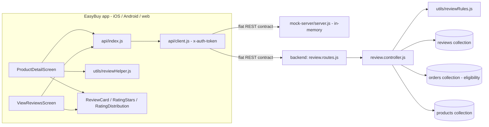
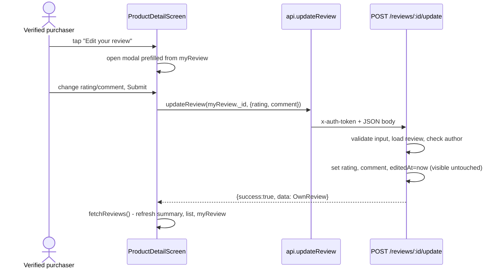
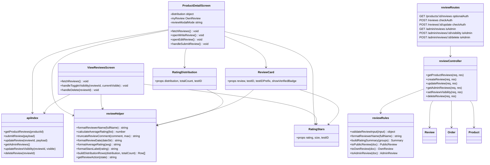
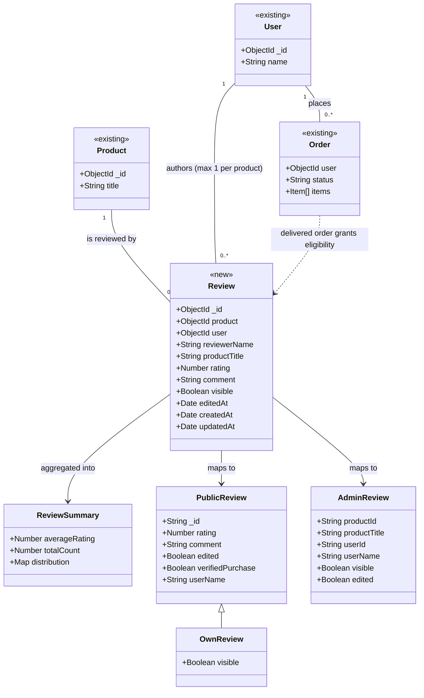

# Design: Verified Purchaser Ratings and Reviews (Agentic-SDLC-test/ecommerce-react-native-example#1)

> Linked Jira Epic: [Agentic-SDLC-test/ecommerce-react-native-example#1](https://github.com/Agentic-SDLC-test/ecommerce-react-native-example/issues/1)
> Business spec: v1 (submitted 2026-10-13T07:33:00Z by 01d38c68-5da5-4ca6-bf5b-e8c88557dfc0)
> Architect: ALORA Design Agent (draft for Architect review)

## Architecture overview

### Problem essence and value

Let verified purchasers rate (1–5 stars, optional text up to 500 characters) and later edit one review per product. Show shoppers a trustworthy summary (average, count, star distribution, five most recent reviews, each with a Verified Purchase badge). Give administrators reactive moderation (hide, show, delete). The same contract must work on the in-repo mock server and the production Node/MongoDB backend.

Implicit requirements surfaced during exploration:

- **The production backend has no review capability at all.** `ecommerce-backend-node-example` has no review model, route, controller or OpenAPI entry (`src/routes/index.js` mounts auth, product, category, order, wishlist, cart, admin and upload routers only). The app already calls `GET /products/:id/reviews`, `POST /reviews` and the three `/admin/reviews` endpoints (`api/index.js`), and today these return `404 Route not found` against the backend. The existing review features only work against `mock-server/server.js`. The Ideation statement "much of this already exists" is true for the app and the mock, not for the backend. So this design adds a complete review module to the backend, not only the editing delta. BR-14 requires this.
- `AGENTS.md` says "Wishlist and review endpoints only on backend". That is wrong for reviews and gets corrected.
- The public review payload sends the reviewer's **full** name today (`user.name`), and the app shortens it client-side with `formatReviewerName`. BR-15 needs the server to send only "First L.".
- Today the admin "edited" status, the rating distribution, the author's own review (including when hidden) and an update endpoint don't exist on any server.

### Scope and boundaries

- **In scope**:
  - review editing (author only, moderation-safe)
  - star distribution
  - Verified Purchase badge
  - Edited indicator
  - author's own-review view with a hidden notice
  - Write/Edit entry-point switching
  - edited/hidden status in the admin list
  - server-side validation tightening
  - public payload privacy
  - full review module in the backend (model, rules, controller, routes, OpenAPI, README)
  - mock-server parity plus executable parity tests
  - CI wiring for the new tests
- **Out of scope**:
  - approval queue
  - customer sorting/filtering
  - "see all reviews" view
  - photo/video reviews, helpfulness voting, replies
  - customer self-delete
  - spam/profanity detection
  - admin notifications on edits
  - cascading review deletion when a product or user is deleted (orphans stay harmless: admin rows use the stored `productTitle`, public reads are keyed by product)
  - changes to `easybuy-api-client`
- **Conservative-reuse stance**:
  - The flat URL contract, the `{ success, message, data }` envelope, `api/client.js`, `checkAuth` / `isAdmin`, `asyncHandler`, `ApiError`, the global error handler, the logger and the existing screens are all reused unchanged.
  - Extended in place: the review sections of `ProductDetailScreen`, `ViewReviewsScreen`, `utils/reviewHelper.js` and the mock review routes.
  - New: three small presentational components (`RatingStars`, `RatingDistribution`, `ReviewCard`). They replace four copy-pasted star rows and two copy-pasted review-card/date blocks.
  - New in the backend: one review module that follows the existing model/controller/routes layering exactly.

### High-level architecture

The app keeps its existing seam: screens call named operations in `api/index.js`, and `api/client.js` attaches `x-auth-token` and returns the parsed body. Both servers implement one shared flat contract (documented under "API schemas and contracts"). In the backend, the review module follows the project's pattern: Express router → `asyncHandler`-wrapped controller → Mongoose model. Pure, dependency-free rule functions (`src/utils/reviewRules.js`) handle validation, summary maths and response mapping, so they can be unit-tested without MongoDB. The mock server mirrors the same rules inline over its in-memory arrays. A `node:test` suite then exercises the mock over HTTP against every acceptance criterion.



Edit flow (BR-4, BR-6):



### Key design decisions

- **One shared contract, two implementations.** The mock and the backend expose identical paths, status codes, messages and shapes. Rejected alternative: the app branching per environment. Why: the app already relies on one flat contract ("The same flat contract is served by both the Node backend and the mock-server", `api/index.js`).
- **Extend the existing product-reviews read instead of adding endpoints.** `GET /products/:id/reviews` gains `distribution` and `myReview`. The app already makes this one call on mount, so one round trip delivers the whole page state (BR-7, BR-8, BR-11).
- **Edit endpoint `POST /reviews/:id/update`.** This mirrors the project's POST-for-mutation convention (`/update-product`, `/admin/reviews/:id/visibility`, `/admin/reviews/:id/delete`). It avoids PUT/PATCH, which no other route uses.
- **Moderation-safe edits.** Update never writes `visible` (BR-6). `edited` is derived from a dedicated `editedAt` timestamp, not from `updatedAt`, because admin visibility toggles also bump `updatedAt`.
- **Order by `createdAt` only.** Edits don't re-sort (Ideation assumption: no bumping by editing).
- **Server-formatted reviewer names on public payloads.** Public reviews carry `user: { name: "John D." }` with no user `_id` or email (BR-15). `formatReviewerName` is idempotent ("John D." stays "John D."), so app builds that still format client-side render correctly. Admin payloads keep the full name and user id, since admins already see users via `/admin/users`.
- **Snapshot `reviewerName` and `productTitle` on the review.** This keeps reviews readable after account or product deletion (Ideation default: keep reviews) and supports admin search without populate joins.
- **Uniqueness enforced by the database** in the backend: a unique compound index `{ product: 1, user: 1 }`, plus a pre-check for the friendly 409. This closes the double-submit race, and admin delete frees the slot (BR-13).
- **Status codes**: 403 for "not eligible" or "not the author", 409 for a duplicate. The mock used 400 for both today. The app is unaffected, because `api/client.js` returns the body for any status and screens read `success` / `message`.
- **Recent list capped server-side at 5** (`RECENT_REVIEWS_LIMIT`). This bounds the payload; the app keeps its harmless `slice(0, 5)`.
- **No feature flag.** The project has no flag mechanism, and every change is additive and degrades gracefully: missing `distribution` hides the bars, missing `myReview` hides the Edit action. See "Rollout and rollback considerations".

### Alternatives considered

- **Separate `GET /reviews/mine?productId=`** for the author's review: rejected. It adds a round trip, and the existing read already resolves the optional token for `isEligible` / `hasReviewed`.
- **Reusing `POST /reviews` as an upsert:** rejected. It hides the "one review per product" rule (BR-2 requires refusing a second submission) and blurs the audit of create vs. edit.
- **Computing the distribution client-side from the review list:** rejected. The list is capped at 5, so client maths would be wrong once a product has more than 5 reviews.
- **Embedding reviews inside the product document:** rejected. Unbounded array growth, and it can't be uniquely indexed per user.
- **Supertest + mongodb-memory-server in the backend:** rejected for now. It needs a ~100 MB binary download in CI for a repo whose `npm test` is a placeholder today. Pure-rule unit tests plus mock HTTP tests plus a staging smoke checklist cover the acceptance criteria at much lower cost.
- **Adding review operations to `@agentic-sdlc-test/easybuy-api-client`:** rejected. The app doesn't depend on that package (not in `package.json`), the package has no review operations today, and nothing breaks for its consumers.

## Affected repositories

- **Agentic-SDLC-test/ecommerce-react-native-example** (branch `main`, type `primary`). Changes here:
  - app review UI (product detail plus admin moderation)
  - `api.updateReview`
  - review helpers and three presentational components
  - mock-server parity (rules, update endpoint, distribution, `myReview`, privacy) plus a `node:test` suite
  - CI steps running the mock tests
  - `AGENTS.md` and `mock-server/README.md` doc corrections
- **Agentic-SDLC-test/ecommerce-backend-node-example** (branch `main`, type `dependency` / service). Changes here:
  - new review module: `review.model.js`, `reviewRules.js`, `review.controller.js`, `review.routes.js`
  - `optionalAuth` middleware
  - router mount
  - OpenAPI `Reviews` tag and paths
  - README endpoint table
  - `node:test` unit tests, with `npm test` switched to `node --test`

`Agentic-SDLC-test/easybuy-api-client` is intentionally unchanged (see "Alternatives considered").

### Cross-repository impact (approved)

_Decided by hharis on 2026-10-13. Written by ALORA from the classified required changes; a new decision rewrites everything down to the closing line, so keep your own notes outside it._

| Repository | Role | Branch | Changes |
| --- | --- | --- | --- |
| `Agentic-SDLC-test/ecommerce-react-native-example` | Primary | `Feat/68b3f28f-verified-purchaser-review-edit-and-d` | C-2 Add pure review rules: input validation, reviewer-name formatting, rating summary/distribution, and public/own/admin payload mappers.; C-4 Add the review controller: product reviews read with summary/distribution/myReview, create with eligibility and duplicate checks, author-only update, admin list, visibility and delete.; C-8 Bring the mock server to contract parity: shared review helpers, distribution and myReview on the product read, 403/409 create semantics, new POST /reviews/:id/update, admin edited flag, export app for tests.; C-9 Add a node:test HTTP contract suite for the mock server covering every acceptance scenario, and a test script.; C-10 Add the updateReview API operation.; C-11 Extend review helpers with date/average/stars-label formatting, distribution rows and the write/edit action resolver, with Jest coverage.; C-12 Add RatingStars, RatingDistribution and ReviewCard presentational components with accessibility labels and the Verified Purchase badge.; C-13 Update the product detail screen: distribution, one-decimal average, own-review block with hidden notice, Write/Edit entry point, edit-capable modal, accessible stars.; C-14 Show Hidden and Edited chips in the admin review list and reuse shared star/date helpers.; C-15 Run the mock-server test suite in GitHub Actions and Bitbucket Pipelines test steps.; C-16 Correct developer docs: review endpoints served by both mock and backend; list review endpoints and fixtures in the mock README. |
| `Agentic-SDLC-test/ecommerce-backend-node-example` | Dependency | `Feat/68b3f28f-verified-purchaser-review-edit-and-d` | C-1 Add the Mongoose Review model with a unique (product, user) index and a (product, visible, createdAt) read index.; C-3 Add optionalAuth middleware that resolves a valid token to req.currentUser and otherwise continues anonymously.; C-5 Add review routes and mount them on the root router.; C-6 Document the Reviews tag, schemas and six endpoints in OpenAPI and the README endpoint table.; C-7 Add node:test unit tests for review rules and switch the backend test script to node --test. |

**Evidence**

- C-1 → `Agentic-SDLC-test/ecommerce-backend-node-example`: reassigned by the Architect
- C-2 → `Agentic-SDLC-test/ecommerce-react-native-example`: `utils/reviewHelper.js:1` formatReviewerName is a node of the primary's code graph
- C-3 → `Agentic-SDLC-test/ecommerce-backend-node-example`: `src/middleware/auth.middleware.js` src/middleware/auth.middleware.js exists in Agentic-SDLC-test/ecommerce-backend-node-example
- C-4 → `Agentic-SDLC-test/ecommerce-react-native-example`: `api/index.js:50` getProductReviews is a node of the primary's code graph
- C-5 → `Agentic-SDLC-test/ecommerce-backend-node-example`: `src/routes/index.js` src/routes/index.js exists in Agentic-SDLC-test/ecommerce-backend-node-example
- C-6 → `Agentic-SDLC-test/ecommerce-backend-node-example`: `src/docs/openapi.js` src/docs/openapi.js exists in Agentic-SDLC-test/ecommerce-backend-node-example
- C-7 → `Agentic-SDLC-test/ecommerce-backend-node-example`: `package.json` package.json exists in Agentic-SDLC-test/ecommerce-backend-node-example
- C-8 → `Agentic-SDLC-test/ecommerce-react-native-example`: `utils/reviewHelper.js:1` formatReviewerName is a node of the primary's code graph
- C-9 → `Agentic-SDLC-test/ecommerce-react-native-example`: `mock-server/server.js:285` reviews is a node of the primary's code graph
- C-10 → `Agentic-SDLC-test/ecommerce-react-native-example`: `api/index.js` api/index.js exists in the primary
- C-11 → `Agentic-SDLC-test/ecommerce-react-native-example`: `utils/reviewHelper.js` utils/reviewHelper.js exists in the primary
- C-12 → `Agentic-SDLC-test/ecommerce-react-native-example`: reassigned by the Architect
- C-13 → `Agentic-SDLC-test/ecommerce-react-native-example`: `screens/user/ProductDetailScreen.js:25` ProductDetailScreen is a node of the primary's code graph
- C-14 → `Agentic-SDLC-test/ecommerce-react-native-example`: `screens/admin/ViewReviewsScreen.js:20` ViewReviewsScreen is a node of the primary's code graph
- C-15 → `Agentic-SDLC-test/ecommerce-react-native-example`: `package.json:12` test is a node of the primary's code graph
- C-16 → `Agentic-SDLC-test/ecommerce-react-native-example`: `AGENTS.md` AGENTS.md exists in the primary

_End of the cross-repository impact._

## Component-level design

### Layered architecture and dependency map



### Extension points

- `RECENT_REVIEWS_LIMIT` (backend `reviewRules.js`, mock constant) is the single knob if a later "see all reviews" view adds paging.
- `GET /products/:id/reviews` can accept future `sort` / `limit` query parameters without breaking clients. None are added now (sorting is a non-goal).

### Conventions in use

- **App modules**: ES modules, functional React components with hooks, `StyleSheet.create` at file bottom, `colors` from `constants`, `Ionicons` from `@expo/vector-icons`, and a `testID` on every interactive or asserted element using the `screen-element` kebab pattern (e.g. `product-detail-review-card-<id>`). Components live in `components/<Name>/<Name>.js` with `components/<Name>/index.js` re-exporting the default (as in `components/CustomInput/index.js`).
- **App networking**: only via `import * as api from "../../api"`. Promise chains use `.then / .catch / .finally`; read `result.success` / `result.message`; set user feedback through `CustomAlert` (`setError` + `setAlertType`).
- **Backend**: CommonJS with `'use strict'`. Mongoose models in `src/models/<name>.model.js` registered under a lowercase singular model name (`mongoose.model('review', ...)`). Controllers wrap every handler in `asyncHandler` and carry a JSDoc header line `METHOD /path (auth)`. Errors are thrown as `ApiError.badRequest/notFound/forbidden` or `new ApiError(409, ...)`, and the global `errorHandler` renders `{ success: false, message }`. Routers mount at `/` in `src/routes/index.js`.
- **Dependency injection**: none (module imports), matching the project.
- **Input validation**: explicit checks in the controller via `reviewRules.validateReviewInput`, plus Mongoose schema validators as a backstop (no validation library exists in either repo).
- **Logging**: the backend uses `src/utils/logger.js` (`logger.info/warn/error`); the mock uses `console.log`, matching its existing lines. Never log tokens or review text.
- **Documentation**: the hand-authored `src/docs/openapi.js` is updated for every new path. JSDoc stays on exported helpers.

### Backend — `src/models/review.model.js` (new)

- **Responsibility**: persist one review per (product, user), with moderation and edit state.
- **Schema** (`{ timestamps: true }`):
  - `product: { type: ObjectId, ref: 'product', required: true }`
  - `user: { type: ObjectId, ref: 'user', required: true }`
  - `reviewerName: { type: String, required: true, trim: true }` (snapshot of `User.name` at creation; falls back to `'Anonymous'` when the user has no name)
  - `productTitle: { type: String, default: '' }` (snapshot of `Product.title` at creation)
  - `rating: { type: Number, required: true, min: 1, max: 5, validate: { validator: Number.isInteger, message: 'Rating must be an integer between 1 and 5' } }`
  - `comment: { type: String, default: '', trim: true, maxlength: [500, 'Comment must be at most 500 characters'] }`
  - `visible: { type: Boolean, default: true }`
  - `editedAt: { type: Date, default: null }`
- **Indexes**: `reviewSchema.index({ product: 1, user: 1 }, { unique: true })` and `reviewSchema.index({ product: 1, visible: 1, createdAt: -1 })`.
- **Export**: `module.exports = mongoose.model('review', reviewSchema);` (collection `reviews`).

### Backend — `src/utils/reviewRules.js` (new, pure, no Mongoose import)

- **Constants**: `MAX_COMMENT_LENGTH = 500`, `RECENT_REVIEWS_LIMIT = 5`, `STAR_LEVELS = [5, 4, 3, 2, 1]`.
- `validateReviewInput({ rating, comment }): { rating: number, comment: string }`
  - `rating` is required: `Number(rating)` must satisfy `Number.isInteger` and fall between 1 and 5. Otherwise throw `ApiError.badRequest('Rating must be an integer between 1 and 5')`. Booleans, arrays and objects are rejected, as are `4.5`, `'4.5'`, `0`, `6`, `null` and `''`.
  - `comment`: `undefined` or `null` becomes `''`. A non-string throws `ApiError.badRequest('Comment must be text')`. Otherwise trim it; if the trimmed length is over 500, throw `ApiError.badRequest('Comment must be at most 500 characters')`.
  - Returns the normalized values.
- `formatReviewerName(fullName): string`: the same algorithm as the app's `utils/reviewHelper.js` (`'Anonymous'` when empty, single token unchanged, otherwise `First L.`).
- `buildRatingSummary(groups: Array<{ _id: number, count: number }>): { averageRating: number, totalCount: number, distribution: { '1': number, '2': number, '3': number, '4': number, '5': number } }`
  - Start the distribution with all five keys at 0, then add counts.
  - `totalCount` is the sum of counts.
  - `averageRating` is `totalCount ? parseFloat((sum(rating*count)/totalCount).toFixed(1)) : 0`.
- `toPublicReview(doc): PublicReview` returns `{ _id: String(doc._id), rating, comment, createdAt, edited: Boolean(doc.editedAt), verifiedPurchase: true, user: { name: formatReviewerName(doc.reviewerName) } }`.
- `toOwnReview(doc): OwnReview` returns `{ ...toPublicReview(doc), visible: doc.visible }`.
- `toAdminReview(doc): AdminReview` returns `{ _id, productId: String(doc.product), productTitle, user: { _id: String(doc.user), name: doc.reviewerName }, rating, comment, visible, edited: Boolean(doc.editedAt), editedAt, verifiedPurchase: true, createdAt, updatedAt }`.
- `isSameId(a, b): boolean` returns `String(a) === String(b)`.

### Backend — `src/middleware/auth.middleware.js` (extend)

- Add `async function optionalAuth(req, res, next)`:
  - Call `extractToken(req)`. With no token, call `next()`.
  - Otherwise `jwt.verify` it, load the user with `User.findOne({ _id: decoded._id }).select('-password')`, and set `req.user` / `req.currentUser` when found.
  - On **any** verification or lookup error, continue anonymously with `next()`. Never respond 401 from a public read.
- Export it beside `checkAuth`, `isAdmin` and `extractToken`.

### Backend — `src/controllers/review.controller.js` (new)

Each handler is wrapped in `asyncHandler`. Ids are validated with `mongoose.isValidObjectId(id) && typeof id === 'string'`; on failure throw `ApiError.badRequest('Invalid product id')` or `ApiError.badRequest('Invalid review id')`.

- `getProductReviews` — `GET /products/:id/reviews (optional auth)`
  1. Validate `req.params.id`. If `!(await Product.exists({ _id: id }))`, throw `ApiError.notFound('Product not found')`.
  2. Run `Promise.all` over:
     - `Review.aggregate([{ $match: { product: oid, visible: true } }, { $group: { _id: '$rating', count: { $sum: 1 } } }])`
     - `Review.find({ product: oid, visible: true }).sort({ createdAt: -1 }).limit(RECENT_REVIEWS_LIMIT).lean()`
     - when `req.currentUser` is set: `Order.exists({ user: uid, status: 'delivered', 'items.productId': oid })`
     - when `req.currentUser` is set: `Review.findOne({ product: oid, user: uid }).lean()`
  3. Respond `200 { success: true, reviews: recent.map(toPublicReview), ...buildRatingSummary(groups), isEligible: Boolean(eligible), hasReviewed: Boolean(mine), myReview: mine ? toOwnReview(mine) : null }`.
- `createReview` — `POST /reviews (auth)`
  1. Read `{ productId, rating, comment }` from `req.body`. If `productId` is missing or `rating` is `undefined`, throw `ApiError.badRequest('productId and rating are required')`.
  2. Validate `productId` (string plus ObjectId), then call `validateReviewInput`.
  3. Load the product with `Product.findById(productId).select('title')`. If it is missing, throw 404 `'Product not found'`.
  4. Check eligibility with `Order.exists({ user: req.currentUser._id, status: 'delivered', 'items.productId': productId })`. If false, throw `ApiError.forbidden('You are not eligible to review this product')`.
  5. Pre-check with `Review.exists({ product, user })`. If one exists, throw `new ApiError(409, 'You have already reviewed this product. Edit your existing review instead.')`.
  6. Call `Review.create({ product, user, reviewerName: req.currentUser.name || 'Anonymous', productTitle: product.title, rating, comment })`. If it throws with `err.code === 11000`, rethrow the same 409 `ApiError` (race-safe).
  7. Log `review.created`, then respond `200 { success: true, message: 'Review submitted successfully', data: toOwnReview(review) }`.
- `updateReview` — `POST /reviews/:id/update (auth)`
  1. Validate the `:id` and call `validateReviewInput(req.body)`.
  2. Load the review with `Review.findById(id)`. If it is missing, throw 404 `'Review not found'`.
  3. If `!isSameId(review.user, req.currentUser._id)`, throw `ApiError.forbidden('You can only edit your own review')`.
  4. Set `review.rating`, `review.comment` and `review.editedAt = new Date()`. **Do not touch `visible`.**
  5. Call `await review.save()`, log `review.updated`, then respond `200 { success: true, message: 'Review updated successfully', data: toOwnReview(review.toObject()) }`.
- `getAdminReviews` — `GET /admin/reviews (admin)`: `Review.find().sort({ createdAt: -1 }).lean()`, then respond `{ success: true, message: 'all reviews', data: list.map(toAdminReview) }`.
- `setReviewVisibility` — `POST /admin/reviews/:id/visibility (admin)`
  1. Validate the `:id`. If `typeof req.body.visible !== 'boolean'`, throw `ApiError.badRequest('visible must be a boolean')`.
  2. Run `Review.findByIdAndUpdate(id, { visible }, { new: true }).lean()`. If no review comes back, throw 404 `'Review not found'`.
  3. Log `review.visibility_changed`, then respond `{ success: true, message: 'Visibility updated successfully', data: toAdminReview(doc) }`.
- `deleteReview` — `POST /admin/reviews/:id/delete (admin)`
  1. Validate the `:id` and run `Review.findByIdAndDelete(id)`. If nothing was deleted, throw 404 `'Review not found'`.
  2. Log `review.deleted`, then respond `{ success: true, message: 'Review deleted successfully' }`.
- **Transaction / concurrency boundary**: single-document writes only. Duplicate creation is serialized by the unique index. Concurrent edits are last-write-wins, which is acceptable because only the author can edit.

### Backend — `src/routes/review.routes.js` (new) and `src/routes/index.js` (extend)

- `router.get('/products/:id/reviews', optionalAuth, getProductReviews)`
- `router.post('/reviews', checkAuth, createReview)`
- `router.post('/reviews/:id/update', checkAuth, updateReview)`
- `router.get('/admin/reviews', isAdmin, getAdminReviews)`
- `router.post('/admin/reviews/:id/visibility', isAdmin, setReviewVisibility)`
- `router.post('/admin/reviews/:id/delete', isAdmin, deleteReview)`
- In `src/routes/index.js`, add `const reviewRoutes = require('./review.routes');` and `router.use('/', reviewRoutes);` after `adminRoutes`. No path clash: product routes only define `/products` (exact), and admin routes don't use `/admin/reviews`.

### Mock server — `mock-server/server.js` (extend)

- **Export for tests**: replace the bare `app.listen(...)` with `if (require.main === module) { app.listen(PORT, "0.0.0.0", ...) }` and add `module.exports = app;`. `npm start` and `npm run dev` behaviour is unchanged.
- **Review helpers section**, placed above the review endpoints and mirroring the backend rules with the same messages:
  - constants `MAX_COMMENT_LENGTH = 500` and `RECENT_REVIEWS_LIMIT = 5`
  - `formatReviewerName(fullName)`, `validateReviewInput({ rating, comment })` (returns `{ error }` or `{ rating, comment }`), `buildRatingSummary(list)`, `toPublicReview(r)`, `toOwnReview(r)`, `toAdminReview(r)`
  - `getUserFromToken(req)`, the optional-auth lookup used by the public read
  - `isEligibleFor(userId, productId)`, the existing delivered-order predicate, extracted once
- **Seed reviews**: add `editedAt: null` and `updatedAt` (equal to `createdAt`) to `rev001` and `rev002`.
- `GET /products/:id/reviews`: same 404 as today. Build the response exactly as in the contract: visible reviews sorted by `createdAt` descending and sliced to 5, mapped by `toPublicReview`, plus the summary, `isEligible`, `hasReviewed` and `myReview`.
- `POST /reviews`: switch to `validateReviewInput`. Return 403 for "not eligible" and 409 for a duplicate, with the exact backend messages. The new record carries `editedAt: null` and `updatedAt`. Respond with `data: toOwnReview(newReview)`.
- `POST /reviews/:id/update` (new, `authMiddleware`): 404 when missing, 403 when not the author, 400 on validation. Set `rating`, `comment`, `editedAt` and `updatedAt`, and keep `visible` unchanged.
- `GET /admin/reviews`: sort a copy by `createdAt` descending and map with `toAdminReview`. Visibility and delete return `toAdminReview` data. `visible` must be a boolean (400 `'visible must be a boolean'`).
- Startup log: add the six review endpoint lines.

### App — `api/index.js` (extend)

- Add `export const updateReview = (reviewId, payload) => post(`/reviews/${q(reviewId)}/update`, payload);` in the Reviews block. All other operations stay unchanged.

### App — `utils/reviewHelper.js` (extend)

Keep `formatReviewerName`, `calculateAverageRating` and `truncateReviewComment` unchanged. Add:

- `export const REVIEW_COMMENT_MAX_LENGTH = 500;`
- `export const formatReviewDate = (dateStr) => string`: returns `''` when the value is empty, otherwise `DD-MM-YYYY`. This is the exact logic currently duplicated as `formatDate` in both review screens.
- `export const formatAverageRating = (avg) => string`: `Number(avg || 0).toFixed(1)`, e.g. `5` becomes `'5.0'` (BR-8).
- `export const formatStarsLabel = (rating) => string`: returns `` `${rating} out of 5 stars` `` (BR-15 accessibility).
- `export const buildDistributionRows = (distribution, totalCount) => Array<{ stars: number, count: number, percent: number }>`: always returns five rows ordered 5 to 1. A missing or non-numeric count becomes 0. `percent = totalCount > 0 ? Math.round(count / totalCount * 100) : 0`.
- `export const getReviewAction = ({ isEligible, hasReviewed, myReview }) => 'edit' | 'write' | null`: returns `'edit'` when `myReview` is present, `'write'` when `isEligible && !hasReviewed`, and `null` otherwise (BR-11).

### App — `components/RatingStars/RatingStars.js` + `index.js` (new)

- **Props**: `{ rating: number, size = 14, testID }`.
- **Render**: a row `View` with `accessible`, `accessibilityRole="image"` and `accessibilityLabel={formatStarsLabel(rating)}`. Inside it are five `Ionicons` with the name `star` when `star <= Math.round(rating)`, otherwise `star-outline`, colored `#ffc107` or `colors.muted`, with `marginRight: 2`. This is the same visual as today's inline rows.

### App — `components/RatingDistribution/RatingDistribution.js` + `index.js` (new)

- **Props**: `{ distribution, totalCount, testID }`.
- **Render**: `buildDistributionRows(...)` mapped to rows, each with:
  - `testID={`${testID}-row-${stars}`}`
  - `accessible` and `accessibilityLabel={`${stars} stars: ${count} reviews`}`
  - a label `Text` showing `${stars} ★`
  - a track `View` (height 8, radius 4, background `colors.light`) holding a fill `View` (width `${percent}%`, background `#ffc107`)
  - a count `Text` with `testID={`${testID}-count-${stars}`}`
- Returns `null` when `distribution` is falsy, so it degrades gracefully against an older server.

### App — `components/ReviewCard/ReviewCard.js` + `index.js` (new)

- **Props**: `{ review, testID, testIDPrefix = 'product-detail-review', children }`.
- **Render**: today's product-detail card markup and styles, with these elements:
  - header with `formatReviewerName(review.user?.name)` (testID `${testIDPrefix}-username`) and `formatReviewDate(review.createdAt)` (testID `${testIDPrefix}-date`)
  - `<RatingStars rating={review.rating} testID={`${testIDPrefix}-stars`} />`
  - a badge row with the Verified Purchase badge (`Ionicons` `checkmark-circle` size 14, `colors.primary`, text "Verified Purchase", testID `${testIDPrefix}-verified-badge`, `accessibilityLabel="Verified Purchase"`), shown when `review.verifiedPurchase !== false` (BR-10)
  - an "Edited" label (testID `${testIDPrefix}-edited`), shown when `review.edited`
  - the comment `Text` when present (testID `${testIDPrefix}-comment`)
  - `children` rendered last, used for the hidden notice

### App — `screens/user/ProductDetailScreen.js` (modify)

- **New state**: `distribution` (`null`), `myReview` (`null`), `reviewModalMode` (`'write'`).
- **`fetchReviews`**: additionally call `setDistribution(result.distribution ?? null)` and `setMyReview(result.myReview ?? null)`.
- **Rating summary**:
  - The stars row is replaced by `<RatingStars rating={averageRating} size={18} testID="product-detail-rating-stars" />`.
  - The text becomes `` `${formatAverageRating(averageRating)} out of 5 (${totalCount} ${totalCount === 1 ? 'review' : 'reviews'})` `` when `totalCount > 0`, otherwise `"No reviews yet"` (keep testID `product-detail-rating-text`).
  - Below it, render `<RatingDistribution distribution={distribution} totalCount={totalCount} testID="product-detail-distribution" />` when `totalCount > 0`.
- **Entry point**: compute `const reviewAction = getReviewAction({ isEligible, hasReviewed, myReview })`.
  - `'write'` renders the existing button (testID `product-detail-write-review-btn`, text "Write a Review", `onPress={openWriteReview}`).
  - `'edit'` renders the same style with text "Edit your review", testID `product-detail-edit-review-btn` and `onPress={openEditReview}`.
  - `null` renders nothing.
- **Own review (BR-7)**: when `myReview` is set, render above "Customer Reviews":
  - a "Your review" title (testID `product-detail-my-review-title`)
  - `<ReviewCard review={myReview} testID="product-detail-my-review" testIDPrefix="product-detail-my-review">`
  - when `myReview.visible === false`, a child notice `Text` (testID `product-detail-my-review-hidden-notice`, color `colors.danger`, `accessibilityRole="alert"`) reading "This review is hidden by a moderator and is only visible to you."
- **Recent list**: replace the inline card with `<ReviewCard key={rev._id} review={rev} testID={`product-detail-review-card-${rev._id}`} />`. Keep the `slice(0, 5)` and the empty-state text and testID unchanged.
- **`openWriteReview()`**: set mode `'write'`, rating 0, comment `''`, submit error `''`, and show the modal.
- **`openEditReview()`**: set mode `'edit'`, `setUserRating(myReview.rating)`, `setUserComment(myReview.comment || '')`, submit error `''`, and show the modal.
- **`handleSubmitReview()`**:
  1. Keep the existing 1–5 guard.
  2. Build `const payload = { rating: userRating, comment: userComment.trim() }`.
  3. Send the request with `reviewModalMode === 'edit' && myReview ? api.updateReview(myReview._id, payload) : api.submitReview({ productId: product?._id, ...payload })`.
  4. On success, set the alert to "Review updated successfully" for edits or "Review submitted successfully" for new reviews, then close and reset the modal and call `fetchReviews()`.
  5. On `success: false`, show `result.message` in the modal and call `fetchReviews()`, so a 409 flips the button to "Edit your review".
  6. Keep the `.catch` / `.finally` unchanged.
- **Modal**:
  - The title is `reviewModalMode === 'edit' ? 'Edit your review' : 'Write a Review'`.
  - Each interactive star `TouchableOpacity` gets `accessibilityRole="button"`, `accessibilityLabel={`Rate ${star} out of 5 stars`}` and `accessibilityState={{ selected: star <= userRating }}`.
  - `maxLength` uses `REVIEW_COMMENT_MAX_LENGTH`. The counter shows `` `${userComment.length} / ${REVIEW_COMMENT_MAX_LENGTH}` ``.
  - The Cancel handler reuses the reset logic.
- **Cleanup**: remove the local `formatDate` and the now-unused review-card styles (they move into `ReviewCard`). Keep every other existing style and testID.

### App — `screens/admin/ViewReviewsScreen.js` (modify)

- Replace the local `formatDate` with `formatReviewDate`, and the inline stars with `<RatingStars rating={item.rating} />`.
- Add a status chip row under the reviewer row:
  - "Hidden" chip (testID `view-reviews-item-hidden-${index}`, background `colors.danger`) when `!item.visible`
  - "Edited" chip (testID `view-reviews-item-edited-${index}`, background `colors.muted`) when `item.edited`
- Search, toggle and delete-with-`Alert.alert` confirmation stay unchanged (BR-12). The reviewer line keeps the full name (`item.user?.name`), since this is an admin view.

## UI/UX design notes

- **Product detail summary**: stars, then "4.3 out of 5 (12 reviews)", then a five-row distribution (5★ to 1★) with proportional amber bars and counts. The distribution is hidden when there are 0 reviews, and "No reviews yet" shows instead (BR-8, BR-9 empty state). The review count always shows next to the average, which mitigates the low-volume risk.
- **Entry point**: a single primary button between the description and "Customer Reviews". It reads "Write a Review" for eligible customers who haven't reviewed, "Edit your review" for authors, and is absent for everyone else, including signed-out users (BR-11).
- **Your review**: a dedicated block above the public list, so authors always find their review, even when it is hidden or older than the top five. A hidden review shows a red notice under the card. Hidden reviews never appear in the public list or the figures.
- **Review cards**: reviewer "First L.", date `DD-MM-YYYY`, stars, a "✓ Verified Purchase" badge on every card, an "Edited" label when applicable, and the optional text. The list order stays newest first by original submission date.
- **Modal**: the existing slide-up modal is reused for both write and edit. Edit is prefilled, and its title changes. Rating-only submission is allowed; the comment placeholder already says "(optional)". The 500-character counter is kept.
- **Admin list**: "Hidden" and "Edited" chips, so moderators see edited content in context (Ideation open-question default: no notification).
- **Accessibility**:
  - Star rows announce "4 out of 5 stars".
  - Interactive stars are buttons with a selected state.
  - Distribution rows announce "5 stars: 3 reviews".
  - The hidden notice uses the alert role.
  - The badge has a text label, never icon-only meaning.
- **Platforms**: only core React Native primitives and `@expo/vector-icons` are used, so iOS, Android and web render identically. No new native dependency.

## API schemas and contracts

All endpoints are served identically by `mock-server/server.js` and the backend. The base URL is `EXPO_PUBLIC_API_URL` (default `http://localhost:3002`). Auth uses the `x-auth-token: <JWT>` header (the mock accepts its seeded tokens). Error bodies are `{ "success": false, "message": "<text>" }`. Backend auth failures from `checkAuth` / `isAdmin` keep their existing `{ "msg", "err" }` shape (e.g. `err: "jwt expired"` triggers the app logout).

Shared shapes:

```json
// PublicReview: never contains user _id or email
{
  "_id": "string",
  "rating": 4,
  "comment": "string (may be empty)",
  "createdAt": "ISO-8601",
  "edited": false,
  "verifiedPurchase": true,
  "user": { "name": "John D." }
}
// OwnReview = PublicReview + { "visible": true | false }
// AdminReview
{
  "_id": "string",
  "productId": "string",
  "productTitle": "string",
  "user": { "_id": "string", "name": "John Doe" },
  "rating": 4,
  "comment": "string",
  "visible": true,
  "edited": true,
  "editedAt": "ISO-8601 | null",
  "verifiedPurchase": true,
  "createdAt": "ISO-8601",
  "updatedAt": "ISO-8601"
}
```

```http
GET /products/:id/reviews
Auth: optional (x-auth-token). An invalid or expired token is treated as anonymous.
200 OK -> {
  "success": true,
  "reviews": [PublicReview],            // visible only, createdAt desc, max 5
  "averageRating": 4.3,                 // visible only, 1 decimal, 0 when none
  "totalCount": 3,                      // visible only
  "distribution": { "5": 1, "4": 2, "3": 0, "2": 0, "1": 0 },  // all five keys always present
  "isEligible": true,                   // caller has a delivered order containing the product; false when anonymous
  "hasReviewed": true,                  // caller owns a review for the product (visible or hidden)
  "myReview": OwnReview | null          // caller's review incl. hidden; null when anonymous or none
}
400 -> { "success": false, "message": "Invalid product id" }        (backend: non-ObjectId id)
404 -> { "success": false, "message": "Product not found" }
```

```http
POST /reviews
Auth: required (x-auth-token)
Body: { "productId": "string", "rating": 1..5 (integer), "comment": "string <= 500 chars, optional" }
200 OK -> { "success": true, "message": "Review submitted successfully", "data": OwnReview }
400 -> "productId and rating are required" | "Invalid product id" | "Rating must be an integer between 1 and 5" | "Comment must be text" | "Comment must be at most 500 characters"
403 -> "You are not eligible to review this product"
404 -> "Product not found"
409 -> "You have already reviewed this product. Edit your existing review instead."
```

```http
POST /reviews/:id/update
Auth: required; caller must be the review author
Body: { "rating": 1..5 (integer), "comment": "string <= 500 chars, optional; omitted/null => empty" }
200 OK -> { "success": true, "message": "Review updated successfully", "data": OwnReview }   // edited=true, visible unchanged
400 -> "Invalid review id" | "Rating must be an integer between 1 and 5" | "Comment must be text" | "Comment must be at most 500 characters"
403 -> "You can only edit your own review"
404 -> "Review not found"
```

```http
GET /admin/reviews
Auth: admin
200 OK -> { "success": true, "message": "all reviews", "data": [AdminReview] }   // all reviews, createdAt desc

POST /admin/reviews/:id/visibility
Auth: admin
Body: { "visible": true | false }   // must be a JSON boolean
200 OK -> { "success": true, "message": "Visibility updated successfully", "data": AdminReview }
400 -> "Invalid review id" | "visible must be a boolean"
404 -> "Review not found"

POST /admin/reviews/:id/delete
Auth: admin
200 OK -> { "success": true, "message": "Review deleted successfully" }
400 -> "Invalid review id"
404 -> "Review not found"
```

The `400 "Invalid product id"` and `400 "Invalid review id"` responses are backend-only (ObjectId check). The mock uses free-form string ids (`prod007`, `rev-<uuid>`), so an unknown id there falls through to the 404 response.

Non-admin access to admin endpoints: the backend `isAdmin` returns `403 { msg: 'Insufficient User Permissions', err: ... }`, and the mock `adminMiddleware` returns 403. No events or webhooks are emitted.

OpenAPI: add the tag `{ name: 'Reviews', description: 'Verified-purchaser product reviews and moderation' }`, the schemas `PublicReview`, `OwnReview`, `AdminReview` and `ReviewSummary`, and the six paths above to `src/docs/openapi.js`, with `security: [{ authToken: [] }]` on the authenticated ones.

## Integration patterns

- **Inbound**: synchronous REST from the app through `api/client.js` only. There are no webhooks, queues or batch jobs, and no new ones are introduced.
- **Cross-collection reads (backend)**:
  - Eligibility reads `orders` (`status: 'delivered'` and `items.productId`), which administrators set through the existing `GET /admin/order-status`.
  - Product existence and the title snapshot read `products`.
  - The reviewer-name snapshot reads `req.currentUser` (loaded by `checkAuth`).
- **Outbound**: none. No third-party calls.
- **Idempotency / retry**:
  - Create is guarded by the unique `(product, user)` index; a retried submit returns 409, and the app then refetches and shows "Edit your review".
  - Update, visibility and delete are idempotent for the same input (delete returns 404 on repeat).
  - The app does no automatic retries; existing `.catch` handlers surface network failures.
- **Environment parity**: the mock and backend share messages, status codes and payloads. The mock `node:test` suite is the executable contract; the backend is verified by the same scenario list in the staging smoke test (see "Test strategy").

## Data model changes

### Entity relationships



### Schema changes

- **New collection (backend)**: `reviews`, via Mongoose model `review` (fields as in "Backend — review.model.js").
  - Index `{ product: 1, user: 1 }` is unique; it enforces BR-2, and deleting a review frees the slot for BR-13.
  - Index `{ product: 1, visible: 1, createdAt: -1 }` serves the summary aggregate and the recent-5 read.
- **Existing backend collections**: no changes to `products`, `users` or `orders`. The eligibility query uses the existing `items.productId` field. An index on `orders { user: 1, status: 1 }` is not added; order volume per user is small and this matches today's unindexed `Order.find({ user })`.
- **Mock in-memory `reviews` array**: each record gains `editedAt: string | null` and `updatedAt: string`. Seed records are updated accordingly.

### Backward-compatibility plan

- Purely additive: a new collection, new endpoints and new response fields. No destructive change and no backfill. No reviews exist in the backend today, because no review endpoint existed.
- Response compatibility:
  - Existing fields (`reviews`, `averageRating`, `totalCount`, `isEligible`, `hasReviewed`, `user.name`) keep their names and types.
  - Public `user._id` is removed. No app code reads it (`ProductDetailScreen` reads only `rev.user?.name`, and the admin screen uses the admin endpoint).
- Status-code changes in the mock (400 to 403/409) don't affect the app, which branches on `success` only.
- Index creation relies on Mongoose `autoIndex` (on by default, and not disabled in `src/config/database.js`). It is safe because the collection starts empty. This is owned by the rollout step "Backend deploy".

## Security and compliance considerations

- **Auth**:
  - `GET /products/:id/reviews` is public with optional auth.
  - `POST /reviews` and `POST /reviews/:id/update` use `checkAuth` / `authMiddleware`.
  - All `/admin/reviews*` routes use `isAdmin` / `adminMiddleware`.
  - Authorization is enforced server-side: eligibility (delivered order) on create (BR-1), author-only edit (BR-4), admin-only moderation (BR-12). The app's hidden buttons are convenience only.
- **Input validation**:
  - Integer rating 1–5.
  - Comment must be a string, trimmed, at most 500 characters.
  - Ids must be strings and valid ObjectIds (backend), which blocks operator-object injection such as `{ "$gt": "" }`.
  - `visible` must be a strict boolean.
  - Mongoose validators are a second line of defence.
  - The existing global rate limiter and the 5 MB JSON limit apply unchanged.
- **Output encoding**: review text renders only through React Native `Text`, never as HTML, so there is no XSS sink in the app.
- **Secrets**: none new. `TOKEN_KEY` and `DB_CON_STRING` are unchanged.
- **PII / data classification**:
  - Reviewer names are personal data. Public payloads expose only "First L." with no user id or email (BR-15).
  - Admin payloads expose the full name and user id, which admins already see.
  - Review text is user-generated content and may contain PII, so it is never logged.
- **Retention**: reviews persist after account deletion, using the stored `reviewerName` snapshot (Ideation default). If the privacy owner later chooses removal or anonymisation, it is a one-line change: in `deleteUser`, run `Review.deleteMany({ user: id })` or `Review.updateMany({ user: id }, { reviewerName: 'Anonymous' })`. That change is not made now.
- **Audit log entries**: `review.created`, `review.updated`, `review.visibility_changed` (with `adminId`) and `review.deleted` (with `adminId`) are emitted through the backend logger (see "Observability requirements"). These lines are the moderation audit trail; no audit store exists in the project.
- **Regulatory**: GDPR-style data minimisation is honoured by the name truncation and by not logging content. No payment or health data is touched.

## Observability requirements

- **Structured logs (backend, `logger.info`)**. Exact shape: message key, then a context object. Never include `comment` text, the token or the email.
  - `logger.info('review.created', { reviewId, productId, userId, rating })`
  - `logger.info('review.updated', { reviewId, productId, userId, rating, wasVisible: review.visible })`
  - `logger.info('review.visibility_changed', { reviewId, productId, adminId: req.currentUser._id, visible })`
  - `logger.info('review.deleted', { reviewId, productId, adminId: req.currentUser._id })`
  - `logger.warn('review.create_rejected', { productId, userId, reason })` with `reason` one of `not_eligible` or `duplicate`
  - 5xx errors are already logged by `errorHandler`.
- **Mock logs (`console.log`)**: the same message keys and context objects, replacing the current free-text lines (`'Review created for product:'` and similar).
- **Metrics**: the project has no metrics library or exporter. No metrics are introduced; counts can be derived from the log keys above and from `morgan` access logs (status codes per route).
- **Traces**: not applicable, since no tracing is configured in either repository.
- **Dashboards / alerts**: none exist. During rollout, watch the backend container logs for `5xx` on `/products/*/reviews`, `/reviews*` and `/admin/reviews*`, and for spikes in `review.create_rejected` (`reason=not_eligible` points to a client gating bug).

## Implementation plan

> Execute phases in order. Phases 1–2 are in `Agentic-SDLC-test/ecommerce-backend-node-example`; phases 3–6 are in the primary repository. Run each verification step before moving on.

### Phase 1 — Backend: model and rules

1. **Create `src/utils/reviewRules.js`** with `MAX_COMMENT_LENGTH`, `RECENT_REVIEWS_LIMIT`, `STAR_LEVELS`, `validateReviewInput`, `formatReviewerName`, `buildRatingSummary`, `toPublicReview`, `toOwnReview`, `toAdminReview` and `isSameId`, exactly as specified in "Component-level design". Import only `ApiError`.
2. **Create `src/models/review.model.js`** with the schema, both indexes and `mongoose.model('review', reviewSchema)`.
3. **Create `test/reviewRules.test.js`** using `node:test` and `node:assert/strict`. Cover:
   - `validateReviewInput` accepts 1 and 5 and `'3'`, rejects 0, 6, 4.5, `'abc'`, `null`, `true` and `[]`
   - comment `undefined` becomes `''`, a number throws `Comment must be text`, a 501-character comment throws, a 500-character comment passes, and comments are trimmed
   - `buildRatingSummary([])` gives `{ averageRating: 0, totalCount: 0, distribution: all zeros }`, and `[{_id:5,count:1},{_id:4,count:2}]` gives `4.3` / `3` / `{5:1,4:2,3:0,2:0,1:0}`
   - `formatReviewerName` cases mirror the app tests, including idempotency (`'John D.'` stays `'John D.'`)
   - `toPublicReview` has no `user._id`, sets `edited` from `editedAt`, and sets `verifiedPurchase: true`; `toOwnReview` includes `visible`
4. **Change `package.json` `"test"`** to `"node --test"`. Verify with `npm test` (passes) and `npm run lint`.

### Phase 2 — Backend: middleware, controller, routes, docs

1. **`src/middleware/auth.middleware.js`**: add and export `optionalAuth` as specified.
2. **Create `src/controllers/review.controller.js`** with the six `asyncHandler` handlers, the error messages and the log lines specified. Use `mongoose.Types.ObjectId` for aggregate `$match` values.
3. **Create `src/routes/review.routes.js`** and mount it in `src/routes/index.js` after `adminRoutes`.
4. **`src/docs/openapi.js`**: add the `Reviews` tag, the four schemas and the six paths.
5. **`README.md`**:
   - Add "reviews" to the feature list.
   - Add six rows to the endpoint table: Public `GET /products/:id/reviews`; User `POST /reviews` and `POST /reviews/:id/update`; Admin `GET /admin/reviews`, `POST /admin/reviews/:id/visibility` and `POST /admin/reviews/:id/delete`.
6. **Verify**:
   - `npm test` passes.
   - `npm run dev` with a local MongoDB.
   - `GET /api-docs.json` contains `/reviews/{id}/update`.
   - Run the staging smoke checklist in "Test strategy" with curl against the local server: create a user, check out, mark the order delivered via `/admin/order-status`, then run every scenario.

### Phase 3 — Mock server parity

1. **`mock-server/server.js`**:
   - Add the review helpers section.
   - Rewrite `GET /products/:id/reviews`, `POST /reviews`, `GET /admin/reviews` and the visibility/delete responses per the contract, and add `POST /reviews/:id/update`.
   - Add `editedAt` / `updatedAt` to the seeds and convert the log lines to the new keys.
   - Add the six review endpoints to the startup log.
   - Wrap `app.listen` in `if (require.main === module)` and add `module.exports = app;`.
2. **`mock-server/package.json`**: add `"test": "node --test"`.
3. **Create `mock-server/test/reviews.test.js`** (`node:test`, global `fetch`; start the server with `app.listen(0)` in `before` and close it in `after`). It uses the seeded tokens `mock-user-token-001` (user001: delivered `order003` contains `prod007`, and owns `rev001` on `prod001`), `mock-user-token-002` (user002: no delivered orders) and `mock-admin-token-001`. Run the scenarios sequentially in one `describe`:
   1. Anonymous `GET /products/prod007/reviews`: `isEligible` false, `myReview` null, distribution has keys 1–5 all 0, `totalCount` 0.
   2. user002 `POST /reviews` on prod007 returns 403 with "You are not eligible to review this product".
   3. user001 posts rating 4.5, which returns 400; a 501-character comment returns 400.
   4. user001 `POST /reviews` `{ productId: 'prod007', rating: 4 }` (no comment) returns 200 with `data.edited` false and `data.visible` true.
   5. A repeat of step 4 returns 409.
   6. Anonymous GET on prod007: `totalCount` 1, `averageRating` 4, `distribution['4']` 1. The review has `verifiedPurchase` true, `user.name` 'John D.' and no `user._id`.
   7. GET as user001: `hasReviewed` true, `myReview.rating` 4.
   8. user002 `POST /reviews/:id/update` returns 403.
   9. Admin hides the review via `{ visible: true/false }`; `{ visible: 'no' }` returns 400.
   10. After the hide: anonymous GET has `totalCount` 0; user001 GET has `myReview.visible` false.
   11. user001 updates `{ rating: 2, comment: 'Changed my mind' }`: response has `visible` false and `edited` true; the anonymous GET still has `totalCount` 0.
   12. Admin shows the review; anonymous GET has `distribution['2']` 1 and `reviews[0].edited` true.
   13. Admin `GET /admin/reviews` returns items sorted by `createdAt` descending, each with `edited` and full `user.name`; user001 calling it gets 403.
   14. Admin delete returns 200; user001 `POST /reviews` on prod007 again returns 200 (slot freed).
   15. `GET /products/unknown/reviews` returns 404.
4. **Verify**: `npm test --prefix mock-server` passes, and `npm start --prefix mock-server` still boots on port 3002.

### Phase 4 — App: API seam, helpers, components

1. **`api/index.js`**: add `updateReview`.
2. **`utils/reviewHelper.js`**: add `REVIEW_COMMENT_MAX_LENGTH`, `formatReviewDate`, `formatAverageRating`, `formatStarsLabel`, `buildDistributionRows` and `getReviewAction`.
3. **`__tests__/reviews.test.js`**: extend it. Cover:
   - `buildDistributionRows` order 5 to 1, zeros for missing keys, percent rounding (`{5:1,4:2}` with total 3 gives 33 / 67), and `totalCount` 0 giving all-zero percents
   - `getReviewAction` for all branches (myReview present gives `'edit'`; eligible and not reviewed gives `'write'`; ineligible, or hasReviewed without myReview, gives `null`)
   - `formatAverageRating(5)` is `'5.0'`, `formatAverageRating(undefined)` is `'0.0'`
   - `formatStarsLabel(4)` is `'4 out of 5 stars'`
   - `formatReviewDate('2026-08-21T12:00:00Z')` matches `/^\d{2}-\d{2}-2026$/`, and the empty string gives `''`
   - `formatReviewerName('John D.')` is `'John D.'`
4. **Create `components/RatingStars/{RatingStars.js,index.js}`, `components/RatingDistribution/{RatingDistribution.js,index.js}` and `components/ReviewCard/{ReviewCard.js,index.js}`** as specified.
5. **Verify**: `npm test` and `npm run lint`.

### Phase 5 — App: screens

1. **`screens/user/ProductDetailScreen.js`**: apply every change in "App — ProductDetailScreen" (state, fetch, summary, distribution, entry point, own review, list via `ReviewCard`, write/edit modal, accessibility, cleanup).
2. **`screens/admin/ViewReviewsScreen.js`**: use `formatReviewDate` and `RatingStars`, and add the Hidden/Edited chips.
3. **Verify**:
   - `npm run lint` and `npm test`.
   - `npm start --prefix mock-server` plus `npm run web`.
   - Walk the manual checklist in "Test strategy" as user001 (prod007 write, then edit), user002 (no button) and admin (hide, show, delete).

### Phase 6 — CI and docs

1. **`.github/workflows/ci.yml`**: in the `test` job, after "Install mock-server dependencies", add a step `- name: Test mock-server` with `run: npm test --prefix mock-server`.
2. **`bitbucket-pipelines.yml`**: in the `&test` step script, add `- npm test --prefix mock-server` after `npm ci --prefix mock-server`.
3. **`AGENTS.md`**:
   - Replace "Wishlist and review endpoints only on backend." with "Wishlist endpoints only on backend; review endpoints are served by both (shared contract)."
   - Add `api/updateReview()` to the Customer Shopping detail line.
4. **`mock-server/README.md`**: list the six review endpoints and the seeded review/eligibility fixtures (user001 eligible for prod007).
5. **Verify**: CI passes on the PR in both repositories.

## Test strategy

### Test layers

- **Unit tests**:
  - App Jest (`__tests__/reviews.test.js`): every new helper in `utils/reviewHelper.js`, plus the idempotent name format.
  - Backend `node:test` (`test/reviewRules.test.js`): input validation branches, summary maths, payload mappers (privacy, `edited`, `verifiedPurchase`, `visible` only on own/admin).
- **Integration (contract) tests**: `mock-server/test/reviews.test.js` over real HTTP covers all fifteen scenarios in Phase 3. This is the executable form of the shared contract, run in CI.
- **Staging smoke tests (backend)**: the same fifteen scenarios run with curl against the deployed backend (with real JWTs from `POST /login` for two customers and one admin, and one order moved to `delivered` via `/admin/order-status`). Record the results in the backend PR.
- **Manual E2E (iOS, Android, web)** against the mock and against the staging backend:
  - user001 sees "Write a Review" on prod007, submits rating only, and sees the summary update, the distribution and the badge
  - the button flips to "Edit your review"; the edit is prefilled, shows "Edited" after saving and keeps its position
  - admin hides the review; as user001 the hidden notice appears and public figures drop; user001 edits it and it stays hidden; admin shows it again
  - admin deletes the review and "Write a Review" returns
  - user002 sees no button on prod007
  - signed-out users see figures but no button
  - VoiceOver / TalkBack announce "4 out of 5 stars" and "5 stars: 1 reviews"

### Acceptance Criteria coverage

| AC# | Description | Covered by | Notes |
| --- | ----------- | ---------- | ----- |
| 1 | Only verified purchasers may submit (Epic AC-1) | mock scenarios 2, 4; backend smoke; `getReviewAction` unit; manual user002 | Server-side 403 proven with an ineligible account |
| 2 | One review per product, editable; hidden stays hidden after edit (Epic AC-2) | mock scenarios 5, 7, 8, 11; `validateReviewInput` units; manual edit flow | 409 plus refetch flips to Edit |
| 3 | Average, count, distribution, recent reviews; visible-only; updates after every action (Epic AC-3) | mock scenarios 1, 6, 10, 12; `buildRatingSummary` and `buildDistributionRows` units; manual | Cap of 5 asserted by the server constant; average to 1 decimal via `formatAverageRating` |
| 4 | "Verified Purchase" indicator (Epic AC-4) | mock scenario 6 (`verifiedPurchase`); mapper units; manual badge check | |
| 5 | Admin hide / show / delete; non-admins blocked (Epic AC-5) | mock scenarios 9, 10, 12, 13, 14; backend smoke | Delete frees the slot (BR-13) |
| 6 | Immediate publication (Q-1) | mock scenarios 4 then 6 (visible without approval) | |
| 7 | Rating-only accepted; text over 500 refused (Q-2) | mock scenarios 3, 4; validation units | |
| 8 | Most-recent order only, no sort controls (Q-3) | mock scenario 13 ordering; scenario 12 (edit doesn't re-sort); manual | |
| 9 | Author always sees own review incl. hidden notice | mock scenarios 7, 10; manual hidden notice | |

### Performance targets and quality bars

- **Latency**: `GET /products/:id/reviews` p95 under 300 ms on staging with 1,000 reviews per product (four indexed queries run in parallel via `Promise.all`). Mutations p95 under 300 ms.
- **Payload**: the product reviews response holds at most 5 reviews (≤ 5 × 500 characters of text), so the response stays under 10 KB.
- **Data validation rules** (each proven by the named tests):
  - integer rating 1–5 (scenario 3, rules unit)
  - comment ≤ 500 after trim (scenario 3, rules unit)
  - one review per (product, user) (scenario 5, unique index)
  - edit never changes `visible` (scenario 11)
  - only visible reviews in figures (scenario 10)
  - public payload has no user id (scenario 6, mapper unit)
- **Availability**: no regression to the existing endpoints; CI must stay green in both repositories.

### Flake risks and fixtures

- Mock tests share in-memory state, so scenarios run sequentially in one `describe` with explicit ordering. Each run starts a fresh process (`node --test` isolates files).
- The server listens on port 0 to avoid clashing with a developer's running mock on 3002.
- Date assertions use regex shape, not the local-timezone day, because `formatReviewDate` uses local time.
- Seed fixtures used: users `user001` / `user002` / `admin001`, order `order003` (delivered, contains `prod007`), review `rev001`. Changing them requires updating the test.

## Rollout and rollback considerations

- **Feature flag**: none. The project has no flag mechanism, and adding one for additive endpoints would be speculative. Safety comes from additive changes plus graceful degradation: the app reads every new field with `??` defaults, so an app on an older server hides the distribution and Edit actions instead of failing.
- **Order of release**:
  1. **Backend deploy.** Merge the backend PR; CI publishes the Docker image tagged `latest` and `sha-<short>`. Deploy it, then confirm `db.reviews.getIndexes()` shows the unique `product_1_user_1` index and run the staging smoke checklist. This also fixes the review section for the app version already in the field, which currently gets 404s from the backend.
  2. **App PR** (mock, app, CI, docs). Merge after the backend is live on staging.
  3. **EAS staging builds** (`npm run build:staging:android`, `npm run build:staging:ios`) plus web. QA runs the manual E2E checklist against the staging backend.
  4. **Production app release** through the normal store and update process.
- **Canary**: ramp through store phased release (Android staged rollout 10% → 50% → 100%, iOS phased release). Gates: no new crash signatures on the product detail screen, and no rise in 5xx on review routes.
- **Backfill / migration ordering**: no backfill. The collection and indexes are created on first use by Mongoose `autoIndex`, before any review can exist.
- **Rollback plan**:
  - App: halt the phased rollout and re-ship the previous build. The previous app version is compatible with the new backend (same field names; pre-formatted names render unchanged).
  - Backend: redeploy the previous `sha-` image. The `reviews` collection stays in place (no data loss), and review routes return 404 again, exactly as before this release.
  - Optional cleanup only after a permanent abandonment: `db.reviews.drop()`.
  - Mock: revert the commit; it holds no persistent data.
- **Monitoring during rollout**: backend logs for `review.*` keys, `review.create_rejected` reasons and 5xx on review routes; app crash reporting on `ProductDetailScreen` and `ViewReviewsScreen`.

## Validation summary

- **Jira Epic**: `Agentic-SDLC-test/ecommerce-react-native-example#1`
- **Acceptance Criteria coverage**:
  - AC-1 (verified purchasers only): server-side eligibility in `createReview` (backend) and the mock `POST /reviews` (403), the `getReviewAction` gate in the UI, mock scenario 2, and the backend smoke test.
  - AC-2 (one per product, editable): unique index plus 409; the new `POST /reviews/:id/update` with an author check; `editedAt` / `edited`; the moderation-safe edit that leaves `visible` untouched (BR-6); the write/edit modal; Phases 1–5.
  - AC-3 (average, count, distribution, recent): `buildRatingSummary` (visible only), the server cap of 5 newest by `createdAt`, `RatingDistribution`, `formatAverageRating`, and the refetch after every mutation.
  - AC-4 (Verified Purchase): `verifiedPurchase: true` on all mapped payloads plus the `ReviewCard` badge.
  - AC-5 (admin moderation): `isAdmin` / `adminMiddleware` routes for list, visibility and delete; delete frees the slot; Hidden/Edited chips in `ViewReviewsScreen`.
  - Q-1, Q-2, Q-3 decisions: immediate `visible: true` on create, optional comment ≤ 500, no sort controls with `createdAt` descending only.
  - BR-7 (own review incl. hidden) via `myReview`. BR-14 (parity) via the shared contract and the mock contract tests. BR-15 (privacy, accessibility) via server-formatted names and accessibility labels.
- **Material finding**: the production backend currently has **no** review endpoints, so the existing app review features work only against the mock. The design therefore delivers the full backend review module (Phases 1–2). This is consistent with the business spec's dependency on the backend team and BR-14, but it is a larger backend scope than Ideation implied.
- **Open questions**: _None._ The Ideation non-blocking questions keep their recorded defaults:
  - reviews from deleted accounts are kept with the stored "First L." (a one-line change point is documented under Security)
  - no "see all reviews" view
  - no admin notification on edits (edited status shown in the admin list)
  - returns/refunds not applicable
- **Known risks accepted**:
  - Reactive-moderation exposure window (PO decision Q-1).
  - Orphaned reviews when a product or user is deleted (harmless; deferred).
  - Backend integration is verified by a staging smoke checklist rather than automated DB-backed tests.
  - The enterprise knowledge graph couldn't be queried in this run (`cognee-cli` isn't installed in the agent environment), so related ticket history and architecture standards weren't consulted. The design relies on repository conventions only.