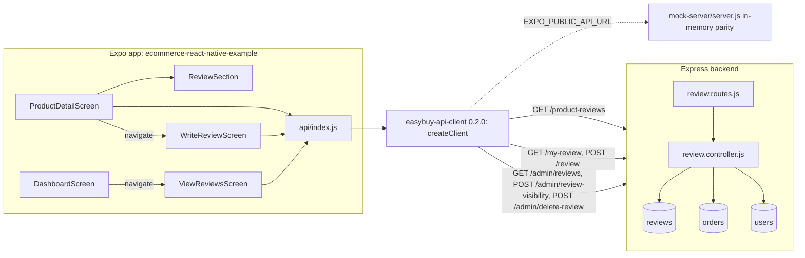
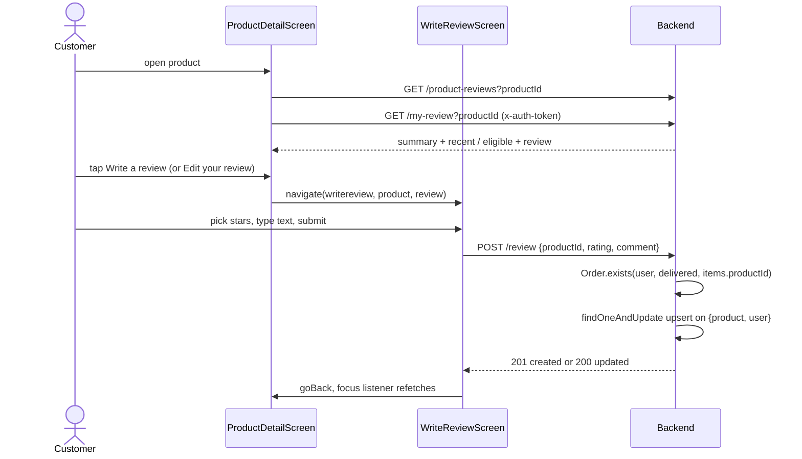
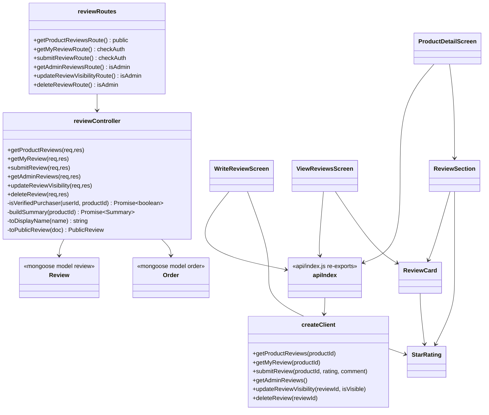
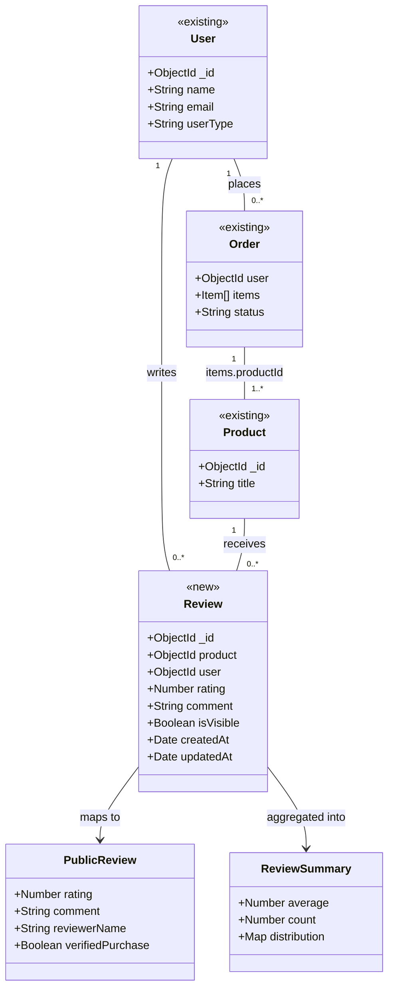

# Design: Verified Purchaser Ratings and Reviews (Agentic-SDLC-test/ecommerce-react-native-example#1)

> Linked Jira Epic: [Agentic-SDLC-test/ecommerce-react-native-example#1](https://github.com/Agentic-SDLC-test/ecommerce-react-native-example/issues/1)
> Business spec: v1 (submitted 2026-10-13T21:09:35Z by 01d38c68-5da5-4ca6-bf5b-e8c88557dfc0)
> Architect: ALORA Design Agent (draft for Architect review)

## Architecture overview

### Problem essence and value

Let customers who have a delivered order for a product rate it (1 to 5 whole stars) and optionally write up to 500 characters about it; show every shopper a trustworthy, always-current summary (average, count, star distribution) plus the five most recent written reviews on the product detail page; and give administrators reactive hide, restore and delete controls.

Implicit requirements the business spec leaves unstated, which this design makes explicit:

- **Verification must not be forgeable.** Today `POST /checkout` in the backend stores `req.body` as-is (`Order.create(body)` in `src/controllers/order.controller.js`), so a client can create an order that is already `status: "delivered"` and become a "verified purchaser" without an admin delivering anything. AC-1 says the rule must hold "even if they bypass the app screen", so checkout must force `status: "pending"` and ignore client-supplied `shippedOn` / `deliveredOn`.
- **Reviews of deleted products must not linger.** `GET /delete-product` removes the product, so its reviews are removed too.
- **The public read path must not leak identity.** It returns only a shortened display name, never a user id or email.

### Scope and boundaries

- **In scope**: a review collection and REST endpoints in the backend; the matching client operations in `@agentic-sdlc-test/easybuy-api-client` (released as `0.2.0`); mock-server parity; the review section on `ProductDetailScreen`; a new `WriteReviewScreen`; a new admin `ViewReviewsScreen` reachable from the dashboard; checkout status hardening; review clean-up on user and product deletion; tests; correcting `AGENTS.md`.
- **Out of scope**: photo or video reviews, helpfulness voting, replies, pre-publication approval, sorting and filtering, a full per-product review list, ratings on product cards, review prompts from order history, pagination of the admin list (consistent with the existing unpaginated `GET /admin/orders` and `GET /admin/users`), and fixing the pre-existing unauthenticated `GET /delete-user` (flagged under Security as a follow-up).
- **Conservative-reuse stance**:
  - Reused unchanged: `checkAuth` / `isAdmin` middleware, `asyncHandler`, `ApiError` plus the global `errorHandler`, `logger`, the client's `request()` helper and `onUnauthorized` token-expiry flow, `api/index.js` re-export pattern, `CustomButton`, `CustomAlert`, `OptionList`, `ProgressDialog`, `Alert.alert` confirm dialogs, colour constants.
  - Extended: the `Order` model (one index), `checkout`, `deleteUser`, `deleteProduct`, `paths` and `createClient()` in the client, `CustomInput` (optional `multiline`), `ProductDetailScreen`, `DashboardScreen`, `Routes.js`, the mock server, `openapi.js`.
  - New: `review` Mongoose model, review controller and routes, three UI components, two screens, test suites.
  - Nothing is replaced.

### High-level architecture

The feature follows the three-tier delivery chain already in place: the Expo app calls named functions re-exported from `api/index.js`; those come from `createClient()` in the shared `@agentic-sdlc-test/easybuy-api-client` package, which owns `fetch`, the `x-auth-token` header and the `jwt expired` logout; the package talks to the Express + Mongoose backend, whose routers are mounted flat at `/` (`src/routes/index.js`) and whose controllers call Mongoose models directly (there is no service layer). The design adds one domain, reviews, to each tier, using the same layering: `review.routes.js` (middleware guards) to `review.controller.js` (validation, rules, aggregation) to `review.model.js` (schema plus indexes).

All business rules live in the backend, the only trust boundary: verified-purchase eligibility (`Order.exists` on the caller's delivered orders), one review per customer per product (a unique `{ product, user }` index plus an atomic upsert), and visibility-filtered summaries computed by a MongoDB aggregation on every read, so the summary can never drift from the set of visible reviews (BR-6, BR-13). Hidden is a flag (`isVisible: false`); removed is a hard delete, which also frees the unique slot so the customer may review again, as the business spec requires.





### Key design decisions

- **Separate `review` collection, not an array on `product`** — a product embedding reviews would need array updates per edit and could not carry a unique per-user constraint; a top-level collection gets a real unique index, simple aggregation, and cheap per-user and per-product deletes. Matches how `order` references `user` and `product` by ObjectId.
- **Compute the summary on read with `$group`, no denormalised counters on `product`** — counters would need updating on create, edit, hide, restore, delete, user deletion and product deletion, each a drift risk against BR-13. The aggregation uses the `{ product, isVisible, updatedAt }` index and touches only one product's reviews, so it is cheap at this catalogue's scale.
- **Hide is a flag, remove is a hard delete** — the business spec says removal is permanent and frees the customer to review again; a hard delete gives both for free through the unique index. Hiding stays reversible.
- **Upsert ignores `isVisible`** — `$setOnInsert: { isVisible: true }` only applies on create, so editing a hidden review leaves it hidden (business-spec assumption: editing cannot bypass moderation).
- **Eligibility is checked at write time only** — matches the business-spec rule that reverting an order's status leaves existing reviews in place.
- **Mutations use POST with a JSON body, reads use GET with a query string** — the existing contract has GET-based deletes (`/delete-product`, `/remove-from-wishlist`), but a GET that mutates can be triggered by link prefetching and caches; new endpoints use POST like `/checkout` and `/add-to-wishlist`, while keeping the flat, hyphenated path style the app depends on.
- **New controllers return proper 4xx through `ApiError`** — the global `errorHandler` already turns them into `{ success: false, message }`, and the client's `request()` parses bodies regardless of status, so screens keep checking `result.success` exactly as today.
- **Client method names follow the names `AGENTS.md` already documents** (`getProductReviews`, `getAdminReviews`, `updateReviewVisibility`, `deleteReview`), plus `getMyReview` and `submitReview`.
- **Review section lives on the product page, written in a separate stack screen** — `ProductDetailScreen` has a fixed flex layout with no scrolling; the top info area becomes a `ScrollView` so the summary and five recent reviews fit while the quantity and Add to Cart bar stay fixed. Composing a review on its own screen avoids keyboard overlap with the fixed cart bar.

### Alternatives considered

- **Denormalised `ratingAverage` / `ratingCount` on `product`** — rejected: many write paths, drift risk, and not needed until ratings show on product cards (out of scope).
- **Soft-delete status enum (`visible` / `hidden` / `removed`)** — rejected: needs a partial unique index and keeps data the business spec says is permanently removed.
- **Pre-computing eligibility as a `verifiedPurchaser` list on `user`** — rejected: duplicates order data and needs maintenance on every status change; `Order.exists` on an indexed query is enough.
- **Calling the backend directly from the app for reviews (bypassing the client package)** — rejected: `api/index.js` now delegates everything to `createClient()`; the business spec makes the package the only path to the backend.
- **A dedicated "all reviews" screen for shoppers** — rejected for this release; the business spec limits the page to about five recent reviews.

## Affected repositories

- **Agentic-SDLC-test/ecommerce-react-native-example** (branch `main`, type `primary`) — review section on the product page, write/edit review screen, admin review moderation screen and dashboard entry, three new components, mock-server review endpoints and seed data, checkout status hardening in the mock, adopt `@agentic-sdlc-test/easybuy-api-client@0.2.0`, tests, `AGENTS.md` correction.
- **Agentic-SDLC-test/easybuy-api-client** (branch `main`, type `library`) — six new client operations, six new `paths`, `ReviewRules` constants and `validateReview()` in `domain`, version bump to `0.2.0`, tests.
- **Agentic-SDLC-test/ecommerce-backend-node-example** (branch `main`, type `service`) — `review` model, controller and routes, OpenAPI entries, checkout status hardening, review clean-up on user and product deletion, an `order` index, a Jest + Supertest + in-memory MongoDB test suite.

### Cross-repository impact (approved)

_Decided by hharis on 2026-10-13. Written by ALORA from the classified required changes; a new decision rewrites everything down to the closing line, so keep your own notes outside it._

| Repository | Role | Branch | Changes |
| --- | --- | --- | --- |
| `Agentic-SDLC-test/ecommerce-react-native-example` | Primary | `Feat/bc309fc6-verified-purchaser-ratings-and-revie` | C-3 Add the review controller with eligibility, summary aggregation, upsert and admin moderation handlers.; C-5 Force checkout to store status pending and ignore client shippedOn/deliveredOn.; C-6 Delete a user's reviews when the account is deleted.; C-7 Delete a product's reviews when the product is deleted.; C-9 Add Jest, Supertest and mongodb-memory-server test suite for reviews, checkout hardening and purges.; C-12 Bump the client package to 0.2.0 and add tests for the new methods and validateReview.; C-13 Adopt easybuy-api-client 0.2.0 and re-export the six review operations from api/index.js.; C-14 Add multiline support to CustomInput.; C-15 Add StarRating, ReviewCard and ReviewSection components.; C-16 Show rating summary, distribution, recent reviews and the write/edit entry point on the product detail page.; C-17 Add the write/edit review screen and register writereview and viewreviews routes.; C-18 Add the admin review moderation screen and a Reviews entry on the dashboard.; C-19 Mirror the review endpoints, seed data, checkout hardening and purges in the mock server.; C-20 Add component tests and the @testing-library/react-native devDependency.; C-21 Correct AGENTS.md review and API client documentation. |
| `Agentic-SDLC-test/easybuy-api-client` | Dependency | `Feat/bc309fc6-verified-purchaser-ratings-and-revie` | C-10 Add review paths, ReviewRules and validateReview to the client domain module.; C-11 Add getProductReviews, getMyReview, submitReview, getAdminReviews, updateReviewVisibility and deleteReview to createClient. |
| `Agentic-SDLC-test/ecommerce-backend-node-example` | Dependency | `Feat/bc309fc6-verified-purchaser-ratings-and-revie` | C-1 Add the review Mongoose model with rating, comment, isVisible and unique product+user index.; C-2 Add an index on order user+status for the verified-purchase check.; C-4 Add review routes with checkAuth/isAdmin guards and mount them in the root router.; C-8 Document the six review endpoints and schemas in the OpenAPI spec. |

**Evidence**

- C-1 → `Agentic-SDLC-test/ecommerce-backend-node-example`: reassigned by the Architect
- C-2 → `Agentic-SDLC-test/ecommerce-backend-node-example`: `src/models/order.model.js` src/models/order.model.js exists in Agentic-SDLC-test/ecommerce-backend-node-example
- C-3 → `Agentic-SDLC-test/ecommerce-react-native-example`: `api/index.js:50` getProductReviews is a node of the primary's code graph
- C-4 → `Agentic-SDLC-test/ecommerce-backend-node-example`: `src/routes/index.js` src/routes/index.js exists in Agentic-SDLC-test/ecommerce-backend-node-example
- C-5 → `Agentic-SDLC-test/ecommerce-react-native-example`: `api/index.js:36` checkout is a node of the primary's code graph
- C-6 → `Agentic-SDLC-test/ecommerce-react-native-example`: `api/index.js:18` deleteUser is a node of the primary's code graph
- C-7 → `Agentic-SDLC-test/ecommerce-react-native-example`: `api/index.js:26` deleteProduct is a node of the primary's code graph
- C-8 → `Agentic-SDLC-test/ecommerce-backend-node-example`: `src/docs/openapi.js` src/docs/openapi.js exists in Agentic-SDLC-test/ecommerce-backend-node-example
- C-9 → `Agentic-SDLC-test/ecommerce-react-native-example`: `package.json:12` test is a node of the primary's code graph
- C-10 → `Agentic-SDLC-test/easybuy-api-client`: `api/index.js:1` `import { createClient } from "@agentic-sdlc-test/easybuy-api-client";`
- C-11 → `Agentic-SDLC-test/easybuy-api-client`: `api/index.js:1` `import { createClient } from "@agentic-sdlc-test/easybuy-api-client";`
- C-12 → `Agentic-SDLC-test/ecommerce-react-native-example`: `app.json:5` version is a node of the primary's code graph
- C-13 → `Agentic-SDLC-test/ecommerce-react-native-example`: `api/index.js:50` getProductReviews is a node of the primary's code graph
- C-14 → `Agentic-SDLC-test/ecommerce-react-native-example`: `components/CustomInput/CustomInput.js:5` CustomInput is a node of the primary's code graph
- C-15 → `Agentic-SDLC-test/ecommerce-react-native-example`: reassigned by the Architect
- C-16 → `Agentic-SDLC-test/ecommerce-react-native-example`: `screens/user/ProductDetailScreen.js:25` ProductDetailScreen is a node of the primary's code graph
- C-17 → `Agentic-SDLC-test/ecommerce-react-native-example`: `routes/Routes.js:33` Routes is a node of the primary's code graph
- C-18 → `Agentic-SDLC-test/ecommerce-react-native-example`: `screens/admin/ViewReviewsScreen.js:20` ViewReviewsScreen is a node of the primary's code graph
- C-19 → `Agentic-SDLC-test/ecommerce-react-native-example`: `mock-server/server.js:285` reviews is a node of the primary's code graph
- C-20 → `Agentic-SDLC-test/ecommerce-react-native-example`: `package.json` package.json exists in the primary
- C-21 → `Agentic-SDLC-test/ecommerce-react-native-example`: `AGENTS.md` AGENTS.md exists in the primary

_End of the cross-repository impact._

## Component-level design

### Layered architecture and dependency map



### Extension points

- `buildSummary(productId)` is the single place that computes ratings; a later "ratings on product cards" feature can batch it with `$in` on product ids without touching writers.
- `GET /product-reviews` accepts only `productId` now; `limit` and `sort` query parameters can be added later without breaking callers (sorting and filtering are out of scope).
- `StarRating` supports read-only and interactive modes, so it can be reused on product cards later.

### Conventions in use

- **Module style (backend)**: CommonJS, `'use strict';` at the top, JSDoc block per handler naming the method, path and `(auth)` / `(admin)` guard, as in `wishlist.controller.js`.
- **Module style (client package)**: TypeScript, arrow functions inside the object returned by `createClient`, ids passed through `queryValue()` in query strings, path strings only in `domain/index.ts` `paths`.
- **Module style (app)**: function components with hooks, `StyleSheet.create` at the bottom of the file, a `testID` on every interactive and data element using the `<screen>-<element>` kebab pattern (`product-detail-add-to-cart-btn`), components in `components/<Name>/<Name>.js` with an `index.js` default re-export.
- **Dependency injection**: none; modules `require` / `import` collaborators directly. Middleware is attached per route.
- **Exception handling (backend)**: controllers are wrapped in `asyncHandler`; business failures throw `ApiError.badRequest / forbidden / notFound`; Mongoose `ValidationError`, `CastError` and duplicate key `11000` are mapped centrally by `errorHandler` to `{ success: false, message }` with 400 / 400 / 409.
- **Exception handling (app)**: every API call uses `.then(result => result.success ? ... : setError(result.message))` with `.catch(error => setError(error.message))`, and shows `CustomAlert`.
- **Input validation**: Mongoose schema validators are authoritative (rating integer 1 to 5, comment max 500 after trim); the controller checks presence and type first for clear messages; the app pre-validates with `validateReview()` from the client `domain` export, mirroring how `validateLogin` / `validateProduct` are used.
- **Logging**: `src/utils/logger.js` (`logger.info` / `warn` / `error`) with `key=value` pairs; `morgan` already logs every request line.
- **Documentation**: every new backend path is added by hand to `src/docs/openapi.js` under a new `Reviews` tag.

### Backend: `src/models/review.model.js` (new)

- **Responsibility**: persist one customer's rating and optional comment for one product.
- **Fields**: see Data model changes.
- **Exports**: `mongoose.model('review', reviewSchema)`.

### Backend: `src/controllers/review.controller.js` (new)

- **Responsibility**: enforce review business rules and shape responses.
- **Collaborators**: `Review`, `Order` models; `ApiError`; `asyncHandler`; `logger`.
- **Constants**: `RECENT_REVIEWS_LIMIT = 5`.
- **Private helpers** (module scope, not exported):
  - `isVerifiedPurchaser(userId, productId): Promise<boolean>` — `Boolean(await Order.exists({ user: userId, status: 'delivered', 'items.productId': productId }))`.
  - `buildSummary(productId): Promise<{ average: number|null, count: number, distribution: { '1': number, '2': number, '3': number, '4': number, '5': number } }>` — aggregate `[{ $match: { product: new mongoose.Types.ObjectId(productId), isVisible: true } }, { $group: { _id: '$rating', n: { $sum: 1 } } }]`; fill missing star levels with 0; `count` = sum of `n`; `average` = `Math.round((sum(rating*n) / count) * 10) / 10`, or `null` when `count === 0`.
  - `toDisplayName(name): string` — trim and split on whitespace; one part returns it unchanged; two or more parts return `first + ' ' + lastPart[0].toUpperCase() + '.'`; empty or missing returns `'EasyBuy customer'`.
  - `toPublicReview(doc)` — returns `{ _id, rating, comment, reviewerName: toDisplayName(doc.user?.name), verifiedPurchase: true, createdAt, updatedAt, edited: updatedAt - createdAt > 1000 }`. Never includes `user` id or email.
  - `assertObjectId(value, field)` — throws `ApiError.badRequest('<field> is required')` when empty and `ApiError.badRequest('Invalid <field>')` when `!mongoose.isValidObjectId(value)`.
- **Handlers** (all wrapped in `asyncHandler`):
  - `getProductReviews` — `assertObjectId(req.query.productId, 'productId')`; run `buildSummary` and the recent query in parallel: `Review.find({ product, isVisible: true, comment: { $ne: '' } }).sort({ updatedAt: -1 }).limit(RECENT_REVIEWS_LIMIT).populate({ path: 'user', select: 'name' })`; respond `200 { success: true, message: 'product reviews', data: { summary, reviews: reviews.map(toPublicReview) } }`. Unknown product ids return an empty summary, not 404 (keeps the page working for products created after caching).
  - `getMyReview` — `assertObjectId`; `const [eligible, review] = await Promise.all([isVerifiedPurchaser(req.user._id, productId), Review.findOne({ product: productId, user: req.user._id })])`; respond `200 { success: true, message: 'my review', data: { eligible, review: review ? { _id, rating, comment, isVisible, createdAt, updatedAt } : null } }`.
  - `submitReview` — read `{ productId, rating, comment = '' }` from `req.body`; `assertObjectId(productId, 'productId')`; reject with 400 `'Rating must be a whole number from 1 to 5'` when `!Number.isInteger(rating) || rating < 1 || rating > 5`; reject with 400 `'Comment must be text'` when `typeof comment !== 'string'`; `const text = comment.trim()`; reject with 400 `'Comment must be 500 characters or fewer'` when `text.length > 500`; reject with 404 `'product does not exist'` when `!(await Product.exists({ _id: productId }))`; reject with 403 `'Only customers with a delivered order for this product can review it'` when `!(await isVerifiedPurchaser(req.user._id, productId))` and log `review.rejected`; then `Review.findOneAndUpdate({ product: productId, user: req.user._id }, { $set: { rating, comment: text }, $setOnInsert: { isVisible: true } }, { upsert: true, new: true, runValidators: true, includeResultMetadata: true })`; `const doc = result.value; const created = !result.lastErrorObject.updatedExisting`; respond `201` (created) or `200` (updated) with `{ success: true, message: created ? 'review submitted' : 'review updated', data: { _id, rating, comment, isVisible, createdAt, updatedAt } }`. On a duplicate key error (`err.code === 11000`, two concurrent first submissions) retry the same `findOneAndUpdate` once without `upsert`, which then updates the row the other request created.
  - `getAdminReviews` — `Review.find().sort({ createdAt: -1 }).populate({ path: 'user', select: 'name email' }).populate({ path: 'product', select: 'title image' })`; respond `200 { success: true, message: 'all reviews', data: reviews }` (full documents; admins may see email, as in `GET /admin/users`).
  - `updateReviewVisibility` — `{ reviewId, isVisible } = req.body`; `assertObjectId(reviewId, 'reviewId')`; 400 `'isVisible must be true or false'` unless `typeof isVisible === 'boolean'`; `Review.findByIdAndUpdate(reviewId, { isVisible }, { new: true })`; 404 `'review does not exist'` when null; log `review.visibility_changed`; respond `200 { success: true, message: isVisible ? 'review restored' : 'review hidden', data: review }`.
  - `deleteReview` — `{ reviewId } = req.body`; `assertObjectId`; `Review.findByIdAndDelete(reviewId)`; 404 when null; log `review.deleted`; respond `200 { success: true, message: 'review deleted successfully' }`.
- **Exports**: the six handlers.
- **Transaction / concurrency boundary**: each write is a single-document atomic operation; the unique index is the concurrency guard. No multi-document transaction is needed (the eligibility read and the upsert race only against an admin changing order status, which the business spec accepts).

### Backend: `src/routes/review.routes.js` (new) and `src/routes/index.js` (modified)

- `router.get('/product-reviews', getProductReviews)`; `router.get('/my-review', checkAuth, getMyReview)`; `router.post('/review', checkAuth, submitReview)`; `router.get('/admin/reviews', isAdmin, getAdminReviews)`; `router.post('/admin/review-visibility', isAdmin, updateReviewVisibility)`; `router.post('/admin/delete-review', isAdmin, deleteReview)`.
- `index.js`: `const reviewRoutes = require('./review.routes');` and `router.use('/', reviewRoutes);` after `wishlistRoutes`.

### Backend: existing controllers (modified)

- `order.controller.js` `checkout` — after copying the body, set `body.status = 'pending'` and `delete body.shippedOn; delete body.deliveredOn;`. The app already sends `status: OrderStatus.PENDING`, so its behaviour is unchanged.
- `auth.controller.js` `deleteUser` — after a successful `User.findByIdAndDelete(id)`, run `const { deletedCount } = await Review.deleteMany({ user: deleted._id })` and log `reviews.purged reason=user_deleted`. Response shape unchanged.
- `product.controller.js` `deleteProduct` — after a successful delete, `await Review.deleteMany({ product: product._id })` and log `reviews.purged reason=product_deleted`. Response shape unchanged.
- `order.model.js` — add `orderSchema.index({ user: 1, status: 1 });`.

### Client package: `src/domain/index.ts` (modified)

- Add to `paths`: `productReviews: "/product-reviews"`, `myReview: "/my-review"`, `review: "/review"`, `adminReviews: "/admin/reviews"`, `reviewVisibility: "/admin/review-visibility"`, `deleteReview: "/admin/delete-review"`.
- Add `export const ReviewRules = { MIN_RATING: 1, MAX_RATING: 5, COMMENT_MAX_LENGTH: 500 } as const;`
- Add `export function validateReview(input: { rating: number; comment?: string }): string | null` — returns `"Please select a star rating"` when the rating is not an integer from 1 to 5, `"Review must be 500 characters or fewer"` when `(comment ?? "").trim().length > 500`, otherwise `null`. Same style as `validateLogin`.

### Client package: `src/index.ts` `createClient` (modified)

- `getProductReviews: (productId: unknown) => request("GET", `${paths.productReviews}?productId=${queryValue(productId)}`)`
- `getMyReview: (productId: unknown) => request("GET", `${paths.myReview}?productId=${queryValue(productId)}`)`
- `submitReview: (productId: unknown, rating: number, comment = "") => request("POST", paths.review, { productId, rating, comment })`
- `getAdminReviews: () => request("GET", paths.adminReviews)`
- `updateReviewVisibility: (reviewId: unknown, isVisible: boolean) => request("POST", paths.reviewVisibility, { reviewId, isVisible })`
- `deleteReview: (reviewId: unknown) => request("POST", paths.deleteReview, { reviewId })`
- `package.json` `version` becomes `0.2.0`, which makes the existing publish job release it on merge.

### App: `api/index.js` (modified)

- Add `export const getProductReviews = client.getProductReviews;` and the same for `getMyReview`, `submitReview`, `getAdminReviews`, `updateReviewVisibility`, `deleteReview`.
- `package.json`: `"@agentic-sdlc-test/easybuy-api-client": "0.2.0"` and the regenerated `package-lock.json`.

### App: `components/StarRating/StarRating.js` (new)

- **Props**: `rating: number` (0 to 5, may be fractional), `size = 16`, `onChange?: (value: number) => void`, `testID`.
- **Behaviour**: renders five `Ionicons` (`star`, `star-half`, `star-outline`) in `colors.primary`. Read-only when `onChange` is absent; when present, each star is a `TouchableOpacity` with `testID={`${testID}-star-${n}`}`, `accessibilityRole="button"` and `accessibilityLabel={`${n} star${n > 1 ? 's' : ''}`}`, and calls `onChange(n)`. Half star when `rating - floor >= 0.5` (read-only only). The read-only wrapper has `accessibilityLabel={`Rated ${rating} out of 5`}`.

### App: `components/ReviewCard/ReviewCard.js` (new)

- **Props**: `review` (`{ rating, comment, reviewerName, createdAt, updatedAt, edited }`), `testID`, `children` (optional footer, used by the admin screen).
- **Behaviour**: row with `StarRating` (size 14) and the reviewer name in bold; a "Verified Purchase" badge (`Ionicons checkmark-circle`, `colors.primary`, text `Verified Purchase`, `testID={`${testID}-verified`}`); the date `moment(edited ? updatedAt : createdAt).format('MMM D, YYYY')` prefixed with `Edited ` when `edited`; the comment as plain `Text`; then `children`.

### App: `components/ReviewSection/ReviewSection.js` (new)

- **Props**: `summary`, `reviews`, `myReview` (`{ eligible, review } | null`), `loadError: boolean`, `onWritePress: () => void`, `testID = 'review-section'`.
- **Behaviour**:
  - `loadError` true: render only the heading and `Reviews are unavailable right now.` (`testID="review-section-error"`).
  - `summary.count === 0`: render `No reviews yet` (`testID="review-section-empty"`), never `0.0`.
  - Otherwise: large average `summary.average.toFixed(1)`, `StarRating rating={summary.average}`, `Based on N rating(s)`, then five distribution rows from 5 to 1, each `n★`, a bar whose filled width is `Math.round(count / total * 100)%` on `colors.light`, and the count (`testID="review-section-dist-<n>"`).
  - Recent reviews: `reviews.map` to `ReviewCard` (`testID="review-card-<index>"`). When `count > 0` but `reviews` is empty, show `No written reviews yet`.
  - Call to action: `myReview?.review` present: `CustomButton text="Edit your review"`; else `myReview?.eligible`: `CustomButton text="Write a review"`; else when `myReview` is loaded: muted text `You can review this product once your order for it has been delivered.` (`testID="review-section-ineligible"`). Hidden own review: also show `Your review is hidden by a moderator.`.

### App: `screens/user/ProductDetailScreen.js` (modified)

- New state: `reviewData` (`{ summary, reviews } | null`), `myReview` (`{ eligible, review } | null`), `reviewsError` (boolean).
- New `fetchReviews()` — `api.getProductReviews(product._id)` and `api.getMyReview(product._id)` run independently; each sets its own state on `result.success`, and `reviewsError = true` on `success: false` or rejection of `getProductReviews`. Failures never touch the existing `error` / `CustomAlert` state used by the wishlist, so the rest of the page keeps working (BR-13). `getMyReview` failure leaves `myReview` null (no call to action shown).
- `useEffect`: subscribe `navigation.addListener('focus', fetchReviews)` and return the unsubscribe, so returning from `WriteReviewScreen` refreshes the summary.
- Layout: wrap the contents of `productInfoTopContainer` (title, wishlist button, price, description) in a `ScrollView` (`testID="product-detail-scroll"`) and append `<ReviewSection ... onWritePress={() => navigation.navigate('writereview', { product, review: myReview?.review ?? null })} />`. `productInfoBottomContainer` stays outside the scroll view.

### App: `screens/user/WriteReviewScreen.js` (new, route `writereview`)

- **Params**: `product`, `review` (existing review or `null`).
- **State**: `rating` (initial `review?.rating ?? 0`), `comment` (initial `review?.comment ?? ''`), `error`, `alertType`, `isloading`.
- **UI**: top bar with back arrow (same as `ProductDetailScreen`), title `Write a review` or `Edit your review`, product title, interactive `StarRating size={36} testID="write-review-stars"`, `CustomInput multiline maxLength={ReviewRules.COMMENT_MAX_LENGTH} placeholder="Share your experience (optional)" testID="write-review-comment"`, a counter `N/500` (`testID="write-review-count"`), `CustomButton text="Submit"` (`testID="write-review-submit-btn"`), `CustomAlert`, `ProgressDialog`.
- **Submit**: `const msg = validateReview({ rating, comment })`; show and stop on error; otherwise `api.submitReview(product._id, rating, comment.trim())`; on `result.success` call `navigation.goBack()`; else show `result.message || result.msg`; `.catch` shows `error.message`.

### App: `components/CustomInput/CustomInput.js` (modified)

- Add optional `multiline` and `numberOfLines` props passed to `TextInput`; when `multiline`, add `textAlignVertical: "top"` and `minHeight: 100`. Existing callers are unaffected.

### App: `screens/admin/ViewReviewsScreen.js` (new, route `viewreviews`)

- Structure copies `ViewUsersScreen`: top bar, `CustomAlert`, `ProgressDialog`, search box filtering on product title or reviewer name, `ScrollView` with `RefreshControl`.
- `fetchReviews()` calls `api.getAdminReviews()`.
- Each row: product title, reviewer `name (email)`, a status pill `Visible` / `Hidden`, then `ReviewCard` (with `reviewerName` set to the full name) whose `children` holds two buttons: `Hide` / `Restore` (`testID="view-reviews-toggle-<id>"`) calling `api.updateReviewVisibility(id, !review.isVisible)`, and `Delete` (`testID="view-reviews-delete-<id>"`) that opens `Alert.alert('Are you sure?', 'This permanently removes the review.', [...])` like `ViewProductScreen.showConfirmDialog`, then calls `api.deleteReview(id)`. After either succeeds, refetch and show a success alert.

### App: `screens/admin/DashboardScreen.js` and `routes/Routes.js` (modified)

- Dashboard: add `<OptionList testID="dashboard-reviews-option" text={"Reviews"} Icon={Ionicons} iconName={"star"} onPress={() => navigation.navigate("viewreviews", { authUser: user })} type="morden" />` after Users.
- Routes: import and register `<Stack.Screen name="writereview" component={WriteReviewScreen} />` and `<Stack.Screen name="viewreviews" component={ViewReviewsScreen} />`.

### App: `mock-server/server.js` (modified)

- In-memory `let reviews = [...]` with the same shape as the backend document (`user` and `product` stored as id strings).
- Seed: add `order004` for `user002` (Jane Smith), status `delivered`, items `prod007` and `prod001`; seed reviews: Jane on `prod007` (rating 4, comment `Good quality rice, cooks evenly.`) and Jane on `prod001` (rating 5, empty comment). `user001` (John Doe) keeps `order003` (delivered `prod007`) with no review, so the seeded user login can demonstrate writing one.
- Endpoints mirroring the backend contract exactly (same paths, guards, status codes, messages, response shapes), reusing `authMiddleware` and `adminMiddleware`; eligibility checks `orders.some(o => o.user._id === req.user._id && o.status === 'delivered' && o.items.some(i => i.productId._id === productId))`.
- `POST /checkout` forces `status: 'pending'`; `GET /delete-user` and `GET /delete-product` drop matching reviews.
- Add the six routes to the startup route listing.

## UI/UX design notes

- **Product detail page**: below the description, a `Reviews` heading. With ratings: large average (`4.3`), five-star read-only row, `Based on 12 ratings`, then five horizontal bars from 5 to 1 star with counts, then up to five recent written reviews, newest first. Each review card shows stars, shortened name (`John D.`), a `Verified Purchase` badge, the date (`Edited Oct 13, 2026` when edited), and the text.
- **Empty state**: `No reviews yet` in muted text, no average and no bars (BR-12). Ratings but no written text: summary plus `No written reviews yet`.
- **Call to action**: `Write a review` (eligible, no review), `Edit your review` (has a review), or the muted line `You can review this product once your order for it has been delivered.` (signed in, not eligible). A hidden own review adds `Your review is hidden by a moderator.`
- **Load failure**: the section shows `Reviews are unavailable right now.`; wishlist, quantity and Add to Cart work unchanged.
- **Scrolling**: the product title, price, description and reviews scroll; the quantity counter and Add to Cart bar stay pinned at the bottom.
- **Write / edit screen**: large tappable stars (36 px, each with an accessibility label), optional multiline text with a live `N/500` counter, `Submit`. Validation message `Please select a star rating` if no star is picked. Success returns to the product page, which refreshes on focus.
- **Admin**: a `Reviews` row with a star icon on the dashboard Actions list. The moderation screen lists all reviews newest first, with a search box, status pill, `Hide` / `Restore` toggle, and `Delete` behind a confirmation dialog. Pull to refresh.
- **Accessibility**: stars expose `Rated X out of 5` (read-only) or `N stars` buttons; badges are text, not colour alone; tap targets at least 36 px.
- **Styling**: reuse `colors.primary` for stars and badge, `colors.muted` for secondary text, `colors.light` for bar tracks, and the existing card radius (10) and padding (20).

## API schemas and contracts

All endpoints are mounted flat at `/` on the backend (and the mock server). Auth uses the existing `x-auth-token: <JWT>` header. Errors from the new controllers use the global envelope `{ "success": false, "message": string }`; auth middleware failures keep their existing `{ "msg": string, "err": string }` shape (400 no token, 401 invalid or `jwt expired`, 403 not admin), so the client's `jwt expired` logout keeps working.

Shared shapes:

```json
// Summary
{ "average": 4.3, "count": 12, "distribution": { "1": 0, "2": 1, "3": 1, "4": 4, "5": 6 } }
// average is null when count is 0. Only isVisible=true reviews are counted.

// PublicReview (customer-facing)
{
  "_id": "665f1c...",
  "rating": 5,
  "comment": "Great fit and soft fabric.",
  "reviewerName": "John D.",
  "verifiedPurchase": true,
  "edited": false,
  "createdAt": "2026-10-13T21:09:35.398Z",
  "updatedAt": "2026-10-13T21:09:35.398Z"
}

// OwnReview
{ "_id": "665f1c...", "rating": 4, "comment": "", "isVisible": true, "createdAt": "...", "updatedAt": "..." }
```

```http
GET /product-reviews?productId=<ObjectId>
Auth: none
200 OK -> { "success": true, "message": "product reviews",
            "data": { "summary": Summary, "reviews": PublicReview[] } }   // reviews: max 5, comment non-empty, newest updatedAt first
400 Bad Request -> { "success": false, "message": "productId is required" | "Invalid productId" }
```

```http
GET /my-review?productId=<ObjectId>
Auth: x-auth-token (checkAuth)
200 OK -> { "success": true, "message": "my review",
            "data": { "eligible": boolean, "review": OwnReview | null } }
400 Bad Request -> { "success": false, "message": "Invalid productId" }
```

```http
POST /review
Auth: x-auth-token (checkAuth)
Content-Type: application/json
Body: { "productId": "<ObjectId>", "rating": 1..5 (integer, required), "comment": "string, optional, <= 500 chars after trim" }
201 Created -> { "success": true, "message": "review submitted", "data": OwnReview }
200 OK      -> { "success": true, "message": "review updated", "data": OwnReview }   // second submission edits the existing review; isVisible unchanged
400 Bad Request -> { "success": false, "message": "Rating must be a whole number from 1 to 5" | "Comment must be text" | "Comment must be 500 characters or fewer" | "Invalid productId" }
403 Forbidden   -> { "success": false, "message": "Only customers with a delivered order for this product can review it" }
404 Not Found   -> { "success": false, "message": "product does not exist" }
```

```http
GET /admin/reviews
Auth: x-auth-token (isAdmin)
200 OK -> { "success": true, "message": "all reviews",
            "data": [ { "_id", "rating", "comment", "isVisible", "createdAt", "updatedAt",
                        "user": { "_id", "name", "email" } | null,
                        "product": { "_id", "title", "image" } | null } ] }   // newest createdAt first, visible and hidden
```

```http
POST /admin/review-visibility
Auth: x-auth-token (isAdmin)
Body: { "reviewId": "<ObjectId>", "isVisible": boolean }
200 OK -> { "success": true, "message": "review hidden" | "review restored", "data": AdminReview }
400 Bad Request -> { "success": false, "message": "Invalid reviewId" | "isVisible must be true or false" }
404 Not Found   -> { "success": false, "message": "review does not exist" }
```

```http
POST /admin/delete-review
Auth: x-auth-token (isAdmin)
Body: { "reviewId": "<ObjectId>" }
200 OK -> { "success": true, "message": "review deleted successfully" }
400 Bad Request -> { "success": false, "message": "Invalid reviewId" }
404 Not Found   -> { "success": false, "message": "review does not exist" }
```

Changed existing contracts (backward compatible):

- `POST /checkout` — server now always stores `status: "pending"` and ignores `shippedOn` / `deliveredOn` in the body. Response shape unchanged.
- `GET /delete-user?id=` and `GET /delete-product?id=` — also delete the user's or product's reviews. Response shape unchanged.

Client package `@agentic-sdlc-test/easybuy-api-client@0.2.0` signatures:

```ts
getProductReviews(productId: unknown): Promise<any>
getMyReview(productId: unknown): Promise<any>
submitReview(productId: unknown, rating: number, comment?: string): Promise<any>
getAdminReviews(): Promise<any>
updateReviewVisibility(reviewId: unknown, isVisible: boolean): Promise<any>
deleteReview(reviewId: unknown): Promise<any>
// domain
export const ReviewRules: { MIN_RATING: 1; MAX_RATING: 5; COMMENT_MAX_LENGTH: 500 };
export function validateReview(input: { rating: number; comment?: string }): string | null;
```

OpenAPI: add a `Reviews` tag and the six paths to `src/docs/openapi.js`, plus `ReviewSummary`, `PublicReview` and `Review` component schemas, using the same hand-written style as `/add-to-wishlist`.

## Integration patterns

- **Inbound (backend)**: synchronous REST over HTTP from the client package only; no webhooks, queues or batch jobs. The flat router mount in `src/routes/index.js` is reused.
- **Outbound (backend)**: none. Reviews read the `orders` collection in the same database; no cross-service call.
- **App to backend**: always through `createClient()` from the package and the re-exports in `api/index.js`; the screen layer never calls `fetch`. The existing `onUnauthorized` handler clears the session and calls `resetToLogin()` on `jwt expired` for the new authenticated calls too.
- **Local development**: the mock server implements the same contract so `EXPO_PUBLIC_API_URL=http://localhost:3002` works against either server; the old note that review endpoints are backend-only is removed.
- **Release chain**: backend merge and deploy first (additive endpoints), then client `0.2.0` publish via the existing GitHub Packages job on merge to `main`, then the app bumps its exact pin.
- **Idempotency / retry**: `POST /review` is idempotent per `{ product, user }` (repeat calls converge on one document). `POST /admin/review-visibility` is idempotent (sets a value). `POST /admin/delete-review` returns 404 on repeat, which the admin screen shows and recovers from by refetching. The client does not retry automatically, matching every other call.

## Data model changes

### Entity relationships



### Schema changes

- **New collection** `reviews` (Mongoose model `review`, `{ timestamps: true }`):
  - `product: { type: ObjectId, ref: 'product', required: true }`
  - `user: { type: ObjectId, ref: 'user', required: true }`
  - `rating: { type: Number, required: true, min: 1, max: 5, validate: { validator: Number.isInteger, message: 'Rating must be a whole number from 1 to 5' } }`
  - `comment: { type: String, trim: true, maxlength: [500, 'Comment must be 500 characters or fewer'], default: '' }`
  - `isVisible: { type: Boolean, default: true }`
  - Indexes: `{ product: 1, user: 1 }` unique (one review per customer per product); `{ product: 1, isVisible: 1, updatedAt: -1 }` (summary and recent list); `{ user: 1 }` (account deletion).
- **Existing `orders` collection**: add index `{ user: 1, status: 1 }` (eligibility check, also speeds `GET /orders`). No field changes.
- **No change** to `users` or `products` documents.
- **Mock server**: new in-memory `reviews` array and one seeded order (`order004`), reset on restart.

### Backward-compatibility plan

- Purely additive: a new collection and a new index; no existing document is migrated or rewritten, and no backfill is needed (no reviews exist today).
- Mongoose builds the indexes on startup (`autoIndex` default). On a large production `orders` collection, the Architect may instead build `{ user: 1, status: 1 }` ahead of deploy with `db.orders.createIndex({ user: 1, status: 1 })`; both are online operations on MongoDB 4.2 and later.
- Rollback drops nothing automatically; see Rollout and rollback considerations, step "Backend".

## Security and compliance considerations

- **Auth**: `GET /product-reviews` is public (reviews are public content). `GET /my-review` and `POST /review` require `checkAuth`; the reviewer is always `req.user._id` from the JWT, never a body field, so only the author can create or edit their review (BR-10). The three `/admin/*` review endpoints require `isAdmin` (BR-10). Hidden reviews are only returned by `GET /admin/reviews` and by the owner's `GET /my-review`.
- **Verified purchase integrity** (AC-1): eligibility is enforced on the server in `submitReview`; checkout no longer accepts a client-chosen order `status`, so only an admin (`GET /admin/order-status`, `isAdmin`) can move an order to `delivered`.
- **Input validation**: ObjectId format checks; integer rating 1 to 5; comment must be a string, trimmed, at most 500 characters; schema validators repeat the rules; `express.json` limit (5 MB) and the existing global rate limiter (1000 requests per 15 minutes per IP) apply.
- **Output safety**: comments render as React Native `Text`, which does not interpret markup; no HTML is produced.
- **Secrets**: none new. Tests set a throwaway `TOKEN_KEY` in-process.
- **PII / data classification**: reviewer name is personal data. Public responses expose only first name and last initial and no user id or email. Admin responses include name and email (admins already see both in `GET /admin/users`). Comment text and tokens are never logged.
- **Data deletion** (BR-11, GDPR-style erasure): `deleteUser` deletes all the user's reviews in the same request; product deletion deletes that product's reviews.
- **Audit log entries**: every admin moderation action logs `review.visibility_changed` or `review.deleted` with `reviewId`, `productId`, `adminId` and the new state, through `logger.info` (stdout, collected by the container runtime).
- **Pre-existing risk (not changed here)**: backend `GET /delete-user?id=` has no auth middleware, so anyone who knows a user id can delete that account and, with this change, that user's reviews. Recommended follow-up ticket: require `checkAuth` and `req.user._id === id || isAdmin`. Not fixed in this epic to keep the account-deletion contract the app depends on stable.

## Observability requirements

- **Structured logs** (backend `logger`, `key=value`, no comment text, no tokens):
  - `logger.info('review.upserted reviewId=%s productId=%s userId=%s created=%s rating=%d')` on each successful `POST /review`.
  - `logger.warn('review.rejected reason=not_verified_purchaser productId=%s userId=%s')` on 403.
  - `logger.info('review.visibility_changed reviewId=%s productId=%s adminId=%s isVisible=%s')`.
  - `logger.info('review.deleted reviewId=%s productId=%s adminId=%s')`.
  - `logger.info('reviews.purged reason=user_deleted|product_deleted id=%s count=%d')` from `deleteUser` / `deleteProduct`.
  - Unexpected failures are already logged by `errorHandler` at error level with method, URL and stack (5xx only).
  - Mock server: `console.log` the same event names.
- **Metrics**: the backend has no metrics library; counts are derived from the log lines above and from `morgan` request lines (status code per path). No new metrics dependency is introduced.
- **Traces**: _Not applicable — the backend has no tracing instrumentation; adding it is out of scope._
- **Dashboards / alerts**: during rollout, watch for 5xx on `/product-reviews` and `/review` in `morgan` output (target zero), and a spike of `review.rejected` (would indicate a broken eligibility query or confused users). `/health` keeps reporting database connectivity.
- **App**: keep the existing `console.log('error', error)` in `.catch` handlers; no new telemetry.

## Implementation plan

> Repositories must be delivered in this order because the app pins an exact client version: backend, then client package, then app. Each phase lists its verification.

### Phase 1 — Backend data model (ecommerce-backend-node-example)

1. Create `src/models/review.model.js` with the schema and three indexes from Data model changes; export `mongoose.model('review', reviewSchema)`.
2. Add `orderSchema.index({ user: 1, status: 1 });` to `src/models/order.model.js`.
3. Verify: Jest test `review.model` creates a review, rejects rating 0, 6 and 3.5, rejects a 501-character comment, trims whitespace, and rejects a second `{ product, user }` insert with code 11000.

### Phase 2 — Backend rules and endpoints

1. Create `src/controllers/review.controller.js` with the helpers and six handlers exactly as in Component-level design.
2. Create `src/routes/review.routes.js` and mount it in `src/routes/index.js` after the wishlist routes.
3. Harden `checkout` in `src/controllers/order.controller.js` (force `pending`, drop `shippedOn` / `deliveredOn`).
4. Add review purges to `deleteUser` (`auth.controller.js`) and `deleteProduct` (`product.controller.js`).
5. Add the `Reviews` tag, six paths and three schemas to `src/docs/openapi.js`.
6. Add test tooling: devDependencies `jest@^29`, `supertest@^7`, `mongodb-memory-server@^10`; `"test": "jest --runInBand"`; `jest` config `{ "testEnvironment": "node" }`; `test/setup.js` sets `NODE_ENV=test` and `TOKEN_KEY=test-secret`, starts `MongoMemoryServer`, `mongoose.connect(uri)`, clears collections `afterEach`, disconnects `afterAll`. Tests import `src/app.js` (it does not call `listen`) and sign JWTs with `jsonwebtoken` using `{ _id }` to match `checkAuth`.
7. Verify: `npm test` passes the backend suites listed in Test strategy; `npm start` with a real database and `GET /api-docs.json` shows the new paths.

### Phase 3 — Client package (easybuy-api-client)

1. Add the six `paths`, `ReviewRules` and `validateReview` to `src/domain/index.ts`.
2. Add the six methods to `createClient` in `src/index.ts`.
3. Bump `package.json` `version` to `0.2.0`.
4. Add tests to `test/client.test.js` (URL, method, body and auth header per method; `jwt expired` still triggers `onUnauthorized` on `submitReview`) and `test/domain.test.js` (`validateReview` cases).
5. Verify: `npm test` (builds with `tsc` then runs `node --test`); after merge, the CI publish job releases `0.2.0` to GitHub Packages.

### Phase 4 — App adoption and mock server (ecommerce-react-native-example)

1. Bump `@agentic-sdlc-test/easybuy-api-client` to `0.2.0` in `package.json` and regenerate `package-lock.json` (requires `NODE_AUTH_TOKEN` for `npm.pkg.github.com`, per `.npmrc`).
2. Add the six re-exports to `api/index.js`.
3. Extend `mock-server/server.js`: `reviews` store and seed, `order004`, six endpoints with the backend contract, checkout `pending` enforcement, review purges on delete-user and delete-product, route listing.
4. Verify: `cd mock-server && npm start`, then `curl 'http://localhost:3002/product-reviews?productId=prod007'` returns a summary with `count: 1`; `POST /review` with `x-auth-token: mock-user-token-001` for `prod007` returns 201, and for `prod003` returns 403.

### Phase 5 — App customer UI

1. Add `multiline` / `numberOfLines` to `components/CustomInput/CustomInput.js`.
2. Create `components/StarRating/` , `components/ReviewCard/` and `components/ReviewSection/` (each `<Name>.js` plus `index.js`).
3. Modify `screens/user/ProductDetailScreen.js` (scroll view, review state, focus refetch, `ReviewSection`).
4. Create `screens/user/WriteReviewScreen.js` and register route `writereview` in `routes/Routes.js`.
5. Verify: `npm test` passes the component tests; manual check on web against the mock server as `user@easybuy.com`: Organic Basmati Rice shows `4.0`, one rating, Jane S.'s review with `Verified Purchase`, and `Write a review`; submitting 5 stars updates the summary to `4.5` and the button to `Edit your review`; Classic White T-Shirt shows the ineligible message.

### Phase 6 — App admin UI

1. Create `screens/admin/ViewReviewsScreen.js`; register route `viewreviews`.
2. Add the `Reviews` `OptionList` to `screens/admin/DashboardScreen.js`.
3. Verify: as `admin@easybuy.com`, hide Jane's rice review, then the product page shows `No reviews yet` (or only John's); restore brings it back; delete removes it permanently.

### Phase 7 — Documentation and lint

1. Update `AGENTS.md`: list the new screens, routes and API functions under Integration Points; replace "Wishlist and review endpoints only on backend" with "Wishlist endpoints only on backend; review endpoints exist on both"; drop the reference to the removed `api/client.js` and `utils/reviewHelper.js` (the client now lives in the package).
2. Update `mock-server/README.md` with the review endpoints and seeded data.
3. Verify: `npm run lint` and `npm test` in the app; `npm test` in the backend and client.

## Test strategy

### Test layers

- **Backend integration (Jest + Supertest + mongodb-memory-server)**, `test/review.test.js`:
  - `POST /review` 403 for a user with only a pending or shipped order; 403 with no order; 201 with a delivered order; 401 / 400 with bad or missing token.
  - Second `POST /review` returns 200, the same `_id`, the new rating, and `Review.countDocuments()` stays 1.
  - Validation: rating 0, 6, 3.5, `"5"` and missing give 400; comment of 501 characters gives 400; 500 characters succeeds; rating-only succeeds.
  - 404 for a non-existent product; 400 for a malformed id.
  - `GET /product-reviews`: empty product returns `average: null, count: 0`; three ratings 5, 4, 4 return `average: 4.3`, the right distribution; hidden reviews are excluded from summary and list; rating-only reviews count in the summary but are absent from `reviews`; at most five reviews, newest `updatedAt` first; no `user` id or email in the payload; `reviewerName` is `John D.`.
  - `GET /my-review`: `eligible` true/false; returns own hidden review with `isVisible: false`.
  - Editing a hidden review keeps `isVisible: false`.
  - Admin: non-admin gets 403 on all three admin endpoints; hide then restore round-trips; delete then customer can `POST /review` again (201).
  - `POST /checkout` with `status: "delivered"` stores `pending`.
  - `GET /delete-user` removes the user's reviews; `GET /delete-product` removes the product's reviews.
- **Backend unit**, `test/review.model.test.js`: schema validators and unique index (Phase 1).
- **Client package unit** (`node --test`): each new method's URL, method, JSON body and `x-auth-token`; `validateReview` boundaries (0, 1, 5, 6, 2.5, 500 and 501 characters).
- **App component tests** (jest-expo + `@testing-library/react-native@^13` as a new devDependency):
  - `__tests__/StarRating.test.js`: read-only renders the accessibility label; interactive `star-3` press calls `onChange(3)`.
  - `__tests__/ReviewSection.test.js`: empty state text and no average; summary `4.3` and distribution counts; `Verified Purchase` on each card; `Write a review` vs `Edit your review` vs ineligible message; `loadError` message.
  - `__tests__/WriteReviewScreen.test.js` (mock `../api`): submit with no stars shows `Please select a star rating` and does not call the API; valid submit calls `submitReview(productId, 4, 'Nice')` and `navigation.goBack`; `success: false` shows the message.
- **Smoke (manual, mock server and staging)**: the Phase 5 and Phase 6 verification scripts.

### Acceptance Criteria coverage

| AC# | Description | Covered by | Notes |
| --- | ----------- | ---------- | ----- |
| 1 | Only verified purchasers may submit | backend `POST /review` 403/201 cases, checkout `pending` hardening test, `ReviewSection` ineligible test | server-enforced |
| 2 | One review per product, editable | backend second-submit test, unique index test, `WriteReviewScreen` edit prefill | concurrent first-submit covered by unique index retry |
| 3 | Average, count, distribution, recent reviews, empty state | backend `GET /product-reviews` tests, `ReviewSection` tests | visible-only counting tested |
| 4 | Verified Purchase indicator | `ReviewSection` / `ReviewCard` test asserts badge, payload `verifiedPurchase: true` | every review is verified by construction |
| 5 | Admin hide, restore, remove | backend admin tests, manual Phase 6 smoke | 403 for non-admin tested |
| 6 | Rating 1 to 5 required, text optional, 500 cap, rating-only counted not listed | backend validation and summary tests, `validateReview` tests | |
| 7 | Immediate publication | backend test: `GET /product-reviews` right after `POST /review` includes it | no approval state exists |

### Performance targets and quality bars

- **Latency**: `GET /product-reviews` p95 under 150 ms server time for a product with 1000 reviews (index-backed `$match` plus `$group`); `POST /review` p95 under 150 ms.
- **Throughput**: no new target; the existing global rate limiter applies.
- **Availability**: a review failure must never block the product page (component test for `loadError`).
- **Data validation rules**: rating integer 1 to 5; comment at most 500 characters after trim; at most one review per `{ product, user }`; summary counts only `isVisible: true`; each proven by a backend test above.
- **Resource limits**: recent list capped at 5 documents; admin list unpaginated (same as orders and users), acceptable at current volume.

### Flake risks and fixtures

- `mongodb-memory-server` downloads a MongoDB binary on first run; CI caches `~/.cache/mongodb-binaries` via the existing `actions/setup-node` npm cache only partially, so allow a 60-second Jest `testTimeout` in `test/setup.js`.
- Tests that assert newest-first ordering must set `updatedAt` explicitly or insert with distinct timestamps instead of relying on wall-clock gaps.
- App tests mock `../../api` (which imports `expo-secure-store` through `utils/session`) to avoid native modules; `moment` dates are asserted with fixed ISO inputs.
- Mock-server seed data is fixed; manual checks depend on `order003`, `order004` and the two seeded reviews.

## Rollout and rollback considerations

- **Feature flag**: none. The backend endpoints are additive and unused until the app ships, which acts as a dark launch; the app section degrades to `Reviews are unavailable right now.` if the endpoints are missing. A runtime flag would add configuration the app does not have today for a single, fully reversible release.
- **Canary**: deploy the backend to staging, run the smoke script against it, then production. Build the app with `npm run build:staging:android` / `build:staging:ios` against staging before the store release.
- **Ordering**: (1) backend deploy, indexes build on startup; (2) merge the client package, CI publishes `0.2.0`; (3) app PR bumps the pin (its CI install fails until `0.2.0` exists, so it must be merged last); (4) EAS builds.
- **Backfill**: none.
- **Rollback**:
  - App: revert the app commit (or ship the previous build); the backend keeps serving the extra endpoints harmlessly.
  - Client: do not unpublish `0.2.0`; the app pin to `0.1.0` restores old behaviour.
  - Backend: revert the deploy; the `reviews` collection and indexes remain and are ignored by old code; drop them only if the feature is abandoned (`db.reviews.drop()`). The checkout hardening can stay even if reviews are rolled back.
- **Monitoring during rollout**: 5xx counts on the new paths, `review.rejected` volume, `reviews.purged` counts after deletions, and `/health` database status.

## Validation summary

- **Jira Epic**: `Agentic-SDLC-test/ecommerce-react-native-example#1`
- **Acceptance Criteria coverage**:
  - AC-1 (verified purchasers only) → `isVerifiedPurchaser` in `submitReview`, checkout status hardening, `checkAuth` on writes; Phases 2 and 4; backend 403 tests.
  - AC-2 (one per product, editable) → unique `{ product, user }` index and upsert, `WriteReviewScreen` edit mode; Phases 1, 2, 5.
  - AC-3 (average, count, distribution, recent, empty state) → `buildSummary`, `GET /product-reviews`, `ReviewSection`; Phases 2 and 5.
  - AC-4 (Verified Purchase indicator) → `verifiedPurchase` field and `ReviewCard` badge; Phase 5.
  - AC-5 (admin hide, restore, remove) → three admin endpoints and `ViewReviewsScreen`; Phases 2 and 6.
  - AC-6 (rating required, text optional, 500 cap, rating-only rules) → schema validators, `validateReview`, recent-list filter; Phases 1 to 3.
  - AC-7 (immediate publication) → `isVisible` defaults to true, no approval state; Phase 2.
  - BR-11 (account deletion) → `deleteUser` purge; BR-12 (empty state) → `ReviewSection`; BR-13 (consistency, graceful failure) → read-time aggregation and isolated review loading.
- **Business-spec non-blocking items decided here**: five recent reviews; ratings on product cards and post-delivery prompts stay out of scope.
- **Open questions**: _None._
- **Known risks accepted**:
  - Pre-existing unauthenticated `GET /delete-user` (now also deletes reviews) is left for a follow-up ticket.
  - The app PR cannot pass CI until client `0.2.0` is published; merge order is mandatory.
  - The backend test suite is new (the repo had none), adding three devDependencies and a MongoDB binary download in CI.
  - The code graph under `.alora/graphify_output` is stale (it still lists the removed `api/client.js` and `utils/reviewHelper.js`); this design is grounded in direct file reads, and the enterprise knowledge graph could not be queried because `cognee-cli` is not installed in this environment.
