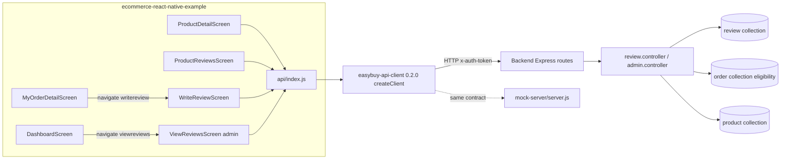
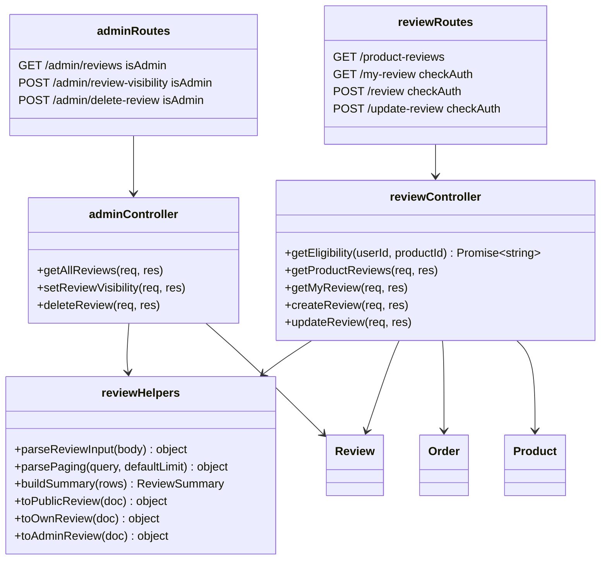
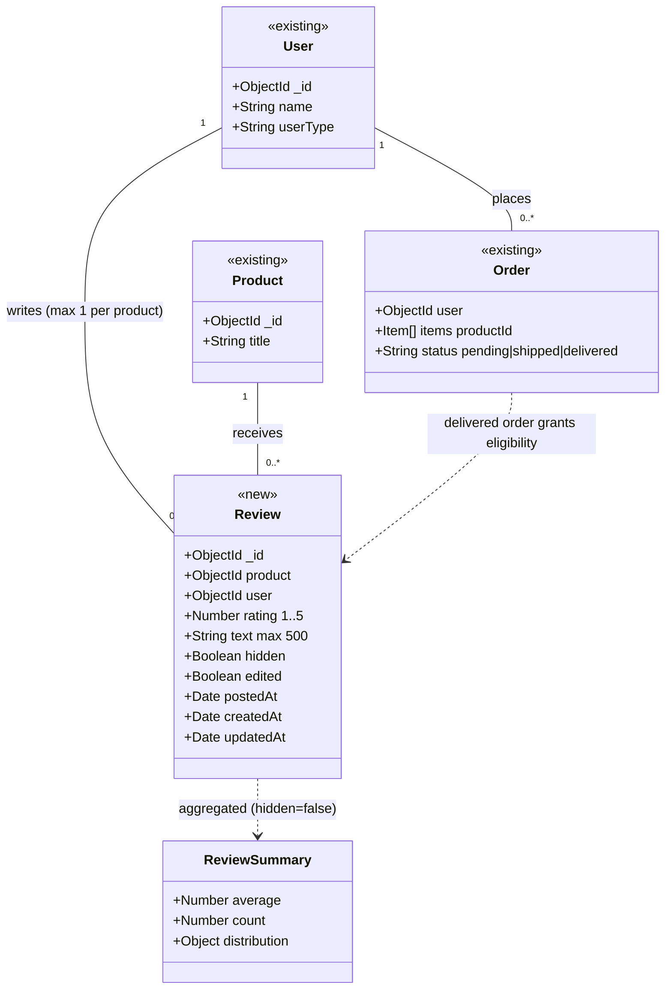

# Design: Verified Purchaser Ratings and Reviews (Agentic-SDLC-test/ecommerce-react-native-example#1)

> Linked Jira Epic: [Agentic-SDLC-test/ecommerce-react-native-example#1](https://github.com/Agentic-SDLC-test/ecommerce-react-native-example/issues/1)
> Business spec: v1 (submitted 2026-10-14T17:21:58Z by a717d871-8b88-4e82-88a2-bbce6ba3a01c)
> Architect: ALORA Design Agent draft for Architect review

## Architecture overview

### Problem essence and value

Let customers who have a Delivered order for a product rate it from 1 to 5 whole stars, with optional text up to 500 characters. Show shoppers an aggregate rating summary and recent written reviews on the product detail page. Let administrators hide, unhide and permanently remove reviews. The goal is trustworthy social proof that lifts buyer confidence and conversion.

The business spec leaves some requirements unstated. Exploring the code turned up these:

- `ProductDetailScreen` has no scrollable area. Its info panel is a fixed flex layout, so the reviews section needs a `ScrollView` around the info content.
- The existing confirm pattern (`Alert.alert` with buttons in `ViewProductScreen`) does nothing on react-native-web. BR-15 requires web parity, so the admin remove confirmation needs a confirm helper that also works on web.
- Deleting a product (`GET /delete-product`) or a user (`GET /delete-user`) must also delete that product's or user's reviews.
- The mock server calls `app.listen` at import time. It must become importable before it can be tested over HTTP.
- Admin hide and unhide must not change a review's position in the newest-first list or mark it Edited. Ordering therefore uses a dedicated `postedAt` field instead of Mongoose's `updatedAt`.

### Scope and boundaries

- **In scope**:
  - Review storage and the verified-purchaser and one-per-product rules, enforced in the backend.
  - Rating summary and paginated recent written reviews.
  - The customer's own review, with eligibility status, create and edit.
  - Admin list, hide, unhide and remove.
  - Cascade deletes when a product or user is deleted.
  - API client functions and a `validateReview` validator, published as client version `0.2.0`.
  - Mock server parity, with seed data and HTTP tests.
  - App UI: product detail section, full review list, write/edit screen, review entry from delivered order details, and the admin moderation screen with a dashboard entry.
  - OpenAPI documentation and tests in all three repositories.
- **Out of scope**:
  - Photo or video reviews, helpfulness votes and replies.
  - An approval queue (PO decision Q-2).
  - Sorting other than newest first, and filtering by star level.
  - Ratings on product lists, search results or category pages.
  - Notifications to customers when their review is hidden or removed.
  - Customers deleting their own reviews.
  - A store-wide or per-product switch to turn reviews off.
  - Automated content filtering.
  - Adding auth to the existing unauthenticated `GET /delete-user` (a known gap, see Security).
- **What is reused, extended or new**:
  - **Reused unchanged:**
    - The flat-URL Express router mounting in `src/routes/index.js`.
    - `checkAuth` and `isAdmin` in `src/middleware/auth.middleware.js`.
    - `asyncHandler`, `ApiError` and `errorHandler`.
    - The `{ success, message, data }` response envelope.
    - The client's `request()` and `queryValue()`.
    - `api/index.js` re-exports.
    - `CustomAlert`, `CustomButton`, `ProgressDialog` and `OptionList`.
    - The `session` module.
    - The date-fns dependency, already installed.
  - **Extended:**
    - `product.controller.deleteProduct` and `auth.controller.deleteUser` (cascades).
    - `admin.controller.js` and `admin.routes.js`.
    - `docs/openapi.js`.
    - Client `paths`, `createClient` and the domain validators.
    - `CustomInput`, which gains a `multiline` prop.
    - `ProductDetailScreen`, `MyOrderDetailScreen`, `DashboardScreen` and `Routes.js`.
    - `mock-server/server.js`.
  - **New:**
    - Backend: the `review` model, `review.controller.js`, `review.routes.js` and `review.helpers.js`.
    - App components: `StarRating`, `ReviewSummary` and `ReviewList`.
    - App screens: `ProductReviewsScreen`, `WriteReviewScreen` and `ViewReviewsScreen`.
    - App utilities: `utils/reviews.js` and `utils/confirm.js`.
  - **Replaced:** nothing.

### High-level architecture

The app keeps its single-API-client architecture. Screens call `api/index.js`, which re-exports functions from `@agentic-sdlc-test/easybuy-api-client`. The client sends JSON over HTTP with an `x-auth-token` header to whichever backend `EXPO_PUBLIC_API_URL` points at: the Express + MongoDB backend (`ecommerce-backend-node-example`) or the in-repo mock server. Both serve the same flat URL contract.

The backend uses the controller-per-feature pattern already in place: routes, then middleware (`checkAuth` / `isAdmin`), then an `asyncHandler`-wrapped controller, then a Mongoose model. Errors are thrown as `ApiError` and serialized by `errorHandler` into `{ success: false, message }` with a real HTTP status. The backend is the trust boundary:

- Eligibility is an `Order.exists` query for a `delivered` order containing the product. It runs on every create and edit.
- A unique `(user, product)` index guarantees one review per customer per product.
- The rating summary is computed on read with an aggregation over visible reviews.

Screen data stays in local `useState`, as every non-cart screen does today. Redux is not touched, because reviews are not shared cross-screen state.



### Key design decisions

- **Backend enforces every rule.** Eligibility (BR-1) is `Order.exists({ user, status: 'delivered', 'items.productId': productId })`, checked on create and on edit. One review per product (BR-3) is a unique index plus a pre-check. The app only shows the eligibility answer the server returns from `GET /my-review`. This follows the business spec's main risk mitigation.
- **Separate `review` collection** referencing `user` and `product`, instead of an embedded array. The `wishlist` and `cart` arrays live on the user document, but reviews are queried per product and across products (admin list), so embedding in either parent would force scans or unbounded arrays.
- **Summary computed on read** with a `$group` on `rating` over `{ product, hidden: false }`, backed by the index `{ product: 1, hidden: 1, postedAt: -1 }`. Denormalized counters on `product` would drift across hide, unhide, remove, edit and cascade paths. Review volume is low, and ratings are not shown on lists yet.
- **One read endpoint for the product page.** `GET /product-reviews` returns the summary, the requested page of written reviews and `writtenCount`. The product page needs one round trip, and the full list screen pages through the same endpoint.
- **Separate create and update endpoints.** `POST /review` returns 409 if a review already exists, and `POST /update-review?id=` edits one. This makes BR-3 explicit and ties the Edited marker to a deliberate edit. An upsert was rejected.
- **`postedAt` drives ordering and Edited.** It is set on create and on every customer edit, and `edited` becomes `true` on the first edit. Admin visibility changes touch only `hidden`, so moderation never reorders reviews or marks them Edited (BR-4, BR-10).
- **New mutations use POST** with query-string ids, matching the flat URL style (`/update-product?id=`). The legacy GET-for-mutation style (`GET /delete-product`) is deliberately not copied, because a GET mutation can be fired by prefetchers or caches. The client already supports any method.
- **The Verified Purchase indicator is rendered for every review.** Every stored review passed the eligibility check (BR-8), so no stored flag is added.
- **Display name only.** Public responses populate `user` with `select: 'name'` and fall back to `EasyBuy customer` when the name is empty. Email never leaves the backend in review payloads.
- **No feature flag.** The backend change is additive and does not affect app version 0.1.0. The app release itself is the gate, and `expo-updates` is already installed for fast rollback. The app has no feature-flag mechanism to reuse, and adding one for a single feature is speculative.

### Alternatives considered

- **Denormalized `ratingAverage` / `ratingCount` on `product`**: rejected. It needs recalculation on five mutation paths and risks drift. Revisit if ratings are added to product lists.
- **Upsert `POST /review`**: rejected. It hides duplicate submissions (BR-3) and makes the Edited state ambiguous.
- **Pending/approved status with an approval queue**: rejected by the PO (Q-2).
- **Embedding reviews in `user` like `wishlist`**: rejected. Product-side reads would need a scan over all users.
- **Client-side eligibility from `GET /orders`**: rejected as the only check because it is not a trust boundary. The server-computed eligibility is used instead.
- **A `@testing-library/react-native` dependency for component tests**: not added. Display logic is pulled into the pure `utils/reviews.js` so it can be unit-tested with the existing jest-expo setup. Rendering is verified by the manual E2E pass.

## Affected repositories

- **Agentic-SDLC-test/ecommerce-react-native-example** (branch `main`, type `primary`). App screens, components and utils for reviews, `api/index.js` re-exports, client dependency bump to `0.2.0`, mock server review routes with seed data and HTTP tests, and CI running the mock server tests.
- **Agentic-SDLC-test/ecommerce-backend-node-example** (branch `main`, type `dependency service`). `review` model, review and admin moderation endpoints, cascade deletes, OpenAPI docs and `node --test` tests.
- **Agentic-SDLC-test/easybuy-api-client** (branch `main`, type `dependency library`). New `paths` entries, seven client functions, the `ReviewEligibility` constants, `REVIEW_TEXT_MAX` and `validateReview`, tests, and a version bump to `0.2.0`. The existing CI publishes it on merge.

### Cross-repository impact (approved)

_Decided by hharis on 2026-10-14. Written by ALORA from the classified required changes; a new decision rewrites everything down to the closing line, so keep your own notes outside it._

| Repository | Role | Branch | Changes |
| --- | --- | --- | --- |
| `Agentic-SDLC-test/ecommerce-react-native-example` | Primary | `Feat/14f6f24f-verified-purchaser-ratings-and-revie` | C-6 Delete a product's reviews when the product is deleted, and a user's reviews when the user is deleted.; C-8 Add node:test unit tests for the review helpers and the controller with stubbed models, and wire the npm test script.; C-12 Pin the app to client 0.2.0 and re-export the seven review functions from the app API module.; C-13 Add review routes, seed order004 and the seed reviews, eligibility, cascades and an exported app to the mock server, with HTTP tests, a test script and README docs.; C-14 Run the mock server tests in the CI test steps.; C-15 Add pure review display helpers and a web-safe confirmation helper, with jest tests.; C-16 Add the StarRating, ReviewSummary and ReviewList components, and a multiline option on CustomInput.; C-17 Show the rating summary, recent reviews, see-all link and review call-to-action on the product detail page inside a scroll view, refreshed on focus.; C-18 Add the full newest-first review list screen and the write or edit review screen.; C-19 Offer Rate this product for each item of a delivered order.; C-20 Add the admin review moderation screen and its Dashboard entry.; C-21 Register the productreviews, writereview and viewreviews stack screens. |
| `Agentic-SDLC-test/easybuy-api-client` | Dependency | `Feat/14f6f24f-verified-purchaser-ratings-and-revie` | C-9 Add the review paths, the ReviewEligibility constants, REVIEW_TEXT_MAX and validateReview to the client domain module.; C-10 Add getProductReviews, getMyReview, createReview, updateReview, getAdminReviews, setReviewVisibility and deleteReview to createClient.; C-11 Test the new client functions and validateReview, and bump the package version to 0.2.0 for CI publishing. |
| `Agentic-SDLC-test/ecommerce-backend-node-example` | Dependency | `Feat/14f6f24f-verified-purchaser-ratings-and-revie` | C-1 Add the review Mongoose model with rating, text, hidden, edited and postedAt fields, plus a unique (user, product) index and the product and admin listing indexes.; C-2 Add review helpers for input validation, ObjectId and paging parsing, summary aggregation shaping, and the public, own and admin review mappers.; C-3 Add the review controller with delivered-order eligibility, the public product reviews read, the caller's own review with eligibility, and create and update with server-side rule enforcement.; C-4 Add admin moderation handlers to list, hide, unhide and remove reviews.; C-5 Register the review routes, mount them in the root router, and add the three admin review routes behind isAdmin.; C-7 Document the Reviews tag, the review schemas and the seven review paths in the OpenAPI spec. |

**Evidence**

- C-1 → `Agentic-SDLC-test/ecommerce-backend-node-example`: reassigned by the Architect
- C-2 → `Agentic-SDLC-test/ecommerce-backend-node-example`: reassigned by the Architect
- C-3 → `Agentic-SDLC-test/ecommerce-backend-node-example`: reassigned by the Architect
- C-4 → `Agentic-SDLC-test/ecommerce-backend-node-example`: `src/controllers/admin.controller.js` src/controllers/admin.controller.js exists in Agentic-SDLC-test/ecommerce-backend-node-example
- C-5 → `Agentic-SDLC-test/ecommerce-backend-node-example`: `src/routes/index.js` src/routes/index.js exists in Agentic-SDLC-test/ecommerce-backend-node-example
- C-6 → `Agentic-SDLC-test/ecommerce-react-native-example`: `api/index.js:22` deleteProduct is a node of the primary's code graph
- C-7 → `Agentic-SDLC-test/ecommerce-backend-node-example`: `src/docs/openapi.js` src/docs/openapi.js exists in Agentic-SDLC-test/ecommerce-backend-node-example
- C-8 → `Agentic-SDLC-test/ecommerce-react-native-example`: `package.json:12` test is a node of the primary's code graph
- C-9 → `Agentic-SDLC-test/easybuy-api-client`: `screens/admin/AddCategoryScreen.js:14` `import { validateCategory } from "@agentic-sdlc-test/easybuy-api-client/domain";`
- C-10 → `Agentic-SDLC-test/easybuy-api-client`: `api/index.js:1` `import { createClient } from "@agentic-sdlc-test/easybuy-api-client";`
- C-11 → `Agentic-SDLC-test/easybuy-api-client`: `api/index.js:1` `import { createClient } from "@agentic-sdlc-test/easybuy-api-client";`
- C-12 → `Agentic-SDLC-test/ecommerce-react-native-example`: `package.json` package.json exists in the primary
- C-13 → `Agentic-SDLC-test/ecommerce-react-native-example`: `mock-server/server.js:7` app is a node of the primary's code graph
- C-14 → `Agentic-SDLC-test/ecommerce-react-native-example`: `package.json:12` test is a node of the primary's code graph
- C-15 → `Agentic-SDLC-test/ecommerce-react-native-example`: reassigned by the Architect
- C-16 → `Agentic-SDLC-test/ecommerce-react-native-example`: `components/CustomInput/CustomInput.js:5` CustomInput is a node of the primary's code graph
- C-17 → `Agentic-SDLC-test/ecommerce-react-native-example`: `screens/user/ProductDetailScreen.js:20` ProductDetailScreen is a node of the primary's code graph
- C-18 → `Agentic-SDLC-test/ecommerce-react-native-example`: reassigned by the Architect
- C-19 → `Agentic-SDLC-test/ecommerce-react-native-example`: `screens/user/MyOrderDetailScreen.js:18` MyOrderDetailScreen is a node of the primary's code graph
- C-20 → `Agentic-SDLC-test/ecommerce-react-native-example`: `screens/admin/DashboardScreen.js:22` DashboardScreen is a node of the primary's code graph
- C-21 → `Agentic-SDLC-test/ecommerce-react-native-example`: `routes/Routes.js:32` Routes is a node of the primary's code graph

_End of the cross-repository impact._

## Component-level design

### Layered architecture and dependency map



App side: `Routes.js` registers the screens. Each screen imports `* as api from '../../api'`, which wraps `createClient` from the client package. The new components (`StarRating`, `ReviewSummary`, `ReviewList`) are presentational only. `utils/reviews.js` holds pure formatting logic, and `utils/confirm.js` wraps platform confirmation.

### Extension points

- `GET /product-reviews` returns `summary` as its own object, so a later release can reuse `buildSummary` for ratings on product lists (an open question in the business spec).
- A future `sort` query parameter can be added to `GET /product-reviews` and `GET /admin/reviews` without changing the response shape.
- Nothing else is left open.

### Conventions in use

- **Backend module style**:
  - CommonJS files starting with `'use strict';`.
  - One controller file per feature, with handlers wrapped in `asyncHandler` and preceded by a JSDoc line naming the route, for example `/** GET /my-review?productId=:id   (auth) */`.
  - Handlers are exported as an object at the bottom of the file.
  - Routers are created with `express.Router()` and mounted at `/` in `src/routes/index.js`.
- **Dependency injection**: direct `require` of models and utils, as in the existing controllers. There is no DI container.
- **Exception handling**:
  - New handlers throw `ApiError.badRequest`, `ApiError.forbidden` and `ApiError.notFound`, or `new ApiError(409, msg)`.
  - The global `errorHandler` produces `{ success: false, message }` with the matching HTTP status.
  - Legacy handlers that return HTTP 200 with `success: false` are not changed.
  - The `checkAuth` failure shape `{ msg, err }` is not changed, because the client relies on `err: 'jwt expired'`.
- **Input validation**: done manually at the start of each controller. Body and query values are validated with `mongoose.isValidObjectId`, `Number.isInteger` and type checks in `review.helpers.js`. Mongoose schema `min`, `max` and `maxlength` act as a second guard.
- **Logging**: `logger.info` / `logger.warn` from `src/utils/logger.js`, using `key=value` messages (see Observability). Review text is never logged.
- **Client conventions**:
  - TypeScript.
  - Every path goes in the `paths` const in `src/domain/index.ts`.
  - Functions are one-line arrows in `createClient` calling `request(method, path, body)`, with ids encoded by `queryValue`.
  - Validators return the first failing message as a `string`, or `null`.
  - Tests use `node:test` against `dist`.
- **App conventions**:
  - JavaScript function components with hooks, and screen data in `useState`.
  - Mutation feedback goes through `CustomAlert` (`message` / `type`), and loading through `ProgressDialog`.
  - Every rendered element of interest gets a kebab-case `testID` of the form `<screen>-<element>`.
  - Styles come from `StyleSheet.create` at the bottom of the file, using `colors` from `constants`, with Ionicons icons.
  - Each component lives in its own folder with `Component.js` and `index.js` (`export { default } from './Component';`).
  - Comments are short `//method to ...` lines above handlers.
- **Mock server**:
  - In-memory arrays, `authMiddleware` / `adminMiddleware`, and the same envelope and status codes as the backend.
  - Each endpoint is listed in the startup log.

### Backend: Review model (`src/models/review.model.js`)

- **Responsibility**: persist one customer's rating and optional text for one product, together with the moderation state.
- **Schema** (`mongoose.model('review', reviewSchema)`, `{ timestamps: true }`):
  - `product`: `ObjectId`, ref `'product'`, required.
  - `user`: `ObjectId`, ref `'user'`, required.
  - `rating`: `Number`, required, min 1, max 5. The validator is `Number.isInteger`.
  - `text`: `String`, default `''`, trim, maxlength 500.
  - `hidden`: `Boolean`, default `false`.
  - `edited`: `Boolean`, default `false`.
  - `postedAt`: `Date`, required, default `Date.now`.
- **Indexes**:
  - `reviewSchema.index({ user: 1, product: 1 }, { unique: true })`.
  - `reviewSchema.index({ product: 1, hidden: 1, postedAt: -1 })`.
  - `reviewSchema.index({ postedAt: -1 })`.

### Backend: review helpers (`src/utils/review.helpers.js`)

- `REVIEW_TEXT_MAX = 500`, and `ELIGIBILITY = { ELIGIBLE: 'eligible', NOT_DELIVERED: 'not_delivered', NOT_PURCHASED: 'not_purchased' }`.
- `parseReviewInput(body): { rating: number, text: string }`
  - `rating = Number(body?.rating)`. If `!Number.isInteger(rating) || rating < 1 || rating > 5`, throw `ApiError.badRequest('Please select a star rating from 1 to 5')`.
  - `text`: `undefined` or `null` becomes `''`. A non-string throws `ApiError.badRequest('Review text must be plain text')`. Otherwise the value is trimmed.
  - Text longer than 500 characters throws `ApiError.badRequest('Review text must be 500 characters or fewer')`.
- `parseObjectId(value, label): string`. Throws `ApiError.badRequest('Invalid ' + label)` unless `mongoose.isValidObjectId(value)`.
- `parsePaging(query, defaultLimit): { limit, skip }`
  - `limit = parseInt(query.limit, 10)`. It defaults to `defaultLimit` when NaN and is clamped to 1..50.
  - `skip = parseInt(query.skip, 10)`. It defaults to 0 when NaN or negative.
- `buildSummary(rows): { average: number|null, count: number, distribution: { 1..5: number } }`
  - `rows` is `[{ _id: rating, n }]`.
  - The distribution starts as `{1:0,2:0,3:0,4:0,5:0}`, with each row filled in.
  - `count` is the sum of `n`.
  - `average = count ? Math.round((sum(rating*n)/count) * 10) / 10 : null`.
- `toPublicReview(doc)` returns `{ _id, rating, text, edited, postedAt, reviewer: { name: doc.user?.name || 'EasyBuy customer' } }`.
- `toOwnReview(doc)` returns `toPublicReview(doc)` plus `{ product: String(productId), hidden }`.
- `toAdminReview(doc)` returns `toPublicReview(doc)` plus:
  - `hidden`
  - `product: { _id, title }`, with title `'Deleted product'` if the product is not populated
  - `reviewer: { _id, name }`

### Backend: review controller (`src/controllers/review.controller.js`)

- **Collaborators**: `Review`, `Order`, `Product`, `review.helpers`, `ApiError`, `asyncHandler` and `logger`.
- `getEligibility(userId, productId): Promise<'eligible'|'not_delivered'|'not_purchased'>`
  - If `Order.exists({ user: userId, status: 'delivered', 'items.productId': productId })`, return `eligible`.
  - Otherwise, if `Order.exists({ user: userId, 'items.productId': productId })`, return `not_delivered`.
  - Otherwise return `not_purchased`.
  - Exported for tests.
- `getProductReviews`, `GET /product-reviews?productId=&limit=&skip=` (public):
  1. `productId = parseObjectId(req.query.productId, 'productId')`. If `!(await Product.exists({ _id: productId }))`, throw `ApiError.notFound('Product not found')`.
  2. `{ limit, skip } = parsePaging(req.query, 5)`.
  3. Set `visible = { product: productId, hidden: false }` and `written = { ...visible, text: { $ne: '' } }`.
  4. Run `Promise.all` over three queries:
     - `Review.aggregate([{ $match: { product: new mongoose.Types.ObjectId(productId), hidden: false } }, { $group: { _id: '$rating', n: { $sum: 1 } } }])`. Aggregate does not cast, so the explicit ObjectId is required.
     - `Review.countDocuments(written)`.
     - `Review.find(written).sort({ postedAt: -1, _id: -1 }).skip(skip).limit(limit).populate('user', 'name')`.
  5. Respond with `res.json({ success: true, message: 'product reviews', data: { summary: buildSummary(rows), reviews: docs.map(toPublicReview), writtenCount } })`.
- `getMyReview`, `GET /my-review?productId=` (checkAuth):
  - Parse `productId`.
  - Compute `eligibility = await getEligibility(req.user._id, productId)`.
  - Load `review = await Review.findOne({ user: req.user._id, product: productId }).populate('user', 'name')`.
  - Respond with `{ success: true, message: 'my review', data: { eligibility, review: review ? toOwnReview(review) : null } }`.
- `createReview`, `POST /review` (checkAuth), body `{ productId, rating, text }`:
  1. Parse `productId`. If the product does not exist, return 404 `Product not found`.
  2. `{ rating, text } = parseReviewInput(req.body)`.
  3. Compute eligibility:
     - `not_delivered` throws `ApiError.forbidden('You can review this product once your order is delivered')`.
     - `not_purchased` throws `ApiError.forbidden('Only customers who have received this product can review it')`.
     - In both cases, first `logger.warn` the rejection.
  4. If `Review.exists({ user, product })`, throw `new ApiError(409, 'You have already reviewed this product. Edit your existing review instead')`.
  5. `Review.create({ user, product, rating, text, postedAt: new Date() })`. Catch `err.code === 11000` and rethrow the same 409; this covers concurrent double submits.
  6. Populate `user` with `name`, log `review.created`, and respond `res.status(201).json({ success: true, message: 'Review submitted', data: toOwnReview(doc) })`.
- `updateReview`, `POST /update-review?id=` (checkAuth), body `{ rating, text }`:
  1. Parse `id`.
  2. `review = await Review.findOne({ _id: id, user: req.user._id })`. If it is null, throw 404 `Review not found`. A non-owner gets the same 404, so the endpoint does not reveal whether another user's review exists.
  3. Run `parseReviewInput`, then re-check eligibility for `review.product`. Ineligible returns 403 with the same messages as create.
  4. Set `rating`, `text`, `edited = true` and `postedAt = new Date()`. `hidden` is left untouched (BR-13).
  5. `await review.save()`, populate the user, log `review.updated`, and respond 200 `{ success: true, message: 'Review updated', data: toOwnReview(review) }`.
- **Transaction / concurrency**: these are single-document writes, so no multi-document transaction is needed. The unique index is the race guard for BR-3. If two edits by the same user overlap, the last write wins, which is acceptable.

### Backend: admin moderation (`src/controllers/admin.controller.js` additions)

- `getAllReviews`, `GET /admin/reviews?visibility=all|visible|hidden&limit=&skip=` (isAdmin):
  - `visibility` defaults to `all`. Any other value throws 400 `Invalid visibility`.
  - The filter is `{}`, `{ hidden: false }` or `{ hidden: true }`.
  - `parsePaging(query, 20)`.
  - Run `Promise.all`:
    - `Review.find(filter).sort({ postedAt: -1, _id: -1 }).skip(skip).limit(limit).populate('user', 'name').populate('product', 'title')`.
    - `Review.countDocuments(filter)`.
  - Respond with `data: { reviews: docs.map(toAdminReview), total }`.
- `setReviewVisibility`, `POST /admin/review-visibility?id=&hidden=true|false` (isAdmin):
  - Parse `id`. `hidden` must be the string `'true'` or `'false'`, otherwise 400 `Invalid hidden value`.
  - `Review.findByIdAndUpdate(id, { hidden }, { new: true })` with populate. A missing review returns 404 `Review not found`.
  - Log `review.hidden` or `review.unhidden`, then respond 200 `{ success: true, message: hidden ? 'Review hidden' : 'Review visible', data: toAdminReview(doc) }`.
- `deleteReview`, `POST /admin/delete-review?id=` (isAdmin):
  - Parse `id` and run `Review.findByIdAndDelete(id)`. A missing review returns 404.
  - Log `review.deleted` and respond 200 `{ success: true, message: 'Review removed' }`.

### Backend: routes and cascades

- `src/routes/review.routes.js`:
  - `router.get('/product-reviews', getProductReviews)`
  - `router.get('/my-review', checkAuth, getMyReview)`
  - `router.post('/review', checkAuth, createReview)`
  - `router.post('/update-review', checkAuth, updateReview)`
- `src/routes/index.js`: `const reviewRoutes = require('./review.routes');` and `router.use('/', reviewRoutes);`, placed after `wishlistRoutes`.
- `src/routes/admin.routes.js`: add `router.get('/admin/reviews', isAdmin, getAllReviews)`, `router.post('/admin/review-visibility', isAdmin, setReviewVisibility)` and `router.post('/admin/delete-review', isAdmin, deleteReview)`.
- `product.controller.deleteProduct`: after a successful `findByIdAndDelete`, run `await Review.deleteMany({ product: id })`.
- `auth.controller.deleteUser`: after a successful delete, run `await Review.deleteMany({ user: id })`.
- `src/docs/openapi.js`:
  - Add the tag `{ name: 'Reviews', description: 'Verified purchaser ratings and reviews' }`.
  - Add schemas `ReviewSummary`, `PublicReview`, `OwnReview` and `AdminReview`.
  - Add all seven paths. The admin paths go under the `Admin` tag with `security: [{ authToken: [] }]`.

### API client: domain (`src/domain/index.ts`)

- Add to `paths`:
  - `productReviews: '/product-reviews'`
  - `myReview: '/my-review'`
  - `review: '/review'`
  - `updateReview: '/update-review'`
  - `adminReviews: '/admin/reviews'`
  - `reviewVisibility: '/admin/review-visibility'`
  - `deleteReview: '/admin/delete-review'`
- `export const ReviewEligibility = { ELIGIBLE: 'eligible', NOT_DELIVERED: 'not_delivered', NOT_PURCHASED: 'not_purchased' } as const;`
- `export const REVIEW_TEXT_MAX = 500;`
- `export function validateReview(input: { rating: number; text?: string }): string | null`:
  - If `!Number.isInteger(input.rating) || rating < 1 || rating > 5`, return `'Please select a star rating from 1 to 5'`.
  - If `(input.text ?? '').trim().length > REVIEW_TEXT_MAX`, return `'Review text must be 500 characters or fewer'`.
  - Otherwise return `null`.

### API client: functions (`src/index.ts`, inside the `createClient` return object)

- `getProductReviews: (productId: unknown, options: { limit?: number; skip?: number } = {}) => request('GET', `${paths.productReviews}?productId=${queryValue(productId)}&limit=${queryValue(options.limit ?? 5)}&skip=${queryValue(options.skip ?? 0)}`)`
- `getMyReview: (productId: unknown) => request('GET', `${paths.myReview}?productId=${queryValue(productId)}`)`
- `createReview: (payload: { productId: unknown; rating: number; text?: string }) => request('POST', paths.review, payload)`
- `updateReview: (id: unknown, payload: { rating: number; text?: string }) => request('POST', `${paths.updateReview}?id=${queryValue(id)}`, payload)`
- `getAdminReviews: (options: { visibility?: 'all' | 'visible' | 'hidden'; limit?: number; skip?: number } = {}) => request('GET', `${paths.adminReviews}?visibility=${queryValue(options.visibility ?? 'all')}&limit=${queryValue(options.limit ?? 20)}&skip=${queryValue(options.skip ?? 0)}`)`
- `setReviewVisibility: (id: unknown, hidden: boolean) => request('POST', `${paths.reviewVisibility}?id=${queryValue(id)}&hidden=${queryValue(hidden)}`)`
- `deleteReview: (id: unknown) => request('POST', `${paths.deleteReview}?id=${queryValue(id)}`)`
- `package.json` `version`: `0.1.0` becomes `0.2.0`.

### App: API wiring (`api/index.js`, `package.json`)

- Add `export const getProductReviews = client.getProductReviews;` and the same for `getMyReview`, `createReview`, `updateReview`, `getAdminReviews`, `setReviewVisibility` and `deleteReview`.
- In `package.json`, change `@agentic-sdlc-test/easybuy-api-client` from `0.1.0` to `0.2.0`, keeping the exact pin. Regenerate `package-lock.json` with `npm install`.

### App: `utils/reviews.js`

- `formatAverage(average)`: returns `''` when `average == null`, otherwise `Number(average).toFixed(1)`.
- `distributionRows(summary)`: returns `[5,4,3,2,1].map((stars) => ({ stars, count: summary?.distribution?.[stars] || 0, percent: summary?.count ? Math.round((count / summary.count) * 100) : 0 }))`.
- `eligibilityMessage(eligibility)` maps:
  - `ReviewEligibility.NOT_DELIVERED` to `'You can review this product once your order is delivered.'`
  - `NOT_PURCHASED` to `'Only customers who have received this product can review it.'`
  - anything else to `''`
- `formatReviewDate(iso)`: `format(new Date(iso), 'MMM d, yyyy')`, using `format` from `date-fns`. Returns `''` for a falsy input.
- `reviewCountLabel(count)`: returns `count + (count === 1 ? ' review' : ' reviews')`.

### App: `utils/confirm.js`

- `confirmAction({ title, message, confirmText = 'Remove' }): Promise<boolean>`
  - When `Platform.OS === 'web'`, return `Promise.resolve(window.confirm(title + ': ' + message))`.
  - Otherwise return a `Promise` wrapping `Alert.alert(title, message, [{ text: 'Cancel', style: 'cancel', onPress: () => resolve(false) }, { text: confirmText, style: 'destructive', onPress: () => resolve(true) }], { cancelable: true, onDismiss: () => resolve(false) })`.

### App: `components/StarRating/StarRating.js` (+ `index.js`)

- Props: `{ rating = 0, size = 16, onChange, testID }`.
- Read-only mode (no `onChange`):
  - A row of 5 Ionicons. Star `i` is `star` when `rating >= i`, `star-half` when `rating >= i - 0.5`, otherwise `star-outline`.
  - Color `colors.warning`.
  - The container has `accessible`, `accessibilityRole='image'` and `accessibilityLabel={'Rated ' + rating + ' out of 5'}`.
- Interactive mode:
  - Each star is a `TouchableOpacity` with `testID={testID + '-' + i}`, `accessibilityRole='button'`, `accessibilityLabel={i + (i === 1 ? ' star' : ' stars')}`, `accessibilityState={{ selected: rating === i }}` and `hitSlop` 6.
  - `onPress={() => onChange(i)}`.

### App: `components/ReviewSummary/ReviewSummary.js` (+ `index.js`)

- Props: `{ summary, testID }`.
- If `!summary || summary.count === 0`, render `No reviews yet` with `testID={testID + '-empty'}` (BR-9).
- Otherwise the left column shows:
  - the average as large text (`formatAverage`, `testID-average`)
  - a read-only `StarRating` of the average
  - the `reviewCountLabel(count)` text (`testID-count`)
- The right column shows five `distributionRows` lines (`testID-row-<stars>`). Each line has a `<stars>★` label, a track `View` (`colors.light`) with a fill `View` (`colors.warning`, `width: percent + '%'`), and the count.

### App: `components/ReviewList/ReviewList.js` (+ `index.js`)

A single-row component, following the naming of `UserList` and `BasicProductList`.

- Props: `{ review, showProduct = false, showStatus = false, actions, testID }`.
- The row renders:
  - The reviewer name (`testID-name`).
  - A `Verified Purchase` badge, an Ionicons `shield-checkmark` in `colors.primary` with `colors.dark` text (`testID-verified`).
  - A read-only `StarRating` at size 14.
  - The date line `formatReviewDate(postedAt)`, with ` · Edited` appended when `edited` (`testID-date`).
  - The text, when it is non-empty (`testID-text`).
  - When `showProduct`, the product title (`testID-product`).
  - When `showStatus`, a `Visible` badge, or a `Hidden` badge in `colors.danger` (`testID-status`).
  - The `actions` node, when one is provided.

### App: `CustomInput` extension

- Add optional props `multiline` and `numberOfLines`, passed through to `TextInput`.
- When `multiline` is set, merge the style `{ minHeight: 120, textAlignVertical: 'top', paddingTop: 10 }`.
- Existing callers are unaffected.

### App: screens

- **`screens/user/ProductDetailScreen.js`**:
  - New state: `reviewData` (`{ summary, reviews, writtenCount }` or `null`), `myReview` (`null`) and `eligibility` (`null`).
  - `fetchReviews()` calls `api.getProductReviews(product._id, { limit: 5 })`. On `result.success`, it calls `setReviewData(result.data)`. On failure it sets `error` / `alertType` as `fetchWishlist` does.
  - `fetchMyReview()` calls `api.getMyReview(product._id)` and on success sets `myReview` and `eligibility`.
  - Both are called from `useFocusEffect(useCallback(() => { fetchReviews(); fetchMyReview(); }, [product?._id]))`, imported from `@react-navigation/native`, so the data refreshes after returning from `writereview`.
  - Wrap the content of `productInfoTopContainer` (title, wishlist, price, description) and the new reviews section in `<ScrollView testID='product-detail-info-scroll' style={{ width: '100%' }} showsVerticalScrollIndicator={false}>`. The quantity and cart bottom container stays fixed.
  - The reviews section (`product-detail-reviews-section`) contains:
    - A heading `Ratings & Reviews`.
    - `<ReviewSummary summary={reviewData?.summary} testID='product-detail-review-summary' />`.
    - Up to 5 `ReviewList` rows (`product-detail-review-<index>`).
    - When `summary.count > 0 && writtenCount === 0`, the text `No written reviews yet.` (`product-detail-no-written-reviews`).
    - When `writtenCount > 0`, a link `See all reviews (<writtenCount>)` (`product-detail-see-all-reviews-btn`) that navigates to `productreviews` with `{ product }`.
    - The review call-to-action block (see UI/UX), which navigates to `writereview` with `{ productId: product._id, productTitle: product.title }`.
- **`screens/user/ProductReviewsScreen.js`** (new, route `productreviews`):
  - Params: `{ product }`.
  - State: `summary`, `reviews`, `writtenCount`, `isloading`, `refeshing` and `error`.
  - `fetchPage(skip)` calls `api.getProductReviews(product._id, { limit: 20, skip })`. It replaces `reviews` when `skip === 0` and appends otherwise.
  - Layout: a top bar with the back button (`product-reviews-back-btn`) and the heading `Reviews` with the product title.
  - A `FlatList` (`product-reviews-list`) with `ListHeaderComponent` set to `ReviewSummary`, and items rendered with `ReviewList`.
  - `onEndReached` loads the next page when `reviews.length < writtenCount && !isloading`. Pull-to-refresh uses `RefreshControl`.
  - Empty states: the summary's `No reviews yet`, or `No written reviews yet.` when only rating-only reviews exist.
- **`screens/user/WriteReviewScreen.js`** (new, route `writereview`):
  - Params: `{ productId, productTitle }`.
  - State: `rating` (0), `text` (''), `existing` (null), `eligibility` (null), `isloading` and `error` / `alertType`.
  - On mount, `api.getMyReview(productId)`. If a review exists, `setExisting(review)`, `setRating(review.rating)` and `setText(review.text)`.
  - The heading is `Edit your review` when `existing` is set, otherwise `Write a review`.
  - When `existing?.hidden`, show a banner (`write-review-hidden-banner`): `This review has been hidden by the store and is not visible to other shoppers.`
  - When eligibility is not `eligible`, show `eligibilityMessage(eligibility)` (`write-review-ineligible-message`) and disable the stars, input and submit.
  - Inputs: an interactive `StarRating` at size 36 (`write-review-stars`) and `CustomInput` with `multiline`, `numberOfLines={5}`, `maxLength={REVIEW_TEXT_MAX}` and placeholder `Share what you liked or disliked (optional)` (`write-review-text`).
  - A counter `<text.length>/500` (`write-review-char-count`).
  - `CustomButton` (`write-review-submit-btn`) reads `Save changes` or `Submit review`. It is disabled while `isloading`.
  - Submit `handleSubmit()`:
    1. `const message = validateReview({ rating, text })`. If it returns a message, show it via `CustomAlert` and stop.
    2. Call `api.updateReview(existing._id, { rating, text })` or `api.createReview({ productId, rating, text })`.
    3. On `result.success`, `navigation.goBack()`. The product page refetches on focus.
    4. Otherwise show `result.message`. If the create failed because a review already exists (the message starts with `You have already reviewed`), re-run `getMyReview` so the screen switches to edit mode.
- **`screens/user/MyOrderDetailScreen.js`**:
  - When `orderDetail?.status === OrderStatus.DELIVERED`, render under each `BasicProductList` a `TouchableOpacity` (`my-order-detail-review-btn-<index>`) labelled `Rate this product`.
  - It navigates to `writereview` with `{ productId: product?.productId?._id, productTitle: product?.productId?.title }` (BR-14).
- **`screens/admin/ViewReviewsScreen.js`** (new, route `viewreviews`), following the `ViewUsersScreen` structure:
  - Layout: a top bar with the back button (`view-reviews-back-btn`), the heading `Reviews` and the subtitle `Hide, unhide or remove customer reviews`.
  - Filter chips `All` / `Visible` / `Hidden` (`view-reviews-filter-all|visible|hidden`). Changing the filter resets to `skip=0`.
  - A `FlatList` (`view-reviews-list`) of `ReviewList` rows with `showProduct` and `showStatus`. Each row's `actions` are:
    - a `Hide` / `Unhide` button (`view-reviews-toggle-btn-<index>`)
    - a `Remove` button (`view-reviews-remove-btn-<index>`)
  - `handleToggle(review)` calls `api.setReviewVisibility(review._id, !review.hidden)`. On success it replaces the item with `result.data`, or drops it when the active filter excludes the new state, then shows a `CustomAlert` success.
  - `handleRemove(review)` runs `if (await confirmAction({ title: 'Remove review', message: 'This permanently deletes the review. It cannot be restored.' }))`, then calls `api.deleteReview(review._id)`. On success it drops the item and decrements `total`.
  - Paging: `limit: 20`, with `onEndReached` while `reviews.length < total`. Pull-to-refresh is supported.
  - Empty state: `No reviews to show.` (`view-reviews-empty`).
- **`screens/admin/DashboardScreen.js`**: after the Users `OptionList`, add `<OptionList testID='dashboard-reviews-option' text={'Reviews'} Icon={Ionicons} iconName={'star'} onPress={() => navigation.navigate('viewreviews', { authUser: user })} type='morden' />`.
- **`routes/Routes.js`**: import the three new screens and register `<Stack.Screen name='productreviews' ... />`, `name='writereview'` and `name='viewreviews'`.

### Mock server (`mock-server/server.js`)

- **Data**:
  - Add `let reviews = []` with seed entries, using the same fields as the backend plus string ids.
  - Add order `order004` (`ORD-2024-004`): user `user002` (Jane Smith), status `delivered`, items `prod007` (12.99 x1), `prod001` (19.99 x1) and `prod003` (89.99 x1), amount 122.97, `shippedOn` `2024-01-20`, `deliveredOn` `2024-01-22`.
- **Seed reviews**:
  - `rev001`: user002 on prod007, rating 4, text `Fluffy and fragrant, cooks evenly. Would buy again.`, visible, postedAt 2024-01-23T10:00:00Z.
  - `rev002`: user002 on prod001, rating 3, no text (rating only), visible, postedAt 2024-01-23T11:00:00Z.
  - `rev003`: user002 on prod003, rating 2, text `Sound is fine but the ear cushions wore out within a week.`, `hidden: true`, postedAt 2024-01-24T09:00:00Z.
- **Resulting demo states for John (`user@easybuy.com`)**:
  - Eligible for prod007, through delivered order003, with no review yet.
  - `not_delivered` for prod001 and prod003, through pending order001.
  - `not_purchased` for prod002.
- **Helpers**:
  - `reviewEligibility(userId, productId)`, using `orders` with `o.user._id` and `i.productId._id`.
  - `parseReviewInput(body)`, which returns `{ error }` or `{ rating, text }`.
  - `buildSummary(list)`, `toPublicReview(r)`, `toOwnReview(r)` and `toAdminReview(r)`. Reviewer names come from `users`, product titles from `products`.
  - Paging uses the same clamps as the backend.
- **Routes**: the seven endpoints with identical paths, status codes, messages and envelopes. They use the mock's `authMiddleware` and `adminMiddleware`.
- **Cascades**:
  - `GET /delete-product` also runs `reviews = reviews.filter((r) => r.product !== id)`.
  - `GET /delete-user` also removes that user's reviews.
- **Startup**: wrap `app.listen(...)` in `if (require.main === module) { ... }` and add `module.exports = app;`. Add the new endpoints to the startup log.
- `mock-server/package.json`: add `"test": "node --test"`.
- `mock-server/README.md`: document the review endpoints and seed states. Change the line saying wishlist routes are not implemented only if it is touched.

## UI/UX design notes

- **Product detail page** (all platforms):
  - The title, price and description now scroll together with a new `Ratings & Reviews` section. Add to Cart stays fixed at the bottom.
  - The summary shows the average to one decimal place, stars, `N reviews`, and a 5-to-1 distribution with bars and counts.
  - Up to 5 newest written reviews follow. Each shows the name, stars, date, Edited marker, text and the Verified Purchase badge.
  - When written reviews exist, a `See all reviews (N)` link follows.
- **Review call-to-action block**:
  - Eligible with no review: `Write a review` button.
  - Has a review and is eligible: `Your rating:` with stars and an `Edit your review` button. If hidden, add the muted note `Hidden by the store`.
  - `not_delivered`: muted text `You can review this product once your order is delivered.`
  - `not_purchased`: muted text `Only customers who have received this product can review it.`
  - Admin accounts get `not_purchased` and see the same text.
  - While loading, the block renders nothing.
- **Empty states**:
  - No visible reviews: `No reviews yet` in place of the summary. The average is never shown as 0.
  - Only rating-only reviews: the summary plus `No written reviews yet.`
- **Write / edit screen**:
  - Large tappable stars with a minimum 44 pt touch target via `hitSlop`.
  - An optional multiline text field with a live `n/500` counter. `maxLength` prevents typing past 500 characters.
  - The validation message for a missing rating is `Please select a star rating from 1 to 5`.
  - The hidden banner follows BR-13.
  - On success the screen navigates back, and the product page refreshes on focus.
- **Order detail**: delivered orders show `Rate this product` under each item. The link opens the same write or edit screen; it is in edit mode when a review already exists.
- **Admin moderation**:
  - Opened from the `Reviews` entry in the Dashboard Actions list.
  - Newest first, with All / Visible / Hidden filter chips.
  - Each row shows the product title, reviewer, rating, text, date, the Visible or Hidden status badge, and the Verified Purchase badge (AC-4).
  - Hide and Unhide take effect immediately. Remove asks for confirmation through `confirmAction`, which uses `window.confirm` on web.
- **Accessibility**:
  - Star rows have text labels such as `Rated 4.3 out of 5`.
  - Interactive stars expose the button role and selected state.
  - Badges are text, not color alone.
- **Consistency**: colors come only from `constants/Colors.js`, with `warning` for stars, `primary` for the verified icon and `danger` for Hidden. Ionicons only. Every new element carries a `testID`.

## API schemas and contracts

All endpoints follow the existing flat URL contract.

- **Auth**: authenticated calls send the JWT in the `x-auth-token` header. A missing token, or a failing `checkAuth` / `isAdmin`, keeps the existing shapes:
  - 400 `{ msg: 'No Auth Token Found', err }`
  - 401 `{ msg, err }`, where `err: 'jwt expired'` triggers client logout
  - 403 `{ msg: 'Insufficient User Permissions', err }`
- **Errors from new handlers**: `{ success: false, message: string }` with the HTTP status listed below.
- **Success**: `{ success: true, message: string, data }`.

```ts
type ReviewSummary = {
  average: number | null;      // rounded to 1 decimal place; null when count is 0
  count: number;               // visible reviews, including rating-only
  distribution: { 1: number; 2: number; 3: number; 4: number; 5: number };
};
type PublicReview = {
  _id: string;
  rating: 1 | 2 | 3 | 4 | 5;
  text: string;                // '' for rating-only (never listed publicly)
  edited: boolean;
  postedAt: string;            // ISO-8601; set on create and on every customer edit
  reviewer: { name: string };  // display name only, fallback 'EasyBuy customer'
};
type OwnReview = PublicReview & { product: string; hidden: boolean };
type AdminReview = PublicReview & {
  hidden: boolean;
  product: { _id: string; title: string };
  reviewer: { _id: string; name: string };
};
type Eligibility = 'eligible' | 'not_delivered' | 'not_purchased';
```

```http
GET /product-reviews?productId=<id>&limit=5&skip=0
Auth: none (public, like GET /products)
Query: productId required ObjectId; limit int 1..50 default 5; skip int >= 0 default 0
200 -> { success: true, message: 'product reviews', data: { summary: ReviewSummary, reviews: PublicReview[], writtenCount: number } }
       reviews = visible reviews with non-empty text, sorted postedAt desc then _id desc
400 -> { success: false, message: 'Invalid productId' }
404 -> { success: false, message: 'Product not found' }
```

```http
GET /my-review?productId=<id>
Auth: x-auth-token (checkAuth)
200 -> { success: true, message: 'my review', data: { eligibility: Eligibility, review: OwnReview | null } }
       review includes hidden reviews (author view, BR-13)
400 -> { success: false, message: 'Invalid productId' }
```

```http
POST /review
Auth: x-auth-token (checkAuth)
Body: { productId: string, rating: integer 1..5, text?: string (<= 500 chars after trim) }
201 -> { success: true, message: 'Review submitted', data: OwnReview }
400 -> { success: false, message: 'Invalid productId' | 'Please select a star rating from 1 to 5' | 'Review text must be plain text' | 'Review text must be 500 characters or fewer' }
403 -> { success: false, message: 'You can review this product once your order is delivered' | 'Only customers who have received this product can review it' }
404 -> { success: false, message: 'Product not found' }
409 -> { success: false, message: 'You have already reviewed this product. Edit your existing review instead' }
```

```http
POST /update-review?id=<reviewId>
Auth: x-auth-token (checkAuth); only the author's own review matches
Body: { rating: integer 1..5, text?: string (<= 500) }
200 -> { success: true, message: 'Review updated', data: OwnReview }   // edited=true, postedAt=now, hidden unchanged
400 -> validation messages as POST /review, or 'Invalid id'
403 -> eligibility messages as POST /review
404 -> { success: false, message: 'Review not found' }   // also for another user's review
```

```http
GET /admin/reviews?visibility=all|visible|hidden&limit=20&skip=0
Auth: x-auth-token (isAdmin)
200 -> { success: true, message: 'all reviews', data: { reviews: AdminReview[], total: number } }   // postedAt desc
400 -> { success: false, message: 'Invalid visibility' }
```

```http
POST /admin/review-visibility?id=<reviewId>&hidden=true|false
Auth: x-auth-token (isAdmin)
200 -> { success: true, message: 'Review hidden' | 'Review visible', data: AdminReview }
400 -> { success: false, message: 'Invalid id' | 'Invalid hidden value' }
404 -> { success: false, message: 'Review not found' }
```

```http
POST /admin/delete-review?id=<reviewId>
Auth: x-auth-token (isAdmin)
200 -> { success: true, message: 'Review removed' }
400 -> { success: false, message: 'Invalid id' }
404 -> { success: false, message: 'Review not found' }
```

**Changed existing contracts**: none in shape. `GET /delete-product?id=` and `GET /delete-user?id=` now also delete the related reviews, and their responses are unchanged.

**Client contract**: the seven functions listed in Component-level design return the parsed JSON body and never throw on non-2xx, matching existing client behavior. The app branches on `result.success`.

**Mock server parity**: the same paths, statuses, messages and shapes. ObjectId validation is replaced by an existence check: unknown ids return 404, and an empty id returns 400.

## Integration patterns

- **Inbound**: synchronous HTTP JSON only. The app goes through `api/index.js`, then the client package, then the backend or the mock server. There are no webhooks, message buses or batch jobs.
- **Outbound**: none. No events are emitted and no third-party services are called.
- **Package delivery**:
  - Client changes merge to `easybuy-api-client` `main`.
  - Its CI job `Publish new version` publishes `0.2.0` to GitHub Packages, because that version is not yet in the registry.
  - The app then pins `0.2.0`. The app CI authenticates to the registry with `GH_TOKEN`, as it already does.
- **Cross-collection reads**: eligibility reads `order` and product existence reads `product`, both through the existing models. Reviews reference `user` and `product` with Mongoose refs, populated with field selection.
- **Idempotency / retry**:
  - `update-review` and `review-visibility` are idempotent.
  - Create is guarded by the unique `(user, product)` index, so a duplicate returns 409 and never creates a second review.
  - A second `delete-review` returns 404, which the UI treats as already removed.
  - The client does not retry automatically. The UI disables submit and action buttons while a request is in flight.

## Data model changes

### Entity relationships



### Schema changes

- **New collection**: `reviews`, from Mongoose model `review`, with the fields listed in Component-level design.
  - Unique index `{ user: 1, product: 1 }` enforces BR-3.
  - Index `{ product: 1, hidden: 1, postedAt: -1 }` serves the product summary and the recent list.
  - Index `{ postedAt: -1 }` serves the admin list.
  - Mongoose `autoIndex` builds the indexes at startup, which is the existing behavior; no explicit index creation exists in the repo today.
- **Existing collections**: no column changes to `user`, `product` or `order`.
- **Mock server**: a new in-memory `reviews` array, plus seed order `order004`.

### Backward-compatibility plan

- The change is purely additive. Client `0.1.0` and older app builds never call the new endpoints and are unaffected.
- No data migration or backfill is needed, because the collection starts empty.
- The cascade deletes only touch the new collection.
- Removal path: if the feature is withdrawn, drop the `reviews` collection after reverting the code (see Rollout and rollback considerations).

## Security and compliance considerations

- **Auth**:
  - `GET /product-reviews` is public, consistent with `GET /products`.
  - `GET /my-review`, `POST /review` and `POST /update-review` require `checkAuth`. Ownership is enforced in the query (`{ _id, user: req.user._id }`), and a non-owner gets 404.
  - The three `/admin/*` review endpoints require `isAdmin`.
  - No customer path can change `hidden` or delete a review (AC-5). `parseReviewInput` reads only `rating` and `text`, so a body containing `hidden`, `edited`, `user` or `postedAt` is ignored. This prevents mass assignment.
- **Trust boundary**:
  - Eligibility and uniqueness are enforced server-side on create and on edit, whether or not the call comes from the app (AC-1).
  - The mock server mirrors this for parity, but it is development-only.
- **Input validation and injection**:
  - Ids are checked with `mongoose.isValidObjectId` before they reach any query.
  - `rating` is an integer between 1 and 5.
  - `text` must be a string and is trimmed, with a 500-character limit. Objects are rejected, which blocks `$`-operator injection through `text`.
  - Text is stored and rendered as plain text in RN `<Text>`, so it is never interpreted as HTML or markdown and no links are created.
- **PII**:
  - Public and admin review payloads expose only the reviewer's display `name` and, for admins, the user `_id`. Email, order ids and addresses are never included.
  - Logs carry ids only and never review text or names.
- **Data lifecycle**: user deletion cascades to that user's reviews, which supports account-erasure expectations (GDPR-style). Product deletion cascades to the product's reviews.
- **Abuse limits**: the existing global `express-rate-limit` (1000 requests per 15 minutes per IP) applies. The one-review-per-product rule caps volume per account.
- **Secrets**: none new. `JWT_SECRET` and the client registry `GH_TOKEN` are unchanged.
- **Audit**: admin moderation actions emit info logs with `adminId`, `reviewId` and `action`. No audit store exists in the backend today; logs are the audit trail.
- **Known pre-existing gap, not changed here**: `GET /delete-user?id=` has no auth middleware in the backend. It is now also a review-deletion path. It is flagged for a separate fix and is not widened by this design.

## Observability requirements

- **Structured logs** (backend, `src/utils/logger.js`, key=value):
  - `logger.info('review.created reviewId=<id> productId=<id> userId=<id> rating=<n> hasText=<bool>')`
  - `logger.info('review.updated reviewId=<id> productId=<id> userId=<id> rating=<n> hasText=<bool>')`
  - `logger.warn('review.rejected reason=<not_delivered|not_purchased|duplicate> productId=<id> userId=<id>')`
  - `logger.info('review.hidden reviewId=<id> adminId=<id>')` and `review.unhidden` in the same format.
  - `logger.info('review.deleted reviewId=<id> adminId=<id>')`
  - `logger.info('review.cascade scope=<product|user> id=<id> deleted=<n>')`, logged only when `n > 0`.
  - Unhandled errors are already logged by `errorHandler` at 5xx.
- **HTTP access logs**: the existing `morgan` middleware covers latency and status for the new routes.
- **Metrics / traces**: not applicable. The backend has no metrics or tracing stack, and this feature does not introduce one. Review volume and rejection rate are derived from the log lines above.
- **Dashboards / alerts**:
  - Watch 5xx on `/product-reviews` and `/review` through access logs during rollout.
  - Watch the share of `review.rejected reason=not_delivered`. A high rate signals stale order statuses, a business-spec risk.
- **App**: keep the existing `console.log('error', error)` in catch blocks. No new telemetry.

## Implementation plan

> Execute in order. Each task names files, symbols and its verification. Repositories:
> - BE = Agentic-SDLC-test/ecommerce-backend-node-example
> - CL = Agentic-SDLC-test/easybuy-api-client
> - APP = Agentic-SDLC-test/ecommerce-react-native-example

### Phase 1: Backend schema and helpers (BE)

1. Create `src/models/review.model.js` with the schema and three indexes from Component-level design. Verify that `node -e "require('./src/models/review.model')"` loads.
2. Create `src/utils/review.helpers.js` with:
   - `REVIEW_TEXT_MAX` and `ELIGIBILITY`
   - `parseReviewInput`, `parseObjectId` and `parsePaging`
   - `buildSummary`
   - `toPublicReview`, `toOwnReview` and `toAdminReview`
   Verify with `test/review.helpers.test.js` (node:test).

### Phase 2: Backend endpoints (BE)

1. Create `src/controllers/review.controller.js` with `getEligibility`, `getProductReviews`, `getMyReview`, `createReview` and `updateReview`, exactly as specified, including the 11000-to-409 mapping and the log lines.
2. Extend `src/controllers/admin.controller.js` with `getAllReviews`, `setReviewVisibility` and `deleteReview`, and add them to `module.exports`.
3. Create `src/routes/review.routes.js`. Mount it in `src/routes/index.js` and add the three admin routes in `src/routes/admin.routes.js`.
4. Add the cascade `Review.deleteMany` calls to `product.controller.deleteProduct` and `auth.controller.deleteUser`.
5. Update `src/docs/openapi.js` with the `Reviews` tag, the four schemas and the seven paths.
6. Set `package.json` `"test": "node --test"`. Add `test/review.controller.test.js`, stubbing `Order.exists`, `Product.exists`, `Review.exists`, `Review.create` and `Review.findOne` with `node:test` `mock.method`. Cover:
   - eligible, not_delivered and not_purchased
   - 409 from the pre-check and from code 11000
   - an update that does not belong to the caller returning 404
   - an update that keeps `hidden`
   - the create body ignoring `hidden`
7. Verify with `npm test`, then a manual check against local Mongo (`npm run dev`): `GET /product-reviews` returns `count 0` and `average null` for a seeded product.

### Phase 3: API client (CL)

1. In `src/domain/index.ts`, add the seven `paths`, `ReviewEligibility`, `REVIEW_TEXT_MAX` and `validateReview`.
2. In `src/index.ts`, add `getProductReviews`, `getMyReview`, `createReview`, `updateReview`, `getAdminReviews`, `setReviewVisibility` and `deleteReview` with the exact signatures above.
3. In `test/client.test.js`, add one test per function asserting URL, method, body and `x-auth-token`. In `test/domain.test.js`, add tests for `validateReview` (missing rating, 0, 6, 4.5, text of 501 characters, 500 characters with surrounding spaces, valid rating-only), plus the `ReviewEligibility` values and the new `paths`.
4. Bump `package.json` version to `0.2.0`. Verify with `npm test`. After merge, confirm the CI publish step released `0.2.0`.

### Phase 4: Mock server (APP)

1. In `mock-server/server.js`, add `order004`, the `reviews` seed (`rev001` to `rev003`), the helpers and the seven routes with backend-identical messages and statuses.
2. Extend the product and user delete routes with review cascades. Guard `app.listen` with `require.main === module`, export `app`, and extend the endpoint log.
3. Add `"test": "node --test"` to `mock-server/package.json`. Add `mock-server/test/reviews.test.js`, which starts `app.listen(0)` in `before` and closes it in `after`, then calls the routes with global `fetch` and the seeded tokens. The scenarios are listed in Test strategy.
4. Add `npm test --prefix mock-server` to the Test step in `.github/workflows/ci.yml` (after `npm ci --prefix mock-server`) and in `bitbucket-pipelines.yml`.
5. Document the endpoints and seed states in `mock-server/README.md`.
6. Verify with `cd mock-server && npm test`.

### Phase 5: App plumbing, utilities and components (APP)

1. Bump `package.json` to `@agentic-sdlc-test/easybuy-api-client` `0.2.0` and run `npm install` to update `package-lock.json`. Add the seven re-exports to `api/index.js`.
2. Create `utils/reviews.js` and `utils/confirm.js`. Add `__tests__/reviews.test.js`, covering:
   - `formatAverage(null)` gives `''` and `formatAverage(4)` gives `'4.0'`
   - `distributionRows` percentages and 5-to-1 order, including when count is 0
   - `eligibilityMessage` for all three values
   - `reviewCountLabel(1|2)`
   - `formatReviewDate`
3. Add `__tests__/confirm.test.js`, with `jest.mock` on `react-native` `Alert`, asserting the native path resolves `true` on the destructive button and `false` on cancel.
4. Add `multiline` / `numberOfLines` to `components/CustomInput/CustomInput.js`.
5. Create `components/StarRating`, `components/ReviewSummary` and `components/ReviewList`, each with `index.js`.
6. Verify with `npm test` and `npm run lint`.

### Phase 6: App screens and navigation (APP)

1. Modify `screens/user/ProductDetailScreen.js`: add the `ScrollView` wrapper, the reviews section, `fetchReviews` / `fetchMyReview` via `useFocusEffect`, and the call-to-action states.
2. Create `screens/user/ProductReviewsScreen.js` and `screens/user/WriteReviewScreen.js`.
3. Modify `screens/user/MyOrderDetailScreen.js` to show `Rate this product` for delivered orders.
4. Create `screens/admin/ViewReviewsScreen.js`, and add the `Reviews` `OptionList` to `screens/admin/DashboardScreen.js`.
5. Register `productreviews`, `writereview` and `viewreviews` in `routes/Routes.js`.
6. Verify with `npm run lint` and `npm test`, then run the manual E2E script (Test strategy) on web (`npm run web`), the iOS simulator and the Android emulator against `cd mock-server && npm start`.

## Test strategy

### Test layers

- **Unit tests**:
  - BE `test/review.helpers.test.js`:
    - `parseReviewInput`: missing rating, 0, 6, 4.5, `'5'` accepted, text of 501 characters, trimmed exactly 500 characters, non-string text, null text becoming `''`
    - `parsePaging` clamps
    - `buildSummary`: empty gives null average; ratings 5,4,4 give 4.3 and the right distribution
    - mappers never expose email
  - BE `test/review.controller.test.js`: stubbed-model tests, as listed in Phase 2.
  - CL `test/client.test.js` and `test/domain.test.js`: the new functions and `validateReview`.
  - APP `__tests__/reviews.test.js` and `__tests__/confirm.test.js`.
- **Integration tests (HTTP)**: `mock-server/test/reviews.test.js` runs these against the real Express app in sequence:
  1. Public `GET /product-reviews?productId=prod007` returns count 1, average 4, and one review with `reviewer.name` `Jane Smith` and no email.
  2. `prod001` returns count 1 and `writtenCount` 0 (rating-only counted but not listed).
  3. `prod003` returns count 0 (hidden excluded).
  4. `GET /my-review` as John returns `eligible` for prod007, `not_delivered` for prod001 and `not_purchased` for prod002. Without a token it returns 401.
  5. `POST /review` as John returns 403 for prod001 and prod002, 400 for a missing rating, 400 for 501 characters, and 201 for prod007 rating 5 with no text. A body containing `hidden: true` stores `hidden: false`.
  6. A second `POST /review` for prod007 returns 409.
  7. Summary for prod007 is count 2 and average 4.5.
  8. `POST /update-review` by John with text returns `edited` true, and the review appears first in the list. Jane updating John's review returns 404.
  9. `/admin/review-visibility` as John returns 403. As admin with `hidden=true`, the count drops back to 1. Unhide restores it.
  10. John's `/my-review` shows `hidden` true while the review is hidden. Editing it keeps `hidden` true.
  11. `/admin/reviews?visibility=hidden` lists the hidden review. An invalid visibility returns 400.
  12. `/admin/delete-review` removes the review and a repeat returns 404. John can then create again.
  13. `GET /delete-product?id=prod007` removes its reviews from `/admin/reviews`.
- **Smoke tests (backend staging)**:
  - `GET /product-reviews?productId=<real id>` returns 200 with `summary`.
  - `GET /my-review` with a staging user token returns an eligibility value.
  - `/api-docs` lists the Reviews tag.
- **E2E (manual, web + iOS + Android against the mock server)**:
  1. As John, open the Basmati Rice product: summary 4.0, one review with the Verified Purchase badge, and a Write a review button.
  2. Submit a rating only. The summary updates to 4.5 and 2 reviews, and the list is unchanged.
  3. Edit it to add text. It appears first and is marked Edited.
  4. Open the T-Shirt (pending order): the not-yet-delivered message is shown.
  5. Open Denim Jeans: the not-purchased message is shown.
  6. From My Orders, open the delivered order and use Rate this product, which opens edit mode.
  7. As admin, open Dashboard, then Reviews. Hide John's review and confirm the product page drops it. Unhide it. Remove it with the confirm dialog, which must work on web.
  8. Headphones (hidden-only reviews) shows No reviews yet.

### Acceptance Criteria coverage

| AC# | Description | Covered by | Notes |
| --- | ----------- | ---------- | ----- |
| 1 | Only verified purchasers may submit a review for a given product. | BE controller tests (eligibility branches); mock HTTP steps 4-5; E2E steps 4-5 | Enforced server-side on create and edit; direct API calls are rejected with 403 |
| 2 | Each customer may submit one review per product, with the ability to edit it. | BE tests for 409 from pre-check and 11000; mock steps 5-6, 8, 10; CL `validateReview` tests; E2E steps 2-3, 6 | Rating-only accepted; missing rating and over-500 characters rejected |
| 3 | The product detail page displays the average rating, total review count, rating distribution, and recent reviews. | BE `buildSummary` tests; mock steps 1-3, 7, 9; APP `reviews.test.js`; E2E steps 1-3, 8 | Hidden excluded, rating-only counted but not listed, empty state shown |
| 4 | Reviews display a Verified Purchase indicator. | `ReviewList` renders `testID-verified` on every row on the product page, full list and admin list; E2E steps 1, 7 | Constant badge, because every stored review passed eligibility |
| 5 | Administrators can hide or remove reviews and toggle review visibility. | Mock steps 9-12; BE route wiring (`isAdmin`); APP `confirm.test.js`; E2E step 7 | Customers get 403 on admin routes and have no hide or delete path |

### Performance targets and quality bars

- **Latency**: p95 < 200 ms for `GET /product-reviews` and `GET /my-review` with up to 5,000 reviews per product on staging MongoDB. Both use indexed queries.
- **Payload**: `limit` is at most 50 and text at most 500 characters, so responses stay under 40 KB.
- **Correctness invariants**:
  - At most one review per (user, product): unique index, proved by the 409 tests.
  - The summary counts only `hidden: false`: mock steps 3 and 9.
  - `average` is null exactly when `count` is 0: helper test.
  - Moderation does not change `postedAt` or `edited`: mock step 9 checks order and flags.
  - Customer bodies cannot set `hidden`: mock step 5.
- **Quality gates**: `npm run lint` is clean in APP, and `npm test` is green in all three repositories and in `mock-server`.

### Flake risks and fixtures

- Mock server state is process-global and mutated in sequence. Keep all review HTTP tests in one file, rely on node:test running top-level tests sequentially, and never depend on order across files.
- Use `app.listen(0)` for an ephemeral port, so the tests never collide with a dev server on 3002.
- `formatReviewDate` depends on time zone. Assert on a midday UTC timestamp so the date is the same in every zone.
- Client tests stub `global.fetch`, using the existing `installFetch` helper.

## Rollout and rollback considerations

- **Feature flag**: none, by design.
  - The backend endpoints are additive and invisible to app builds on client `0.1.0`.
  - The app release that adopts `0.2.0` is the activation point.
  - The app has no flag framework, and adding one for one feature is not justified.
- **Ordering**:
  1. Deploy the BE. Indexes build at startup on an empty collection.
  2. Merge the CL. CI publishes `0.2.0`.
  3. Merge the APP: mock server, dependency bump and UI.
  4. Build staging with `npm run build:staging:android` and `npm run build:staging:ios`, then run the E2E script against a staging backend.
  5. Release to production.
- **Canary**:
  - The backend is a single deploy. Watch logs for 30 minutes.
  - App: use Google Play staged rollout (10%, then 50%, then 100%) and App Store phased release. Web ships at once.
- **Rollback**:
  - App: revert the APP PR and ship a previous build or an `expo-updates` OTA rollback. Older builds keep working because no existing endpoint changed.
  - Backend: revert the deploy. Existing endpoints are unaffected, and the `reviews` collection can stay dormant. Drop it (`db.reviews.drop()`) only if the feature is abandoned, and back it up first, because customer content is lost.
  - Client: `0.2.0` stays published and harmless. The app can re-pin `0.1.0`.
  - Cascades are forward-only deletes on the new collection, so there is nothing to restore in existing data.
- **Monitoring during rollout**:
  - Backend 5xx on the review routes, from morgan and the `errorHandler` logs.
  - Counts of `review.created` and `review.rejected`.
  - The `not_delivered` rejection ratio, which shows stale order statuses.
  - App crash reports from store consoles on the product detail screen.

## Validation summary

- **Jira Epic**: `Agentic-SDLC-test/ecommerce-react-native-example#1`
- **Acceptance Criteria coverage**:
  - AC-1: Architecture overview (backend trust boundary), `review.controller.getEligibility`, `createReview` and `updateReview` (Phase 2), `GET /my-review` eligibility, the WriteReviewScreen and product detail call-to-action states, and the mock server parity tests.
  - AC-2: unique `(user, product)` index (Data model changes), 409 create plus `POST /update-review` with `edited` / `postedAt`, `validateReview` (rating required, text optional, 500 maximum), and the WriteReviewScreen edit mode.
  - AC-3: `GET /product-reviews` with `buildSummary` (average to 1 decimal, count, distribution, hidden excluded, rating-only counted), `ReviewSummary`, the recent list of 5, `ProductReviewsScreen` and the empty states. The page refreshes through `useFocusEffect`.
  - AC-4: the `ReviewList` Verified Purchase badge on the product page, the full list and the admin list.
  - AC-5: `isAdmin`-guarded `GET /admin/reviews`, `POST /admin/review-visibility` and `POST /admin/delete-review`, `ViewReviewsScreen` with a web-safe `confirmAction`, and no customer path to `hidden` or delete.
- **Business requirements**:
  - BR-1 to BR-15 are traced in Component-level design and UI/UX design notes.
  - BR-13 is covered by the author view of a hidden review (`OwnReview.hidden` plus the banner).
  - BR-14 is covered by the product page and the delivered order entry points.
  - BR-15 is covered by the mock server parity and the three-platform E2E.
- **Open questions**: none blocking. The business spec's future-release questions (sort and filter, ratings on lists, moderation notifications, review reminders) stay deferred and are not designed here.
- **Known risks accepted**:
  - Abusive text is visible until an admin hides it (PO decision Q-2).
  - Eligibility depends on admins marking orders Delivered.
  - The pre-existing unauthenticated `GET /delete-user` is out of scope and flagged for a separate fix.
  - Mock server data resets on restart, which is existing behavior.
