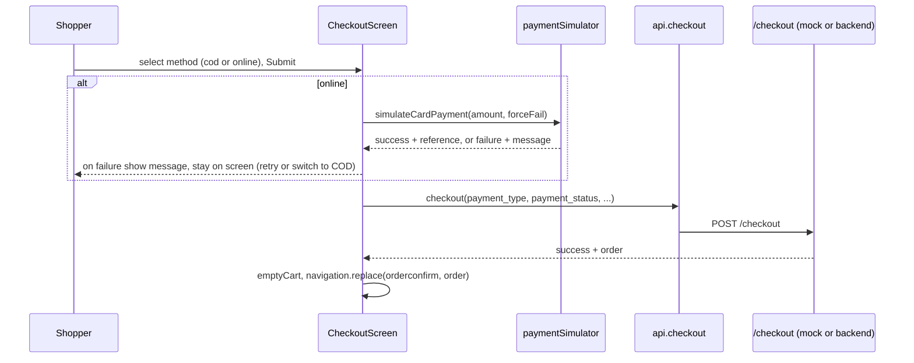
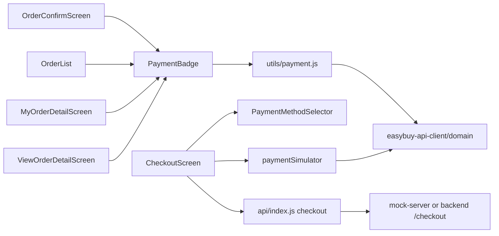
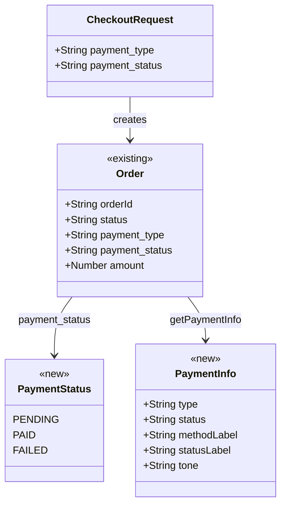

# Design: Digital Payment Options at Checkout (Agentic-SDLC-test/ecommerce-react-native-example#3)

> Linked Jira Epic: [Agentic-SDLC-test/ecommerce-react-native-example#3](https://github.com/Agentic-SDLC-test/ecommerce-react-native-example/issues/3)
> Business spec: v1 (submitted 2026-11-20T22:24:12Z by dc31eacd-6d15-4803-a012-51e493cd60f6)
> Architect: ALORA Design Agent

## Architecture overview

### Problem essence and value

Let shoppers choose between Cash On Delivery (COD) and a simulated digital card payment at checkout, persist `payment_type` and a new `payment_status` on every order, and show both on the confirmation screen, shopper order history/detail and admin order views. Implicit requirements: older orders without `payment_status` must render as COD / "Pay on delivery"; a failed digital payment must never create an order; the simulation must never collect real card data.

### Scope and boundaries

- **In scope**: payment method selector and demo card form on `CheckoutScreen`; client-side payment simulator; `payment_status` on orders in the mock server, the production backend and the API client domain package; payment badge on `OrderConfirmScreen`, `OrderList`, `MyOrderDetailScreen`, `ViewOrderDetailScreen`; Jest tests.
- **Out of scope**: real provider, refunds, saved cards, wallet balances, admin editing of payment status, changes to the delivery `OrderStatus` flow.
- **Conservative-reuse stance**: `payment_type` already exists end to end (`PaymentType.COD = "cod"`, `PaymentType.ONLINE = "online"` in the client domain; `payment_type` enum `['cod','online']` in the backend order model and the mock server). Reuse `online` as the digital method; only `payment_status` is new. No new routes, no new Redux state; `/checkout` is extended in place.

### High-level architecture

Current pattern: React Native screens call `api/index.js` (wrapper over `createClient` from `@agentic-sdlc-test/easybuy-api-client`), which hits Express routes (the mock server mirrors the production Node/Mongoose backend). The cart lives in Redux (`cartReducer`). The design keeps this and adds a thin, pure helper layer in the app (`utils/payment.js`) for labels/defaults and a simulator (`utils/paymentSimulator.js`) that resolves a payment outcome **before** `api.checkout` is called. The order is only created once the outcome is known (`paid` for digital, `pending` for COD), which gives "no order on failure" and "no duplicate on retry" without any server-side rollback.



### Key design decisions

- **Digital option = simulated card ("Card (demo)")** — recommended in the business spec; wallet and redirect flows are rejected for this epic. Stored as `payment_type: "online"` (no new enum value, so the existing backend enum and shipped clients stay valid).
- **Payment outcome is simulated client-side, before the order call** — no payment-intent endpoint is introduced; this avoids orphan or duplicate orders. Trade-off: the server trusts the client's `payment_status` for `online`; acceptable because the flow is a labelled demo.
- **`payment_status` vocabulary: `pending | paid | failed`** — COD orders get `pending` (displayed "Pay on delivery"), successful digital orders get `paid`. `failed` is part of the vocabulary and accepted by the contract, but the app never persists a failed order (failure blocks order creation).
- **Server derives defaults** — the mock server and backend default `payment_type` to `cod` and `payment_status` to `pending` when absent, and reject `online` orders whose status is not `paid` (400) to enforce the status rules server-side.
- **Display fallback for legacy orders** — one helper `getPaymentInfo(order)` maps missing `payment_type`/`payment_status` to COD / `pending` so no screen renders blanks.
- **Demo failure trigger** — a "Simulate failure (demo)" switch on the card form, plus a test card convention: card number `4000000000000002` fails. Neither is transmitted. The form fields are never sent to the API nor stored.

### Alternatives considered

- **Mock wallet / redirect flow** — rejected: wallet needs balance semantics (non-goal); redirect needs an extra route and deep-link handling across iOS/Android/web.
- **Create order as `pending`, then confirm payment via a second endpoint** — rejected: adds endpoints in three repos and a cancel/cleanup path to avoid duplicates.
- **New `payment_method` field** — rejected: `payment_type` already carries this and exists in all three layers.

## Affected repositories

- **Agentic-SDLC-test/ecommerce-react-native-example** (branch `main`, type `primary`) — checkout UI, simulator, payment helpers, status display in confirm / history / detail / admin screens, mock server, tests, dependency bump.
- **Agentic-SDLC-test/easybuy-api-client** (branch `main`, type `dependency`, package `@agentic-sdlc-test/easybuy-api-client`) — add `PaymentStatus` constant to `src/domain/index.ts`; bump version to `0.2.0`.
- **Agentic-SDLC-test/ecommerce-backend-node-example** (branch `main`, type `dependency`) — add `payment_status` to `src/models/order.model.js`, checkout validation in `src/controllers/order.controller.js`, OpenAPI schema in `src/docs/openapi.js`.

### Cross-repository impact (approved)

_Decided by hhamid35 on 2026-11-20. Written by ALORA from the classified required changes; a new decision rewrites everything down to the closing line, so keep your own notes outside it._

| Repository | Role | Branch | Changes |
| --- | --- | --- | --- |
| [`Agentic-SDLC-test/ecommerce-react-native-example`](https://github.com/Agentic-SDLC-test/ecommerce-react-native-example) | Primary | `Feat/dd3bd63f-add-digital-payment-checkout-options` | C-3 Validate and default payment_type/payment_status in the backend checkout handler.; C-5 Accept, validate, default and return payment_status in the mock server checkout and seed orders.; C-7 Add PaymentMethodSelector and PaymentBadge components.; C-9 Show payment method and state on confirmation, order lists, shopper detail and admin detail screens.; C-10 Bump the API client dependency and add Jest tests for payment helpers, components and checkout. |
| [`Agentic-SDLC-test/easybuy-api-client`](https://github.com/Agentic-SDLC-test/easybuy-api-client) | Dependency | `Feat/dd3bd63f-add-digital-payment-checkout-options` | C-1 Add a PaymentStatus constant (pending, paid, failed) to the shared domain vocabulary and bump the package version.; C-6 Add payment helpers and a card payment simulator.; C-8 Add payment method selection, demo card form, simulated payment and failure handling to checkout. |
| [`Agentic-SDLC-test/ecommerce-backend-node-example`](https://github.com/Agentic-SDLC-test/ecommerce-backend-node-example) | Dependency | `Feat/dd3bd63f-add-digital-payment-checkout-options` | C-2 Add payment_status to the backend order model with defaults for payment_type and payment_status.; C-4 Document payment_status in the backend OpenAPI order schema and checkout request body. |

**Evidence**

- C-1 → `Agentic-SDLC-test/easybuy-api-client`: `screens/admin/AddCategoryScreen.js:14` `import { validateCategory } from "@agentic-sdlc-test/easybuy-api-client/domain";`
- C-2 → `Agentic-SDLC-test/ecommerce-backend-node-example`: `src/models/order.model.js` src/models/order.model.js exists in Agentic-SDLC-test/ecommerce-backend-node-example
- C-3 → `Agentic-SDLC-test/ecommerce-react-native-example`: `api/index.js:27` checkout is a node of the primary's code graph
- C-4 → `Agentic-SDLC-test/ecommerce-backend-node-example`: `src/docs/openapi.js` src/docs/openapi.js exists in Agentic-SDLC-test/ecommerce-backend-node-example
- C-5 → `Agentic-SDLC-test/ecommerce-react-native-example`: `mock-server/server.js:184` orders is a node of the primary's code graph
- C-6 → `Agentic-SDLC-test/easybuy-api-client`: `screens/admin/AddCategoryScreen.js:14` `import { validateCategory } from "@agentic-sdlc-test/easybuy-api-client/domain";`
- C-7 → `Agentic-SDLC-test/ecommerce-react-native-example`: `constants/Colors.js` constants/Colors.js exists in the primary
- C-8 → `Agentic-SDLC-test/easybuy-api-client`: `screens/admin/AddCategoryScreen.js:14` `import { validateCategory } from "@agentic-sdlc-test/easybuy-api-client/domain";`
- C-9 → `Agentic-SDLC-test/ecommerce-react-native-example`: `screens/user/OrderConfirmScreen.js:8` OrderConfirmScreen is a node of the primary's code graph
- C-10 → `Agentic-SDLC-test/ecommerce-react-native-example`: `package.json:24` @agentic-sdlc-test/easybuy-api-client is a node of the primary's code graph

_End of the cross-repository impact._

## Component-level design

### Layered architecture and dependency map



### Extension points

- `paymentSimulator.simulateCardPayment` is the single seam where a real provider SDK or a wallet/redirect strategy can later be plugged in.
- The `PAYMENT_METHODS` list in `utils/payment.js` is where a wallet method would be added.

### Conventions in use

- **Annotations / decorators**: none; function components with hooks, `StyleSheet` styles, `testID` on every interactive/text element (kebab-case, e.g. `checkout-method-value`).
- **Dependency injection**: ES module imports; Redux via `useSelector` / `bindActionCreators`.
- **Exception handling**: promise `.then/.catch` against `api.*`; user messages via `CustomAlert` (`message`, `type`, `testID`). Server errors: `res.status(400).json({ success:false, message })` in the mock; `asyncHandler` plus JSON `{ success:false, message }` in the backend.
- **Input validation**: inline in screens; domain constants come from `@agentic-sdlc-test/easybuy-api-client/domain`, never local copies. All network calls go through `api/index.js`.
- **Logging**: `console.log` as today; no card data may be logged.
- **Documentation**: each component folder has an `index.js` re-exporting the component; screens use lowercase route names.

### utils/payment.js (new)

- **Responsibility**: single source for payment labels, defaults and badge tones.
- **Methods**:
  - `PAYMENT_METHODS: Array<{ type: string, label: string, description: string }>` = `[{ type: PaymentType.COD, label: "Cash On Delivery", description: "Pay when your order arrives" }, { type: PaymentType.ONLINE, label: "Card (demo)", description: "Simulated payment, no real charge" }]`.
  - `getPaymentInfo(order): { type, status, methodLabel, statusLabel, tone }` — `type = order?.payment_type || PaymentType.COD`; `status = order?.payment_status || PaymentStatus.PENDING`; `statusLabel`: pending with COD → "Pay on delivery", pending otherwise → "Payment pending", paid → "Paid", failed → "Payment failed"; `tone` is `"warning" | "success" | "danger"`. Never throws on null/undefined.
  - `paymentStatusFor(type): string` — returns `PaymentStatus.PAID` for `PaymentType.ONLINE` (only called after a successful simulation) and `PaymentStatus.PENDING` for COD.

### utils/paymentSimulator.js (new)

- **Responsibility**: simulate a card payment without touching real card data.
- **Methods**:
  - `simulateCardPayment({ amount, forceFail = false, delayMs = 800 }): Promise<{ success: boolean, reference?: string, message?: string }>` — waits `delayMs`; if `forceFail` returns `{ success:false, message:"Payment declined (demo). Try again or choose Cash On Delivery." }`; otherwise `{ success:true, reference:"SIM-" + Date.now() }`.
  - `isFailingTestCard(cardNumber): boolean` — true when the digits equal `4000000000000002`. The card number is read only in the screen to compute `forceFail`; it is never passed to `api` or stored beyond the input state.
  - Pure: no network, no storage.

### components/PaymentMethodSelector (new)

- **Responsibility**: radio-style list of `PAYMENT_METHODS`.
- **Props**: `{ value: string, onChange(type): void, testID }`. One `TouchableOpacity` per method with `testID={`${testID}-${type}`}`, a check icon on the selected one, and the description line. Folder includes `index.js` re-export.

### components/PaymentBadge (new)

- **Responsibility**: show method and state as a pill, separate from the delivery status.
- **Props**: `{ order, testID }`. Uses `getPaymentInfo(order)`; renders `"{methodLabel} · {statusLabel}"` with a tone-coloured background.

### screens/user/CheckoutScreen.js (modified)

- State added: `paymentType` (default `PaymentType.COD`), `cardName`, `cardNumber`, `cardExpiry`, `cardCvc` (demo only), `forceFail` (boolean), `paymentError` (string).
- Replace the static "Cash On Delivery" row with `<PaymentMethodSelector testID="checkout-method-selector" />`; when `paymentType === PaymentType.ONLINE` render the demo card form (four `CustomInput`s with testIDs `checkout-card-name-input`, `checkout-card-number-input`, `checkout-card-expiry-input`, `checkout-card-cvc-input`), a banner "Demo only — do not enter real card details", and a `Switch` with testID `checkout-simulate-failure-switch`. Keep the `checkout-method-label` / `checkout-method-value` testIDs; the value shows the selected method label.
- `handleCheckout`: if `paymentType === ONLINE`: validate the demo form fields are non-empty (message "Please fill in the demo card details"); `setIsloading(true)`; `const result = await simulateCardPayment({ amount: totalamount, forceFail: forceFail || isFailingTestCard(cardNumber) })`; on failure `setIsloading(false)`, `setPaymentError(result.message)` and return (no API call, cart untouched). On success or for COD call `api.checkout` with `payment_type: paymentType` and `payment_status: paymentStatusFor(paymentType)` (other fields unchanged). The submit button is disabled while `isloading` to prevent double submit. On `result.success` → `emptyCart("empty"); navigation.replace("orderconfirm", { order: result.data })`. On API failure show the message in `checkout-payment-error` and keep the cart.
- Card fields are local component state only; cleared on method switch and unmount; never included in the payload, logs or Redux.

### screens/user/OrderConfirmScreen.js (modified)

- Signature becomes `({ navigation, route })`. Read `route.params?.order`. Below `order-confirm-text` render the order id and `<PaymentBadge order={order} testID="order-confirm-payment" />`. When `order` is missing render without the badge (no crash).

### components/OrderList/OrderList.js (modified)

- Add `<PaymentBadge order={item} testID={testID ? `${testID}-payment` : undefined} />` in the row that holds the delivery status; the delivery `item?.status` text stays unchanged. Serves both shopper (`MyOrderScreen`) and admin (`ViewOrdersScreen`) lists.

### screens/user/MyOrderDetailScreen.js and screens/admin/ViewOrderDetailScreen.js (modified)

- In the "Package Details" block add a `Payment` row with `<PaymentBadge order={orderDetail} testID="my-order-detail-payment" />` (admin: `view-order-detail-payment`). Admin cannot edit payment status; the existing delivery dropdown is untouched.

### mock-server/server.js (modified)

- The three seed orders (~L213, L242, L272) gain explicit `payment_status`: two `"pending"` with `payment_type: "cod"`, one `payment_type: "online"` with `payment_status: "paid"`.
- `POST /checkout`: destructure `payment_status`; `type = payment_type || "cod"`; reject a type not in `["cod","online"]` with `400 { success:false, message:"Invalid payment type" }`; `status = type === "cod" ? "pending" : payment_status`; if `type === "online"` and `payment_status !== "paid"` respond `400 { success:false, message:"Online payments must be paid before the order is placed" }`; store `payment_type: type, payment_status: status` and log the order id, type and status.

## UI/UX design notes

- **Checkout "Payment" section**: heading `Payment` stays. Under it a card with two selectable rows: "Cash On Delivery" (default, selected, subtitle "Pay when your order arrives") and "Card (demo)" (subtitle "Simulated payment, no real charge"). The selected row shows a `checkmark-circle` Ionicon in `colors.primary`; unselected rows use `radio-button-off`.
- **Card (demo) form**: appears inline below the selector when chosen: name, card number (number-pad), expiry (MM/YY), CVC; a visible warning banner "Demo only — do not enter real card details"; a "Simulate failure" switch. Switching back to COD hides the form and clears the fields.
- **Failure state**: red message under the payment section (`checkout-payment-error`); the Submit button is re-enabled, and the cart and form are preserved so the shopper can retry or tap Cash On Delivery. The ProgressDialog label is "Processing payment..." for card and "Placing Order..." for COD.
- **Confirmation**: below "Order has be confirmed" show the order id and the payment pill: COD → amber "Cash On Delivery · Pay on delivery"; card → green "Card (demo) · Paid".
- **Order lists/details**: the payment pill sits next to (not inside) the delivery status text so they read as two indicators. Legacy orders render amber "Cash On Delivery · Pay on delivery".
- **Colours**: reuse `constants/Colors.js`; if success/warning/danger tones are missing add `success: "#2e7d32"`, `warning: "#b26a00"`, `danger: "#c62828"` and keep `__tests__/colors.test.js` passing.
- **Accessibility / platforms**: touch targets ≥ 44px, `testID` on all elements; only core React Native components and `@expo/vector-icons`, so it works on iOS, Android and web.

## API schemas and contracts

`POST /checkout` is extended (path and auth unchanged; header `x-auth-token` required). The same contract holds for the mock server and the production backend.

```http
POST /checkout
x-auth-token: <token>
Content-Type: application/json

{
  "items": [{ "productId": "string", "price": 10, "quantity": 2 }],
  "amount": 20,
  "discount": 0,
  "payment_type": "cod | online",
  "payment_status": "pending | paid | failed",
  "status": "pending",
  "country": "string", "city": "string", "zipcode": "string",
  "shippingAddress": "string"
}
// payment_type defaults to "cod"; payment_status defaults to "pending"; "online" requires payment_status "paid"; status is the delivery status, unchanged.

200 OK -> {
  "success": true,
  "message": "Order placed successfully",
  "data": { "_id": "string", "orderId": "string", "payment_type": "cod|online",
            "payment_status": "pending|paid|failed", "status": "pending", "amount": 20 }
}
400 Bad Request -> { "success": false, "message": "Cart is empty" }
400 Bad Request -> { "success": false, "message": "Invalid payment type" }
400 Bad Request -> { "success": false, "message": "Online payments must be paid before the order is placed" }
401 Unauthorized -> missing/invalid x-auth-token (client onUnauthorized resets to login)
```

`GET /orders` and `GET /admin/orders` — returned orders now include `payment_type` and `payment_status`. Orders stored before this change may omit them; clients MUST treat missing values as `cod` / `pending`.

Domain constants (`@agentic-sdlc-test/easybuy-api-client/domain`, `src/domain/index.ts`):

```ts
export const PaymentStatus = {
  PENDING: "pending",
  PAID: "paid",
  FAILED: "failed",
} as const;
```

`PaymentType` is unchanged (`COD: "cod"`, `ONLINE: "online"`). No new client method is needed: `checkout(payload)` already forwards an arbitrary payload.

Backend OpenAPI (`src/docs/openapi.js`): add `payment_status: { type: 'string', enum: ['pending','paid','failed'] }` next to the two existing `payment_type` entries (order schema ~L108, checkout request body ~L386).

## Integration patterns

- **Inbound**: shopper actions on `CheckoutScreen`; no webhooks or message buses exist and none are added.
- **Outbound**: only `api.checkout` (via `api/index.js`, never `fetch`). The payment simulator makes no network call. No third-party payment API.
- **Idempotency / retry**: the order is created at most once per successful outcome; a failed simulation returns before `api.checkout`. The submit button is disabled while `isloading`, and the cart is emptied only after `result.success`, so a retry after a failed payment cannot duplicate an order. A network failure on `api.checkout` after a successful simulation leaves the cart intact; retrying re-simulates and re-submits (accepted for a demo).
- **Contract sync**: the client package, mock server and backend share the field names above; the client package is released first (see Rollout).

## Data model changes

### Entity relationships



### Schema changes

- **New tables**: none (no database in the app repo; mock data is in memory).
- **Backend `order` Mongoose schema** (`src/models/order.model.js`): add `payment_status: { type: String, enum: ['pending', 'paid', 'failed'], default: 'pending' }`; add `default: 'cod'` to `payment_type`.
- **Mock server**: `orders[]` entries gain `payment_status`; `/checkout` handler as described above.
- **Backend controller** (`src/controllers/order.controller.js`): in `checkout`, derive `type = body.payment_type || 'cod'`; unknown type → 400 "Invalid payment type"; `body.payment_status = type === 'cod' ? 'pending' : body.payment_status`; if `online` and not `paid` return `res.status(400).json({ success:false, message:'Online payments must be paid before the order is placed' })`. The existing empty-items response ("pass correct parameters") is unchanged.
- **Client domain**: add the `PaymentStatus` constant; `package.json` version `0.1.0` → `0.2.0`; add an assertion to `test/domain.test.js`.

### Backward-compatibility plan

- The field is additive. Existing Mongo documents lack `payment_status`; the mongoose default applies to new documents only, so readers use the `getPaymentInfo` fallback (COD / pending). No backfill is required; an optional backfill (`updateMany({ payment_status: { $exists: false } }, { $set: { payment_status: 'pending' } })`) can run any time after deploy (Rollout step 3).
- Old app builds that omit `payment_status` still work: the server defaults to `cod` / `pending`.

## Security and compliance considerations

- **Auth**: `/checkout` and `/orders` stay behind `x-auth-token`; `/admin/orders` stays admin-only. No new endpoints.
- **Secrets**: none added.
- **PII / data classification**: no card data is ever sent, logged, kept in Redux, AsyncStorage/SecureStore or the mock server. Demo card inputs live only in component state, are excluded from the checkout payload and cleared on method switch/unmount. A visible "Demo only" banner discourages entering real numbers. Do not `console.log` form state; the existing `console.log("Checkout=>", result)` only prints the order response.
- **Trust boundary**: the server trusts `payment_status: paid` for `online` because there is no real provider; documented as demo behaviour. The method label always reads "Card (demo)" so a simulated `paid` is not mistaken for a real charge.
- **Audit log entries**: none exist in this stack; the order record (method, status, timestamps) is the audit trail.
- **Regulatory**: PCI scope is avoided by never handling real card data.

## Observability requirements

- **Structured logs**: the app keeps `console.log`; add `console.log("Payment=>", { type, success })` after simulation (no card fields). The mock server logs `Checkout: order <orderId> payment_type=<type> payment_status=<status>`; the backend uses `utils/logger.js` with the same fields at info level and a warn on the 400 payment rejections.
- **Metrics**: the stack has no metrics system; none added. Backend log lines are countable by payment_type / payment_status.
- **Traces**: not applicable.
- **Dashboards / alerts**: none; QA verifies via the mock-server console and the order lists.

## Implementation plan

### Phase 1 — Contract (dependency repos, implement and release first)

1. **easybuy-api-client** `src/domain/index.ts`: add `PaymentStatus` as specified; bump `package.json` to `0.2.0`; extend `test/domain.test.js` to assert the three values; verify with `npm test`.
2. **ecommerce-backend-node-example**: update `src/models/order.model.js` (`payment_status`, `payment_type` default), `src/controllers/order.controller.js` (validation and defaults above) and `src/docs/openapi.js` (two spots); verify with the repo's existing scripts and a manual `POST /checkout` for cod, online+paid and online+pending (expect 400).

### Phase 2 — Mock server (primary repo)

1. `mock-server/server.js`: seed `payment_status` on the three seed orders (one `online`/`paid`) and update `POST /checkout` per spec; verify with `cd mock-server && npm start` and curl for cod, online+paid, online+pending (400) and invalid type (400).

### Phase 3 — App helpers and components

1. Bump `@agentic-sdlc-test/easybuy-api-client` to `0.2.0` in the app `package.json` and refresh `package-lock.json` (needs the Phase 1 package published). If it is unavailable in the build environment, keep `0.1.0` and in `utils/payment.js` only, use `import * as Domain from "@agentic-sdlc-test/easybuy-api-client/domain"; export const PaymentStatus = Domain.PaymentStatus ?? { PENDING: "pending", PAID: "paid", FAILED: "failed" };`, and note this as an assumption in the change summary.
2. Create `utils/payment.js`, `utils/paymentSimulator.js`, `components/PaymentMethodSelector/{PaymentMethodSelector.js,index.js}` and `components/PaymentBadge/{PaymentBadge.js,index.js}`; add tone colours to `constants/Colors.js` if missing. Unit test each.

### Phase 4 — Screens

1. `CheckoutScreen.js`: selector, demo card form, failure handling, payload fields, `navigation.replace("orderconfirm", { order })`.
2. `OrderConfirmScreen.js`: read `route.params.order`, render `PaymentBadge` and the order id.
3. `OrderList.js`, `MyOrderDetailScreen.js`, `ViewOrderDetailScreen.js`: add `PaymentBadge`.
4. Verify `npm run lint` and `npm test -- --ci`; manually run Expo web against the mock server: COD order, card success, card failure then switch to COD, check history and admin views.

### Phase 5 — Hardening

1. Update `mock-server/README.md` for the new field; confirm no card data appears in logs; demo on iOS, Android and web.

## Test strategy

### Test layers

- **Unit tests** (`__tests__/`, jest-expo): `payment.test.js` (`getPaymentInfo` for cod/pending, online/paid, online/failed, undefined order, legacy order without fields); `paymentSimulator.test.js` (success, `forceFail`, `isFailingTestCard`, fake timers); `PaymentBadge.test.js` and `PaymentMethodSelector.test.js` using `react-test-renderer` (add `@testing-library/react-native` as a devDependency only if the renderer proves insufficient).
- **Screen tests**: `CheckoutScreen.test.js` with `api` and `react-redux` mocked: default selection is COD; switching shows the card form; COD submit calls `api.checkout` with `payment_type: "cod"`, `payment_status: "pending"`; card success submits `online` / `paid`; forced failure does not call `api.checkout`, shows `checkout-payment-error` and keeps the cart; payload never contains card fields. `OrderConfirmScreen.test.js` renders the badge for paid card and COD and does not crash without params.
- **Integration**: curl against the mock server for `/checkout` branches and for the `/orders` and `/admin/orders` response shape (the mock server is excluded from Jest).
- **Smoke / E2E**: demo run on web via `npm run web` with the mock server.

### Acceptance Criteria coverage

| AC# | Description | Covered by | Notes |
| --- | ----------- | ---------- | ----- |
| 1 | Shopper can choose COD or a digital path | `PaymentMethodSelector.test`, `CheckoutScreen.test` (selection) | |
| 2 | COD end to end still works | `CheckoutScreen.test` COD submit; curl cod | |
| 3 | Successful digital payment saved as method + `paid` | `CheckoutScreen.test` card success; curl online+paid | |
| 4 | Orders store method and status | mock and backend curl; Mongoose schema | no automated backend test unless the repo has a harness |
| 5 | Failed payment: message, retry/switch, no duplicate | `CheckoutScreen.test` failure path (no `api.checkout` call, cart kept) | |
| 6 | Confirmation shows method and state | `OrderConfirmScreen.test` | |
| 7 | History shows method and state incl. legacy | `payment.test` legacy, `PaymentBadge.test`, `OrderList` render | |
| 8 | Admin sees method and state | `OrderList` (shared) + `ViewOrderDetailScreen` badge; manual | |
| 9 | Lint and tests pass | `npm run lint`, `npm test -- --ci` | |

### Performance targets and quality bars

- **Latency**: the simulated payment resolves in about 800 ms (configurable `delayMs`, set to 0 in tests).
- **Data validation rules**: `online` ⇒ `payment_status === "paid"` (server 400 otherwise); unknown `payment_type` ⇒ 400; missing fields default to `cod` / `pending` (curl and `getPaymentInfo` tests).
- **Resource limits**: no new storage; the payload grows by one short string.

### Flake risks and fixtures

- Fake timers for the simulator; mock the `api` module and `react-redux` hooks; mock `react-native-progress-dialog` and `@expo/vector-icons` if the preset does not stub them; no network in tests.

## Rollout and rollback considerations

- **Feature flag**: none; the change is additive and COD remains the default. An optional follow-up is gating the card option with `EXPO_PUBLIC_ENABLE_DEMO_PAYMENTS`.
- **Release order**: (1) publish `easybuy-api-client@0.2.0`; (2) deploy the backend (accepts `payment_status`); (3) optional Mongo backfill; (4) release the app with the bumped dependency. The mock server ships with the app repo.
- **Backfill / migration ordering**: no blocking migration; readers handle missing fields.
- **Rollback plan**: revert the app change (checkout returns to the COD-only UI; orders already stored as `online` / `paid` remain valid data); the backend field is additive and may remain; the app can pin client `0.1.0` again.
- **Monitoring during rollout**: watch backend logs for the 400 payment rejection warnings and checkout error rates; confirm new orders carry `payment_status`.

## Validation summary

- **Jira Epic**: `Agentic-SDLC-test/ecommerce-react-native-example#3`
- **Acceptance Criteria coverage**:
  - AC-1 → Component-level design (`PaymentMethodSelector`, `CheckoutScreen`) and UI/UX notes.
  - AC-2 → `CheckoutScreen.handleCheckout` COD branch; the API contract keeps the COD default.
  - AC-3, AC-4 → API schemas and contracts, Data model changes, mock-server and backend changes (Phases 1–2).
  - AC-5 → simulate-before-create flow, Integration patterns (idempotency), failure UI.
  - AC-6 → `OrderConfirmScreen` + `PaymentBadge`.
  - AC-7 → `getPaymentInfo` legacy fallback, `OrderList`, `MyOrderDetailScreen`.
  - AC-8 → `OrderList` (admin list) and `ViewOrderDetailScreen`.
  - AC-9 → Test strategy and Phase 4 verification.
- **Open questions**: None. Assumptions recorded: the card placeholder is the first digital option; admins cannot change payment status; `refunded` is out of scope; `failed` exists in the vocabulary but failed payments never create orders; the client package must be released before the app bump (fallback described in Phase 3).
- **Known risks accepted**: the server trusts client-reported `paid` for the demo flow; a network failure after a simulated success requires re-simulating on retry; existing test coverage is thin, so the new tests establish the baseline.
